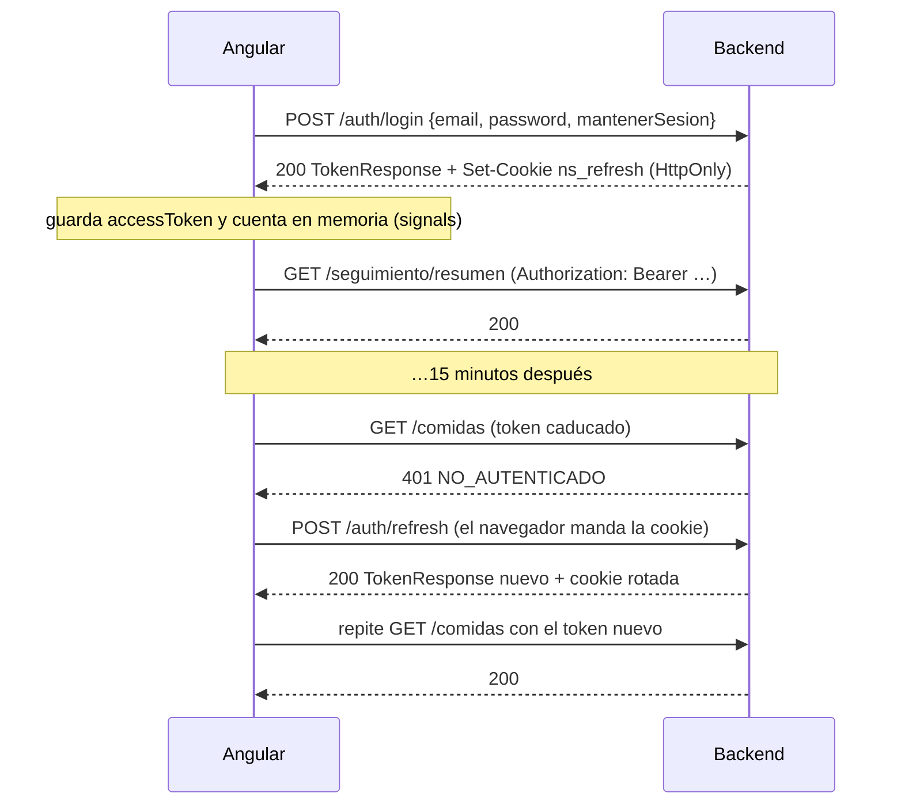
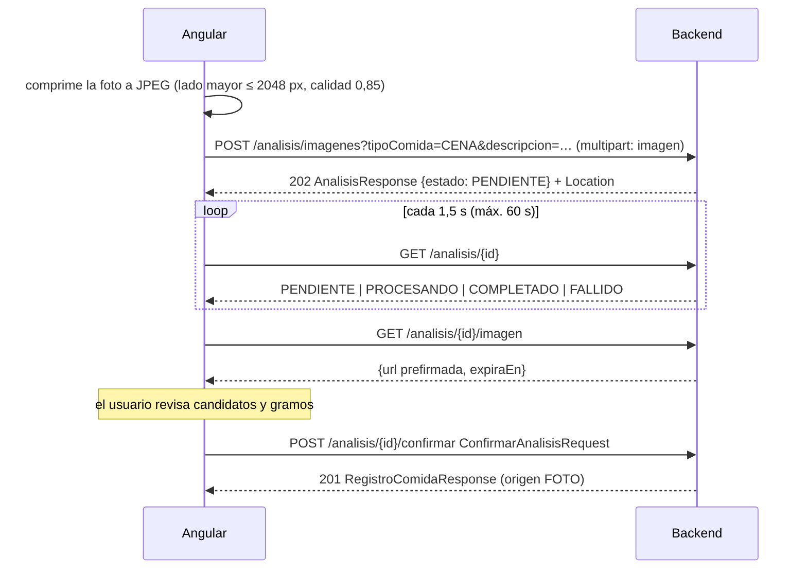

# NutriSport AI · Referencia de la API REST para el frontend

> **Versión 1.0** · generada el 25-11-2026 a partir del OpenAPI que publica el backend (`NutriSport AI API v1`, OpenAPI 3.1, **119 operaciones** y **128 esquemas**) y revisada contra el código de `NutriSport-backend`. Si este documento y el JSON no coinciden, **manda el JSON** (salvo en las discrepancias conocidas del §11, que están comprobadas en el código).

Esta es la referencia que usa el frontend Angular. Los prompts de la guía la leen con `#file:docs/NutriSport_API.md` y comprueban nombres y tipos en `#file:docs/NutriSport-API.json`.

Archivos en el repositorio del frontend (repositorio independiente del backend; el proyecto Angular está en su **raíz**):

- `docs/NutriSport_API.md` (este documento).
- `docs/NutriSport-API.json` (el OpenAPI descargado del backend).

Para volver a descargar el JSON (backend arrancado con el perfil `local`, que es el único que publica la documentación):

```bash
curl -s http://localhost:8080/v3/api-docs -o docs/NutriSport-API.json
```

Swagger UI: <http://localhost:8080/swagger-ui/index.html>.

---

## Índice

1. [Convenciones](#1-convenciones)
2. [Autenticación y sesión](#2-autenticación-y-sesión)
3. [Errores](#3-errores)
4. [Requisitos de la cuenta: email, consentimiento y perfil](#4-requisitos-de-la-cuenta-email-consentimiento-y-perfil)
5. [Tipos (espejo del JSON)](#5-tipos-espejo-del-json)
6. [Endpoints por recurso](#6-endpoints-por-recurso)
7. [Flujos especiales](#7-flujos-especiales)
8. [Validaciones que el formulario debe replicar](#8-validaciones-que-el-formulario-debe-replicar)
9. [Pantallas, rutas y endpoints](#9-pantallas-rutas-y-endpoints)
10. [Textos y etiquetas de los enumerados](#10-textos-y-etiquetas-de-los-enumerados)
11. [Discrepancias conocidas del OpenAPI](#11-discrepancias-conocidas-del-openapi)
12. [Entorno de desarrollo y datos de prueba](#12-entorno-de-desarrollo-y-datos-de-prueba)

---

## 1. Convenciones

| Aspecto | Valor |
|---|---|
| URL base | `/api/v1`. En desarrollo, el proxy de Angular (`proxy.conf.json`) la redirige a `http://localhost:8080`, así que el navegador ve **un único origen** (`http://localhost:4200`) |
| Formato | JSON, propiedades en **`camelCase`** (`fechaNacimiento`, `kcal100`, `tipoActividadCodigo`) |
| Enumerados | Valores en **MAYÚSCULAS** con guion bajo (`PERDER_GRASA`, `MEDIA_MANANA`, `PRE_ENTRENO`). La interfaz los traduce con un mapa de etiquetas (§10) |
| Identificadores | **UUID** en texto (`"0193a3f2-…"`), nunca números. En rutas: `/comidas/{id}` |
| Fechas | `date` = `"2026-11-25"` · `date-time` = ISO con zona (`"2026-11-25T08:30:00+01:00"` o `…Z`) · `time-local` = `"08:30:00"` (al enviar, `"08:30"` también vale) |
| Zona horaria | El servidor calcula "hoy" en **Europe/Madrid**. El frontend envía fechas locales (`AAAA-MM-DD`), nunca `toISOString()` de un `Date` (te puede mover al día anterior) |
| Números | Los valores nutricionales, pesos y cantidades llegan como `number` (decimales con punto en el JSON; la interfaz los muestra con coma) |
| Unidades | Nutrientes por **100 g o 100 ml** en el catálogo (`kcal100`, `proteinas100`…); gramos en comidas y recetas |
| Paginación | Estilo Spring: `?page=0&size=20&sort=campo,desc`. **`page` empieza en 0**. Respuesta `Pagina<T>` = `{ content, page, size, totalElements, totalPages }`. Máximo por página: 50 (alimentos, menús, listas, conversaciones) o 100 (admin) |
| Autenticación | `Authorization: Bearer <accessToken>` (JWT, **15 minutos**). El refresh token va en la cookie `HttpOnly` `ns_refresh` (`Path=/api/v1/auth`, `SameSite=Strict`, 7 días si se marca "Mantener la sesión") |
| Roles | `DEPORTISTA` y `ADMIN` (un usuario puede tener los dos). Las rutas `/admin/**` exigen `ADMIN` |
| Cuerpos estrictos | El backend tiene `fail-on-unknown-properties=true`: **una propiedad que no existe en el DTO devuelve 400**. Envía exactamente los campos de la interfaz `…Request` (no reenvíes un `…Response` entero) |
| Booleanos primitivos | `LoginRequest.mantenerSesion`, los tres booleanos de `RegistroRequest` y `EliminarCuentaRequest.inmediata` **deben enviarse siempre** (si faltan, 400 "cuerpo mal formado") |
| Nulos | Las respuestas incluyen todas las propiedades; las que no tienen valor llegan como `null`. En las peticiones, un campo opcional se puede omitir o mandar a `null` |
| Idioma | Mensajes de error (`detail`, `errors[].mensaje`) en castellano, listos para mostrar |
| Cabeceras útiles | `Location` (201 y 202), `Retry-After` (429 y 503) y `X-Proveedor-No-Disponible` (productos y recetas externas). CORS las expone; con el proxy no hace falta CORS |

**Público o protegido.** Solo son públicos (🔓 en las tablas del §6) `POST /auth/registro`, `/auth/verificar-email`, `/auth/reenviar-verificacion`, `/auth/login`, `/auth/refresh`, `/auth/logout`, `/auth/recuperar-password` y `/auth/restablecer-password`. Todo lo demás necesita el token.

**Recursos ajenos.** Un recurso de otro usuario responde **404** (nunca 403), igual que uno que no existe.

---

## 2. Autenticación y sesión

### 2.1. Ciclo de vida



| Momento | Qué hace el frontend |
|---|---|
| Arranque de la aplicación | `POST /auth/refresh` (con `provideAppInitializer`). 200 → sesión restaurada; 401 → sin sesión (no es un error) |
| Login | `POST /auth/login`. Guarda `accessToken`, `expiraEn` (segundos) y `cuenta` **solo en memoria** (nunca en `localStorage` ni `sessionStorage`) |
| Cada petición | El interceptor añade `Authorization: Bearer …` salvo a `/auth/login`, `/auth/registro`, `/auth/refresh`, `/auth/logout`, `/auth/verificar-email`, `/auth/reenviar-verificacion`, `/auth/recuperar-password` y `/auth/restablecer-password` |
| 401 en una petición protegida | Un único `POST /auth/refresh` compartido por todas las peticiones que fallen a la vez (`shareReplay`); si va bien, se repiten; si falla, se cierra la sesión y se navega a `/login?volver=<url>` |
| Logout | `POST /auth/logout` (borra la cookie) y limpia el estado en memoria |
| Cerrar todas las sesiones | `POST /auth/logout-todas` (con token) y después lo mismo que el logout |
| Cambio de contraseña o restablecimiento | El backend cierra todas las sesiones: el frontend hace logout local y pide iniciar sesión de nuevo |

- `TokenResponse.tipo` es `"Bearer"` y `expiraEn` son **segundos** (900). Puedes programar un refresco silencioso un minuto antes, pero el reintento tras 401 ya es suficiente.
- El refresh token **rota** en cada uso y reutilizar uno ya usado cierra toda su familia de sesiones: no lances dos `refresh` en paralelo.
- `/auth/refresh` comprueba que la cabecera `Origin`, si llega, sea la del frontend (`http://localhost:4200` en desarrollo, que es la que pone el navegador detrás del proxy).
- La cookie es `Secure` fuera del perfil `local`: en producción el frontend tiene que servirse por HTTPS.

### 2.2. Enlaces de los correos

Los correos (Mailpit en desarrollo: <http://localhost:8025>) llevan el token en el **fragmento** de la URL, para que no llegue a los logs ni al `Referer`:

| Correo | Enlace | Qué hace la pantalla |
|---|---|---|
| Verificación del registro | `http://localhost:4200/verificar-email#token=…` | Lee `token` del fragmento → `POST /auth/verificar-email {token}` → 204 "Email verificado" |
| Confirmación de cambio de email | `http://localhost:4200/verificar-email#token=…` | La misma pantalla y el mismo endpoint: el backend sabe qué tipo de token es. Si el email nuevo ya está ocupado: 409 `EMAIL_EN_USO` |
| Recuperación de contraseña | `http://localhost:4200/restablecer-password#token=…` | Formulario de contraseña nueva → `POST /auth/restablecer-password {token, nuevaPassword}` → 204 |

Lee el fragmento con `inject(ActivatedRoute).snapshot.fragment` (formato `token=…`) y bórralo de la barra de direcciones con `history.replaceState` en cuanto lo tengas. Token caducado o usado → 400 `TOKEN_NO_VALIDO` (muestra "El enlace ha caducado" con "Reenviar").

### 2.3. Límites (429)

| Acción | Límite | Respuesta |
|---|---|---|
| Login fallido | 5 cada 15 min por email y por IP | 429 `LIMITE_EXCEDIDO` + `Retry-After` (segundos) |
| Registro y reenvío de verificación | 3 por hora por IP | 429 |
| Recuperación de contraseña | 3 por hora por IP | 429 |
| Análisis de fotos | 20 al día por usuario | 429 |
| Mensajes al asistente | 50 al día por usuario | 429 |

Muestra el tiempo de espera a partir de `Retry-After` ("Inténtalo de nuevo en 12 minutos") y desactiva el botón mientras tanto.

### 2.4. Mensajes genéricos (no revelar si un email existe)

`POST /auth/registro`, `/auth/reenviar-verificacion`, `/auth/recuperar-password` y `PUT /cuenta/email` responden **siempre 202** con el mismo `MensajeResponse`. La interfaz muestra siempre el mismo texto ("Si los datos son correctos, te hemos enviado un correo") y no debe intentar deducir nada. El login responde 401 con el mismo mensaje para credenciales incorrectas y cuentas bloqueadas o eliminadas.

---

## 3. Errores

Todos los errores son **Problem Details (RFC 9457)** con `Content-Type: application/problem+json` y dos propiedades del proyecto, `codigo` y `errors`:

```json
{
  "type": "urn:nutrisport:error:validacion",
  "title": "Datos no válidos",
  "status": 400,
  "detail": "Los datos enviados no son válidos",
  "instance": "/api/v1/auth/registro",
  "codigo": "VALIDACION",
  "errors": [
    { "campo": "mayorDeEdad", "mensaje": "Debes declarar que eres mayor de edad" },
    { "campo": "password", "mensaje": "Debe tener entre 10 y 72 caracteres" }
  ]
}
```

(Respuesta real del backend a un registro incompleto.) `errors` es `[]` cuando el error no es de un campo. En los errores de validación, `campo` es el nombre de la propiedad en `camelCase`; en listas puede llevar índice (`alimentos[0].cantidad`).

```ts
export interface ProblemDetail {
  type: string;        // urn:nutrisport:error:<codigo en minúsculas>
  title: string;       // título corto en castellano
  status: number;
  detail: string;      // mensaje para el usuario
  instance?: string;   // ruta de la petición
  codigo: string;      // ver la tabla
  errors: { campo: string; mensaje: string }[];
}
```

### 3.1. Catálogo de códigos

| HTTP | `codigo` | Cuándo | Qué hace la interfaz |
|---|---|---|---|
| 400 | `VALIDACION` | Datos no válidos, cuerpo mal formado o con propiedades desconocidas, parámetro con formato incorrecto. También contraseña actual incorrecta en `PUT /cuenta/password`, `PUT /cuenta/email` y `DELETE /cuenta` (`errors[campo=passwordActual` o `password]`: "La contraseña no es correcta") | Asigna cada `errors[]` a su control (`setErrors({ servidor: mensaje })`); sin campo, `detail` en un `ns-alert` |
| 400 | `TOKEN_NO_VALIDO` | Token de verificación, cambio de email o recuperación caducado o ya usado | "El enlace ha caducado o ya se ha usado" + reenviar |
| 401 | `NO_AUTENTICADO` | Sin token, token caducado, refresh no válido o credenciales incorrectas | Interceptor: refresh y reintento; en login, mensaje bajo el formulario |
| 403 | `SIN_PERMISO` | Rol insuficiente (rutas `/admin`) o `Origin` no permitido en el refresh | Página "No tienes permiso" |
| 403 | `EMAIL_NO_VERIFICADO` | IA (foto, asistente, sugerencia IA) o exportación sin el email verificado | Aviso con "Reenviar verificación" |
| 403 | `CONSENTIMIENTO_REVOCADO` | Perfil, comidas, análisis, entrenamientos o seguimiento tras revocar el consentimiento de salud | Banner global → Configuración › Privacidad "Volver a dar el consentimiento" |
| 404 | `NO_ENCONTRADO` | No existe, es de otro usuario o la ruta no existe | Estado vacío |
| 404 | `PERFIL_NO_ENCONTRADO` | `GET /perfil` cuando el usuario aún no tiene perfil deportivo | Llevar al onboarding (`/bienvenida`). Decide por el 404, no por el texto |
| 409 | `CONFLICTO` | Estado incompatible (categoría con elementos, nombre duplicado…) | `detail` en un toast |
| 409 | `EMAIL_EN_USO` | Al confirmar un cambio de email que otra cuenta ya usa | Mensaje en la pantalla de verificación |
| 409 | `CODIGO_BARRAS_EN_USO` | El código de barras ya lo tiene un alimento privado | Toast |
| 409 | `COMIDA_CONSUMIDA` | Cambiar o registrar una comida planificada ya consumida | Recargar el menú |
| 409 | `SUGERENCIA_APLICADA` · `SUGERENCIA_OBSOLETA` | Sugerencia IA ya aplicada o la comida ya tiene otra receta | Recargar el menú |
| 409 | `RECETA_PLANIFICADA` | Borrar (admin) una receta que está en algún menú | "Despublícala en su lugar" |
| 409 | `ANALISIS_NO_CONFIRMABLE` · `ANALISIS_NO_DESCARTABLE` | Confirmar o descartar un análisis en un estado que no lo permite | Recargar el análisis |
| 413 | `ARCHIVO_DEMASIADO_GRANDE` | Foto o CSV de más de 10 MB | Comprueba el tamaño antes de subir |
| 415 | `ARCHIVO_NO_VALIDO` | La foto no es JPEG ni PNG (se valida la firma de bytes) | Convierte siempre a JPEG en el cliente |
| 422 | `PERFIL_REQUERIDO` | Resumen, objetivos, entrenamientos o menús sin perfil | Llevar al onboarding (`/bienvenida`) |
| 422 | `NUTRICION_INCOMPLETA` | Receta o producto sin datos suficientes para registrarlo o planificarlo | Botón desactivado con el motivo |
| 422 | `RECETA_NO_PUBLICADA` · `RECETA_INCOMPATIBLE` · `SIN_RECETAS_COMPATIBLES` · `SUGERENCIA_NO_VALIDA` | Reglas del planificador | `detail` en un `ns-alert` |
| 422 | `REGLA_NEGOCIO` | Otras reglas (p. ej. un administrador que intenta bloquearse o quitarse el rol `ADMIN`, valorar un mensaje del usuario) | `detail` en un toast |
| 429 | `LIMITE_EXCEDIDO` | Límites del §2.3 (`Retry-After`) | Tiempo de espera |
| 503 | `SERVICIO_NO_DISPONIBLE` | El proveedor de IA no responde (o el almacenamiento de fotos) | "Puedes reintentarlo o registrar la comida manualmente" |
| 503 | `PROVEEDOR_NO_DISPONIBLE` | Open Food Facts o TheMealDB no responden y no hay copia local (`Retry-After`) | Aviso informativo; la app sigue con el catálogo local |
| 500 | `ERROR_INTERNO` | Error inesperado ("Error interno del servidor") | Toast genérico |
| 0 | — | Sin conexión con el backend (el `HttpErrorResponse` tiene `status = 0`) | "No hay conexión con el servidor" |

> Los títulos (`title`) de cada código los da el backend en castellano ("Datos no válidos", "Perfil requerido"…). Para el usuario, muestra `detail`.

### 3.2. Respuestas 200 que avisan de un problema

- `GET /productos` responde **200 con lista vacía** y la cabecera `X-Proveedor-No-Disponible` si Open Food Facts no responde: muestra "Productos comerciales no disponibles ahora mismo" (no es un error).
- `GET /recetas` devuelve `themealdbDisponible = false` (y la misma cabecera) si TheMealDB no responde: muestra solo el catálogo local con un aviso.
- `RegistroComidaResponse.avisos` y `ObjetivosResponse.avisos` traen textos de advertencia (alérgenos, objetivos fuera de rango) que **no bloquean**: muéstralos en un `ns-alert` de advertencia.

---

## 4. Requisitos de la cuenta: email, consentimiento y perfil

`CuentaResponse` (en el login, el refresh y `GET /cuenta`) dice qué puede hacer el usuario:

| Condición | Campo | Endpoints afectados | Error |
|---|---|---|---|
| Email verificado | `cuenta.emailVerificado` | `POST /analisis/imagenes`, `POST /asistente/conversaciones/{id}/mensajes`, `POST /menus/{id}/comidas/{comidaId}/sugerencia-ia`, `GET /cuenta/exportacion` | 403 `EMAIL_NO_VERIFICADO` |
| Consentimiento de salud vigente | `cuenta.consentimientoSaludVigente` | `/perfil/**`, `/comidas/**`, `/analisis/**`, `/entrenamientos/**`, `/seguimiento/**` (y lo que dependa de ellos) | 403 `CONSENTIMIENTO_REVOCADO` |
| Perfil creado | `GET /perfil` ≠ 404 | `GET /seguimiento/resumen`, `GET /perfil/objetivos`, `POST/PUT /entrenamientos`, generar y regenerar menús, sugerencia IA | 422 `PERFIL_REQUERIDO` |

El frontend lo usa para **prevenir** (guard de perfil, banner "Verifica tu email", banner "Consentimiento revocado", botones de IA desactivados con explicación), pero siempre trata además el error del servidor.

---

## 5. Tipos (espejo del JSON)

Interfaces para `src/app/core/models/`. Reglas:

- Los nombres de las interfaces son los del OpenAPI (`PerfilRequest`, `RegistroComidaResponse`…), así se buscan fácilmente en el JSON y en Swagger. Excepción: `MensajeAsistente` (§11).
- En los `…Request`, `?` = opcional. En las respuestas, `| null` marca los campos que pueden llegar vacíos.
- No se renombran ni se transforman propiedades: el JSON se usa tal cual.

```ts
// ---- Enumerados (valores en MAYÚSCULAS, idénticos a los del backend)
export type TipoComida = 'DESAYUNO' | 'MEDIA_MANANA' | 'COMIDA' | 'MERIENDA' | 'CENA' | 'PRE_ENTRENO' | 'POST_ENTRENO' | 'OTRO';
export type Alergeno = 'GLUTEN' | 'CRUSTACEOS' | 'HUEVOS' | 'PESCADO' | 'CACAHUETES' | 'SOJA' | 'LACTEOS' | 'FRUTOS_DE_CASCARA' | 'APIO' | 'MOSTAZA' | 'SESAMO' | 'SULFITOS' | 'ALTRAMUCES' | 'MOLUSCOS';
export type Preparacion = 'CRUDO' | 'COCIDO' | 'PLANCHA' | 'FRITO' | 'HORNO' | 'ENVASADO' | 'OTRA';
export type Sexo = 'HOMBRE' | 'MUJER';
export type ObjetivoDeportivo = 'PERDER_GRASA' | 'MANTENER' | 'GANAR_MUSCULO' | 'RENDIMIENTO' | 'COMPETICION';
export type NivelActividad = 'SEDENTARIO' | 'LIGERO' | 'MODERADO' | 'ALTO';
export type TipoPreferencia = 'ALERGIA' | 'INTOLERANCIA' | 'DIETA' | 'RECHAZO' | 'FAVORITO';
export type Intolerancia = 'LACTOSA';
export type Dieta = 'VEGETARIANA' | 'VEGANA' | 'PESCETARIANA' | 'HALAL' | 'KOSHER';
export type Severidad = 'ESTRICTA' | 'PREFERENCIA';
export type TipoMenu = 'DIARIO' | 'SEMANAL';
export type EstadoMenu = 'BORRADOR' | 'ACTIVO' | 'ARCHIVADO';
export type OrigenReceta = 'PROPIA' | 'THEMEALDB';
export type Intensidad = 'BAJA' | 'MEDIA' | 'ALTA';
export type EstadoEntrenamiento = 'PLANIFICADO' | 'REALIZADO' | 'OMITIDO';
export type OrigenComida = 'MANUAL' | 'FOTO' | 'PLAN' | 'RECETA' | 'COPIA' | 'CODIGO_BARRAS';
export type UnidadBase = 'G' | 'ML';
export type FuenteAlimento = 'BEDCA' | 'USDA' | 'OPEN_FOOD_FACTS' | 'ADMIN' | 'USUARIO' | 'OCR';
export type Visibilidad = 'PUBLICO' | 'PRIVADO';
export type Dificultad = 'FACIL' | 'MEDIA' | 'DIFICIL';
export type EstadoConversion = 'EXACTA' | 'ESTIMADA' | 'DESPRECIABLE' | 'SIN_DATOS';
export type EstadoNutricional = 'COMPLETO' | 'APROXIMADO' | 'INCOMPLETO';
export type MetodoMapeo = 'AUTOMATICO' | 'MANUAL';
export type TipoCategoria = 'ALIMENTO' | 'RECETA';
export type UnidadCompra = 'G' | 'KG' | 'ML' | 'L' | 'UD';
export type EstadoLista = 'ACTIVA' | 'COMPLETADA';
export type Rol = 'DEPORTISTA' | 'ADMIN';
export type EstadoUsuario = 'ACTIVO' | 'BLOQUEADO' | 'ELIMINADO';
export type Unidades = 'METRICO';
export type TipoAnalisis = 'COMIDA' | 'ETIQUETA';
export type EstadoAnalisis = 'PENDIENTE' | 'PROCESANDO' | 'COMPLETADO' | 'FALLIDO' | 'CONFIRMADO' | 'DESCARTADO';
export type TipoInsight = 'PROTEINA_BAJA' | 'CARBOHIDRATOS_ENTRENO_BAJOS' | 'REPARTO_PROTEINA_BUENO' | 'DIAS_SIN_REGISTRO' | 'TENDENCIA_PESO';
export type SeveridadInsight = 'INFO' | 'POSITIVO' | 'ADVERTENCIA';
export type Agrupacion = 'DIA' | 'SEMANA' | 'MES';
export type RolMensaje = 'USUARIO' | 'ASISTENTE' | 'HERRAMIENTA';

// ---- Página (Spring Data): page empieza en 0
export interface Pagina<T> {
  content: T[];
  page: number;          // 0, 1, 2…
  size: number;
  totalElements: number;
  totalPages: number;
}

// ---- Errores
export interface ProblemDetail {
  type: string;
  title: string;
  status: number;
  detail: string;
  instance: string;
  codigo: string;
  errors: ErrorCampo[];
}
export interface ErrorCampo {
  campo: string;
  mensaje: string;
}

// ---- Auth y cuenta
export interface RegistroRequest {
  nombre: string; // máx. 80 car.
  email: string; // email · máx. 254 car.
  password: string;
  mayorDeEdad: boolean; // obligatorio aunque el JSON no lo marque
  aceptaTerminos: boolean; // obligatorio aunque el JSON no lo marque
  consentimientoSalud: boolean; // obligatorio aunque el JSON no lo marque
}
export interface LoginRequest {
  email: string;
  password: string;
  mantenerSesion: boolean; // obligatorio aunque el JSON no lo marque
}
export interface TokenResponse {
  accessToken: string;
  tipo: string;
  expiraEn: number; // entero
  cuenta: CuentaResponse;
}
export interface CuentaResponse {
  id: string; // UUID
  nombre: string;
  email: string;
  roles: Rol[];
  estado: EstadoUsuario;
  emailVerificado: boolean;
  consentimientoSaludVigente: boolean;
  unidades: Unidades;
  insightsActivos: boolean;
}
export interface MensajeResponse {
  mensaje: string;
} // respuestas 202 de /auth y PUT /cuenta/email
export interface VerificarEmailRequest {
  token: string;
}
export interface ReenviarVerificacionRequest {
  email: string; // email
}
export interface RecuperarPasswordRequest {
  email: string; // email
}
export interface RestablecerPasswordRequest {
  token: string;
  nuevaPassword: string;
}
export interface ActualizarCuentaRequest {
  nombre?: string; // máx. 80 car.
  unidades?: Unidades;
  insightsActivos?: boolean;
}
export interface CambiarPasswordRequest {
  passwordActual: string;
  nuevaPassword: string;
}
export interface CambiarEmailRequest {
  nuevoEmail: string; // email · máx. 254 car.
  password: string;
}
export interface EliminarCuentaRequest {
  password: string;
  inmediata: boolean; // obligatorio aunque el JSON no lo marque
}

// ---- Perfil y objetivos
export interface PerfilRequest {
  fechaNacimiento: string; // "AAAA-MM-DD"
  sexo: Sexo;
  alturaCm: number; // 120–230
  pesoKg: number; // 30–250
  porcentajeGrasa?: number; // 3–60
  objetivo: ObjetivoDeportivo;
  fechaCompeticion?: string; // "AAAA-MM-DD"
  deportePrincipal: string; // máx. 40 car.
  nivelActividad: NivelActividad;
  diasEntrenamientoSemana: number; // 0–7
  duracionMediaMin: number; // 0–600
  comidasPorDia: number; // 3–6
  tiempoMaxCocinaMin?: number; // 0–600
}
export interface PerfilResponse {
  fechaNacimiento: string; // "AAAA-MM-DD"
  sexo: Sexo;
  alturaCm: number;
  pesoKg: number;
  porcentajeGrasa: number | null;
  objetivo: ObjetivoDeportivo;
  fechaCompeticion: string | null; // "AAAA-MM-DD"
  deportePrincipal: string;
  nivelActividad: NivelActividad;
  diasEntrenamientoSemana: number;
  duracionMediaMin: number;
  comidasPorDia: number;
  tiempoMaxCocinaMin: number | null;
  objetivoKcal: number;
  objetivoProteinaG: number;
  objetivoCarbohidratosG: number;
  objetivoGrasaG: number;
  objetivosManuales: boolean;
}
export interface PreferenciaDto {
  tipo: TipoPreferencia;
  alergeno?: Alergeno;
  intolerancia?: Intolerancia;
  dieta?: Dieta;
  alimentoId?: string; // UUID
  categoriaId?: string; // UUID
  severidad: Severidad;
}
export interface PreferenciasRequest {
  preferencias: PreferenciaDto[]; // 0–100 elementos
}
export interface ObjetivosResponse {
  kcal: number;
  proteinaG: number;
  carbohidratosG: number;
  grasaG: number;
  manuales: boolean;
  desglose: ObjetivosCalculados | null;
  avisos: string[];
}
export interface ObjetivosCalculados {
  edad: number;
  metabolismoBasal: number;
  factorActividad: number;
  gastoSinEntreno: number;
  ajustePorcentaje: number;
  kcal: number;
  proteinaG: number;
  carbohidratosG: number;
  grasaG: number;
  avisos: string[];
}
export interface ObjetivosManualesRequest {
  kcal: number; // 1000–6000
  proteinaG: number; // 30–400
  carbohidratosG: number; // 0–900
  grasaG: number; // 20–300
}

// ---- Comunes de nutrición
export interface Nutrientes {
  kcal: number;
  proteina: number;
  carbohidratos: number;
  grasa: number;
}
export interface NutricionRacion {
  kcal: number;
  proteinas: number;
  carbohidratos: number;
  grasas: number;
}
export interface Porcentajes {
  kcal: number;
  proteina: number;
  carbohidratos: number;
  grasa: number;
}
export interface FuenteResponse {
  proveedor: string;
  url: string;
  licencia: string;
  atribucion: string;
}
export interface ObjetivoDiarioResponse {
  fecha: string; // "AAAA-MM-DD"
  base: Nutrientes;
  kcalEntreno: number;
  total: Nutrientes;
}

// ---- Catálogo de alimentos y categorías
export interface AlimentoResumenResponse {
  id: string; // UUID
  nombre: string;
  marca: string | null;
  kcal100: number;
  proteinas100: number;
  carbohidratos100: number;
  grasas100: number;
  fuente: FuenteAlimento;
}
export interface AlimentoResponse {
  id: string; // UUID
  nombre: string;
  marca: string | null;
  categoriaId: string | null; // UUID
  categoriaNombre: string | null;
  preparacion: Preparacion | null;
  kcal100: number;
  proteinas100: number;
  carbohidratos100: number;
  grasas100: number;
  azucares100: number | null;
  saturadas100: number | null;
  fibra100: number | null;
  sal100: number | null;
  unidadBase: UnidadBase;
  porciones: PorcionCasera[];
  alergenosContiene: Alergeno[];
  alergenosTrazas: Alergeno[];
  alergenosRevisados: boolean;
  contieneLactosa: boolean;
  aptoVegano: boolean;
  aptoVegetariano: boolean;
  aptoPescetariano: boolean;
  fuente: FuenteAlimento;
  referenciaExterna: string | null;
  visibilidad: Visibilidad;
  validado: boolean;
  activo: boolean;
  propio: boolean;
}
export interface AlimentoRequest {
  nombre: string; // máx. 150 car.
  marca?: string; // máx. 80 car.
  categoriaId: string; // UUID
  preparacion?: Preparacion;
  kcal100: number; // 0–900
  proteinas100: number; // 0–100
  carbohidratos100: number; // 0–100
  grasas100: number; // 0–100
  azucares100?: number; // 0–100
  saturadas100?: number; // 0–100
  fibra100?: number; // 0–100
  sal100?: number; // 0–100
  unidadBase: UnidadBase;
  porciones?: PorcionCasera[]; // 0–20 elementos
  alergenosContiene?: Alergeno[];
  alergenosTrazas?: Alergeno[];
  contieneLactosa: boolean;
  aptoVegano: boolean;
  aptoVegetariano: boolean;
  aptoPescetariano: boolean;
}
export interface PorcionCasera {
  nombre: string; // máx. 40 car.
  gramos: number; // >0 y ≤5000
}
export interface CategoriaResponse {
  id: string; // UUID
  nombre: string;
  tipo: TipoCategoria;
  padreId: string | null; // UUID
  seccionCompra: string | null;
  codigoExterno: string | null;
  orden: number;
}
export interface CategoriaRequest {
  nombre: string; // máx. 80 car.
  tipo: TipoCategoria;
  padreId?: string; // UUID
  seccionCompra?: string; // máx. 40 car.
  orden: number; // 0–999
}

// ---- Productos (Open Food Facts)
export interface ProductoResumenResponse {
  id: string | null; // UUID
  codigoBarras: string;
  nombre: string;
  marca: string | null;
  imagenUrl: string | null;
  kcal100: number;
  nutricionCompleta: boolean;
  fuente: FuenteResponse;
}
export interface ProductoResponse {
  id: string | null; // UUID
  codigoBarras: string;
  nombre: string;
  marca: string | null;
  imagenUrl: string | null;
  unidadBase: UnidadBase;
  por100: Por100;
  racion: Racion | null;
  ingredientesTexto: string | null;
  alergenosContiene: string[];
  alergenosTrazas: string[];
  alergenosRevisados: boolean;
  nutricionCompleta: boolean;
  fuente: FuenteResponse;
}
export interface Por100 {
  kcal: number;
  proteinas: number;
  carbohidratos: number;
  grasas: number;
  azucares: number | null;
  saturadas: number | null;
  fibra: number | null;
  sal: number | null;
}
export interface Racion {
  gramos: number | null;
  descripcion: string | null;
}

// ---- Comidas
export interface RegistroComidaRequest {
  fecha: string; // "AAAA-MM-DD"
  hora?: string; // "HH:mm:ss"
  tipoComida: TipoComida;
  notas?: string; // máx. 500 car.
  alimentos: AlimentoRegistradoRequest[]; // 1–40 elementos
}
export interface AlimentoRegistradoRequest {
  alimentoId?: string; // UUID
  codigoBarras?: string; // 8–14 dígitos
  cantidad: number; // >0 y ≤5000
  unidad: string; // máx. 40 car.
}
export interface RegistroComidaResponse {
  id: string; // UUID
  fecha: string; // "AAAA-MM-DD"
  hora: string | null; // "HH:mm:ss"
  tipoComida: TipoComida | null;
  origen: OrigenComida;
  notas: string | null;
  alimentos: AlimentoRegistradoResponse[];
  totales: Nutrientes;
  avisos: string[];
}
export interface AlimentoRegistradoResponse {
  id: string; // UUID
  alimentoId: string | null; // UUID
  nombre: string;
  cantidad: number;
  unidad: string;
  gramos: number | null;
  kcal: number;
  proteina: number;
  carbohidratos: number;
  grasa: number;
  origenIa: boolean;
  confianzaIa: number | null;
}
export interface ComidasDiaResponse {
  fecha: string; // "AAAA-MM-DD"
  comidas: RegistroComidaResponse[];
  totales: Nutrientes;
}
export interface DuplicarComidaRequest {
  fecha: string; // "AAAA-MM-DD"
  tipoComida?: TipoComida;
}
export interface RegistrarRecetaRequest {
  recetaId: string; // UUID
  raciones: number; // >0 y ≤10
  fecha: string; // "AAAA-MM-DD"
  tipoComida: TipoComida;
}

// ---- Análisis de fotos
export interface AnalisisResponse {
  id: string; // UUID
  tipo: TipoAnalisis;
  estado: EstadoAnalisis;
  tipoComida: TipoComida | null;
  candidatos: CandidatoAnalisis[];
  totalEstimado: Nutrientes | null;
  errorMensaje: string | null;
  creadoEn: string; // ISO con zona, p. ej. "2026-11-25T08:30:00+01:00"
  completadoEn: string | null; // ISO con zona, p. ej. "2026-11-25T08:30:00+01:00"
}
export interface CandidatoAnalisis {
  nombreDetectado: string;
  preparacion: Preparacion | null;
  gramosEstimados: number | null;
  confianza: number | null;
  nivelConfianza: string;
  estimado: boolean;
  coincidencias: CoincidenciaCatalogo[];
}
export interface CoincidenciaCatalogo {
  alimentoId: string | null; // UUID
  nombre: string;
  similitud: number;
  estimados: Nutrientes | null;
  fuente: string;
}
export interface ConfirmarAnalisisRequest {
  fecha: string; // "AAAA-MM-DD"
  hora?: string; // "HH:mm:ss"
  tipoComida: TipoComida;
  alimentos: AlimentoConfirmadoRequest[]; // 1–20 elementos
}
export interface AlimentoConfirmadoRequest {
  alimentoId: string; // UUID
  gramos: number; // >0 y ≤5000
  indiceCandidato?: number; // ≥0
}
export interface UrlImagenResponse {
  url: string;
  expiraEn: string; // ISO con zona, p. ej. "2026-11-25T08:30:00+01:00"
}

// ---- Actividad
export interface TipoActividadResponse {
  codigo: string;
  nombre: string;
  met: number;
  categoria: string | null;
}
export interface EntrenamientoRequest {
  tipoActividadCodigo: string; // máx. 40 car.
  fechaHora: string; // ISO con zona, p. ej. "2026-11-25T08:30:00+01:00"
  duracionMin: number; // 1–600
  intensidad: Intensidad;
  rpe?: number; // 1–10
  estado?: EstadoEntrenamiento;
  distanciaKm?: number; // 0–9999.99
  notas?: string; // máx. 500 car.
}
export interface EntrenamientoResponse {
  id: string; // UUID
  tipoActividadCodigo: string;
  tipoActividadNombre: string;
  fechaHora: string; // ISO con zona, p. ej. "2026-11-25T08:30:00+01:00"
  duracionMin: number;
  intensidad: Intensidad;
  rpe: number | null;
  estado: EstadoEntrenamiento;
  kcalEstimadas: number;
  distanciaKm: number | null;
  notas: string | null;
}
export interface RelacionNutricionResponse {
  desde: string; // "AAAA-MM-DD"
  hasta: string; // "AAAA-MM-DD"
  mediaEntreno: Nutrientes;
  objetivoEntreno: Nutrientes;
  mediaDescanso: Nutrientes;
  objetivoDescanso: Nutrientes;
  diasEntreno: number;
  diasDescanso: number;
  sesionesConProteinaPost: number;
  sesiones: number;
}

// ---- Seguimiento
export interface ResumenDiarioResponse {
  fecha: string; // "AAAA-MM-DD"
  objetivo: Nutrientes;
  kcalEntreno: number;
  consumido: Nutrientes;
  restante: Nutrientes;
  excesoKcal: number | null;
  porcentajes: Porcentajes;
  comidas: RegistroComidaResponse[];
  entrenamientos: EntrenamientoResponse[];
  comidasPlanificadasPendientes: ComidaPendienteResponse[];
}
export interface ComidaPendienteResponse {
  menuId: string | null; // UUID
  menuNombre: string;
  id: string; // UUID
  fecha: string; // "AAAA-MM-DD"
  tipoComida: TipoComida | null;
  receta: RecetaResumenResponse;
  raciones: number;
  nutrientes: Nutrientes;
}
export interface PesoRequest {
  fecha: string; // "AAAA-MM-DD"
  pesoKg: number; // 30–250
}
export interface PesoResponse {
  id: string; // UUID
  fecha: string; // "AAAA-MM-DD"
  pesoKg: number;
}
export interface SeriePesoResponse {
  puntos: PuntoPeso[];
  variacion: number | null;
}
export interface PuntoPeso {
  fecha: string; // "AAAA-MM-DD"
  pesoKg: number;
  mediaMovil7: number | null;
}
export interface EstadisticasResponse {
  desde: string; // "AAAA-MM-DD"
  hasta: string; // "AAAA-MM-DD"
  agrupacion: Agrupacion;
  serie: PuntoSerieResponse[];
  mediaDiaria: Nutrientes;
  objetivoMedio: Nutrientes;
  diasConRegistro: number;
  diasEnObjetivo: number;
  porcentajeAdherencia: number;
  repartoMacrosPct: Record<string, number>;
  kcalPorTipoComida: Record<string, number>;
  top: AlimentoFrecuenteResponse[];
}
export interface PuntoSerieResponse {
  periodo: string;
  desde: string; // "AAAA-MM-DD"
  consumido: Nutrientes;
  objetivo: Nutrientes;
  diasConRegistro: number;
  diasEnObjetivo: number;
}
export interface AlimentoFrecuenteResponse {
  alimentoId: string; // UUID
  nombre: string;
  veces: number;
  porcentajeEnergia: number;
  fuente: string;
}
export interface ComparativaResponse {
  actual: EstadisticasResponse;
  anterior: EstadisticasResponse;
  variacionPct: Record<string, number>;
}
export interface InsightResponse {
  id: string; // UUID
  tipo: TipoInsight;
  severidad: SeveridadInsight;
  titulo: string | null;
  texto: string;
  periodoDesde: string | null; // "AAAA-MM-DD"
  periodoHasta: string | null; // "AAAA-MM-DD"
  creadoEn: string; // ISO con zona, p. ej. "2026-11-25T08:30:00+01:00"
}

// ---- Recetas
export interface RecetaResumenResponse {
  id: string | null; // UUID
  referenciaExterna: string | null;
  origen: OrigenReceta;
  nombre: string;
  categoria: string | null;
  area: string | null;
  imagenUrl: string | null;
  nutricionRacion: NutricionRacion | null;
  estadoNutricional: string | null;
  alergenosVerificados: boolean;
  compatible: boolean;
  favorita: boolean;
  fuente: FuenteResponse | null;
}
export interface RecetaResponse {
  id: string; // UUID
  origen: OrigenReceta;
  nombre: string;
  descripcion: string | null;
  idioma: string;
  categoria: string | null;
  area: string | null;
  imagenUrl: string | null;
  raciones: number;
  racionesSupuestas: boolean;
  tiempoPreparacionMin: number | null;
  dificultad: Dificultad | null;
  franjasAptas: string[];
  etiquetas: string[];
  ingredientes: IngredienteRecetaResponse[];
  instrucciones: PasoReceta[];
  nutricionRacion: NutricionRacion | null;
  estadoNutricional: EstadoNutricional;
  completitudPct: number | null;
  alergenos: string[];
  alergenosVerificados: boolean;
  compatible: boolean;
  favorita: boolean;
  fuente: FuenteResponse | null;
}
export interface IngredienteRecetaResponse {
  nombre: string;
  nombreOriginal: string | null;
  medidaOriginal: string | null;
  gramos: number | null;
  estadoConversion: EstadoConversion;
  alimentoId: string | null; // UUID
}
export interface PasoReceta {
  orden: number;
  texto: string;
}
export interface BusquedaRecetasResponse {
  catalogo: PaginaResponseRecetaResumenResponse;
  themealdb: RecetaResumenResponse[];
  themealdbDisponible: boolean;
}
export interface NutricionRecetaResponse {
  raciones: number;
  racionesSupuestas: boolean;
  porRacion: Nutrientes | null;
  estado: EstadoNutricional;
  completitudPct: number;
  ingredientes: IngredienteCalculoResponse[];
}
export interface IngredienteCalculoResponse {
  nombre: string;
  nombreOriginal: string | null;
  medidaOriginal: string | null;
  gramos: number | null;
  estadoConversion: EstadoConversion;
  fuente: string;
}

// ---- Menús
export interface MenuResumenResponse {
  id: string; // UUID
  nombre: string;
  tipo: TipoMenu;
  fechaInicio: string; // "AAAA-MM-DD"
  fechaFin: string; // "AAAA-MM-DD"
  favorito: boolean;
  estado: EstadoMenu;
  generadoAutomaticamente: boolean;
  numeroComidas: number;
}
export interface MenuResponse {
  id: string; // UUID
  nombre: string;
  tipo: TipoMenu;
  fechaInicio: string; // "AAAA-MM-DD"
  fechaFin: string; // "AAAA-MM-DD"
  favorito: boolean;
  estado: EstadoMenu;
  generadoAutomaticamente: boolean;
  explicacion: string | null;
  dias: DiaMenuResponse[];
  resumen: Resumen;
}
export interface DiaMenuResponse {
  fecha: string; // "AAAA-MM-DD"
  objetivo: ObjetivoDiarioResponse | null;
  planificado: Nutrientes;
  porcentajeObjetivo: number;
  diaEntreno: boolean;
  comidas: ComidaPlanificadaResponse[];
}
export interface ComidaPlanificadaResponse {
  id: string; // UUID
  fecha: string; // "AAAA-MM-DD"
  tipoComida: TipoComida | null;
  receta: RecetaResumenResponse;
  raciones: number;
  nutrientes: Nutrientes;
  bloqueada: boolean;
  consumida: boolean;
}
export interface Resumen {
  mediaKcal: number;
  ajustePorcentaje: number;
  proteinaMedia: number;
}
export interface GenerarMenuRequest {
  tipo: TipoMenu;
  fechaInicio: string; // "AAAA-MM-DD"
  nombre?: string; // máx. 100 car.
  conExplicacion?: boolean; // por defecto true
}
export interface ActualizarMenuRequest {
  nombre?: string; // máx. 100 car.
  favorito?: boolean;
  estado?: EstadoMenu;
}
export interface DuplicarMenuRequest {
  fechaInicio: string; // "AAAA-MM-DD"
  nombre?: string; // máx. 100 car.
}
export interface AnadirComidaRequest {
  recetaId: string; // UUID
  fecha: string; // "AAAA-MM-DD"
  tipoComida: TipoComida;
  raciones: number; // >0 y ≤10
}
export interface ActualizarComidaPlanificadaRequest {
  recetaId?: string; // UUID
  raciones?: number; // >0 y ≤10
  fecha?: string; // "AAAA-MM-DD"
  tipoComida?: TipoComida;
  bloqueada?: boolean;
}
export interface AlternativaResponse {
  receta: RecetaResumenResponse;
  raciones: number;
  nutrientes: Nutrientes;
  diferenciaKcalPct: number | null;
}
export interface SugerenciaIaRequest {
  preferencia?: string; // máx. 300 car.
}
export interface SugerenciaIaResponse {
  id: string; // UUID
  texto: string;
  deltaKcalRacion: number | null;
  deltaProteinaRacion: number | null;
  valida: boolean;
}
export interface AplicarSugerenciaRequest {
  sugerenciaId: string; // UUID
}

// ---- Lista de la compra
export interface ListaCompraResumenResponse {
  id: string; // UUID
  nombre: string;
  estado: EstadoLista;
  menuId: string | null; // UUID
  fechaDesde: string | null; // "AAAA-MM-DD"
  fechaHasta: string | null; // "AAAA-MM-DD"
  comprados: number;
  total: number;
  creadoEn: string; // ISO con zona, p. ej. "2026-11-25T08:30:00+01:00"
}
export interface ListaCompraResponse {
  id: string; // UUID
  nombre: string;
  estado: EstadoLista;
  menuId: string | null; // UUID
  fechaDesde: string | null; // "AAAA-MM-DD"
  fechaHasta: string | null; // "AAAA-MM-DD"
  comprados: number;
  total: number;
  secciones: SeccionCompraResponse[];
}
export interface SeccionCompraResponse {
  nombre: string;
  productos: ProductoCompraResponse[];
}
export interface ProductoCompraResponse {
  id: string; // UUID
  nombre: string;
  cantidad: number;
  unidad: UnidadCompra;
  seccion: string;
  comprado: boolean;
  manual: boolean;
  desglose: EntradaDesglose[];
}
export interface EntradaDesglose {
  fecha: string; // "AAAA-MM-DD"
  gramos: number | null;
}
export interface GenerarListaRequest {
  desde?: string; // "AAAA-MM-DD"
  hasta?: string; // "AAAA-MM-DD"
}
export interface ActualizarListaRequest {
  nombre?: string; // máx. 100 car.
  estado?: EstadoLista;
}
export interface ProductoCompraRequest {
  nombre: string; // máx. 120 car.
  cantidad: number; // >0 y ≤99999.99
  unidad: UnidadCompra;
  seccion?: string; // máx. 40 car.
}
export interface ActualizarProductoRequest {
  cantidad?: number; // >0 y ≤99999.99
  unidad?: UnidadCompra;
  comprado?: boolean;
}
export interface AnadirRecetaListaRequest {
  recetaId: string; // UUID
  raciones: number; // >0 y ≤50
}

// ---- Asistente
export interface ConversacionResumenResponse {
  id: string; // UUID
  titulo: string | null;
  archivada: boolean;
  ultimoMensajeEn: string | null; // ISO con zona, p. ej. "2026-11-25T08:30:00+01:00"
  vistaPrevia: string | null;
}
// OJO: el OpenAPI fusiona dos clases MensajeResponse distintas. Los endpoints del asistente devuelven esta:
export interface MensajeAsistente {
  id: string;                       // UUID (se usa en POST /asistente/mensajes/{mensajeId}/valoracion)
  rol: RolMensaje;                  // USUARIO o ASISTENTE (HERRAMIENTA no se muestra)
  contenido: string;
  herramientasUsadas: string[];     // vacía en los mensajes del usuario y en las respuestas seguras
  valoracion: -1 | 1 | null;        // solo en las respuestas del asistente
  creadoEn: string;                 // ISO con zona
}
export interface ConversacionResponse {
  id: string; // UUID
  titulo: string | null;
  archivada: boolean;
  mensajes: MensajeAsistente[];
}
export interface ActualizarConversacionRequest {
  titulo?: string; // máx. 100 car.
  archivada?: boolean;
}
export interface EnviarMensajeRequest {
  contenido: string; // máx. 2000 car.
}
export interface ValoracionRequest {
  valor: number;
}

// ---- Administración
export interface UsuarioAdminResponse {
  id: string; // UUID
  nombre: string;
  email: string;
  roles: Rol[];
  estado: EstadoUsuario;
  emailVerificado: boolean;
  ultimoAcceso: string | null; // ISO con zona, p. ej. "2026-11-25T08:30:00+01:00"
  creadoEn: string; // ISO con zona, p. ej. "2026-11-25T08:30:00+01:00"
}
export interface ActualizarUsuarioAdminRequest {
  estado?: EstadoUsuario;
  roles?: Rol[]; // 1–n elementos
}
export interface RevisionAlergenosRequest {
  alergenosContiene: Alergeno[];
  alergenosTrazas: Alergeno[];
  contieneLactosa: boolean;
}
export interface ResultadoImportacion {
  creados: number;
  actualizados: number;
  errores: ErrorCampo[];
}
export interface RecetaAdminRequest {
  nombre: string; // máx. 150 car.
  descripcion?: string; // máx. 2000 car.
  categoriaId: string; // UUID
  raciones: number; // 1–20
  tiempoPreparacionMin?: number; // 1–600
  dificultad?: Dificultad;
  franjasAptas?: TipoComida[]; // 0–7 elementos
  etiquetas?: string[]; // 0–10 elementos
  pasos?: string[]; // 0–30 elementos
  ingredientes: IngredienteRecetaAdminRequest[]; // 1–40 elementos
}
export interface IngredienteRecetaAdminRequest {
  alimentoId: string; // UUID
  gramos?: number; // >0 y ≤5000
  medida?: string; // máx. 60 car.
}
export interface PublicarRecetaRequest {
  publicada?: boolean;
  raciones?: number; // 1–20
  franjasAptas?: TipoComida[]; // 0–7 elementos
}
export interface MapeoIngredienteResponse {
  id: string; // UUID
  nombreNormalizado: string;
  alimentoId: string | null; // UUID
  alimentoNombre: string | null;
  metodo: MetodoMapeo;
  confianza: number | null;
  revisado: boolean;
  recetasRecalculadas: number;
}
export interface ActualizarMapeoRequest {
  alimentoId?: string; // UUID
}
```


`ExportacionDatos` (respuesta de `GET /cuenta/exportacion`) no se tipa en detalle: el frontend solo la descarga como fichero (§7.6).

---

## 6. Endpoints por recurso

Todas las rutas son relativas a `/api/v1`. 🔓 = público (sin token). "Consulta" son los parámetros de la query (`?` = opcional, `=valor` = por defecto). Los parámetros de ruta (`{id}`, `{fecha}`…) van en la propia ruta.

### Auth

Registro, verificación del email, inicio y cierre de sesión, renovación del access token y recuperación de la contraseña. El refresh token viaja solo en la cookie HttpOnly ns_refresh (Path=/api/v1/auth, SameSite=Strict).

| Método | Ruta | Qué hace | Consulta | Cuerpo | Respuesta | Errores |
|---|---|---|---|---|---|---|
| POST | `/auth/login` 🔓 | Iniciar sesión | — | `LoginRequest` | `200` `TokenResponse` | 400, 401, 429 |
| POST | `/auth/logout` 🔓 | Cerrar la sesión | — | — | `204` sin cuerpo | — |
| POST | `/auth/logout-todas` | Cerrar todas las sesiones | — | — | `204` sin cuerpo | 401 |
| POST | `/auth/recuperar-password` 🔓 | Solicitar el email de recuperación de contraseña | — | `RecuperarPasswordRequest` | `202` `MensajeResponse` | 400, 429 |
| POST | `/auth/reenviar-verificacion` 🔓 | Reenviar el email de verificación | — | `ReenviarVerificacionRequest` | `202` `MensajeResponse` | 400, 429 |
| POST | `/auth/refresh` 🔓 | Renovar el access token | — | — | `200` `TokenResponse` | 401, 403 |
| POST | `/auth/registro` 🔓 | Crear una cuenta | — | `RegistroRequest` | `202` `MensajeResponse` | 400, 429 |
| POST | `/auth/restablecer-password` 🔓 | Restablecer la contraseña con el token del enlace | — | `RestablecerPasswordRequest` | `204` sin cuerpo | 400 |
| POST | `/auth/verificar-email` 🔓 | Verificar el email con el token del enlace | — | `VerificarEmailRequest` | `204` sin cuerpo | 400, 409 |

**Reglas de cada endpoint** (resumen de la descripción del OpenAPI):

- `POST /auth/login`: Devuelve el access token (15 minutos) y pone el refresh token en la cookie HttpOnly ns_refresh. Se puede entrar sin verificar el email. El error es el mismo para credenciales incorrectas y cuentas bloqueadas o eliminadas. Tras 5 intentos fallidos en 15 minutos con el mismo email o desde la misma IP responde 429 con Retry-After.
- `POST /auth/logout`: Usa solo la cookie ns_refresh: revoca su sesión y borra la cookie. Sin cookie o con un token desconocido también responde 204.
- `POST /auth/logout-todas`: Revoca todos los refresh tokens del usuario autenticado (en todos sus dispositivos) y borra la cookie de este navegador. Los access tokens emitidos caducan en 15 minutos.
- `POST /auth/recuperar-password`: Si la cuenta existe y está activa, envía un enlace válido 30 minutos. Responde siempre 202 con el mismo mensaje. Máximo 3 por hora por IP.
- `POST /auth/reenviar-verificacion`: Solo se envía si la cuenta existe, está activa y no está verificada, pero responde siempre 202 con el mismo mensaje. Máximo 3 por hora por IP.
- `POST /auth/refresh`: Usa la cookie ns_refresh, la rota (el token anterior deja de valer) y devuelve un access token nuevo con la cookie nueva. Reutilizar un token ya rotado cierra todas las sesiones de su familia. Si llega la cabecera Origin, debe ser la del frontend.
- `POST /auth/registro`: Contraseña de 10 a 72 caracteres con letras y números, que no sea común. Hay que declarar la mayoría de edad y aceptar los términos y el tratamiento de datos de salud. Responde siempre 202 con el mismo mensaje, exista o no el email (si existe, se avisa a su titular por correo). Máximo 3 por hora por IP.
- `POST /auth/restablecer-password`: La contraseña nueva sigue las mismas reglas que en el registro. El token sirve una sola vez. Cierra todas las sesiones abiertas del usuario.
- `POST /auth/verificar-email`: Consume el token del correo de verificación (24 h) o de cambio de email (en ese caso sustituye el email por el nuevo). Cada token sirve una sola vez.

### Cuenta

Datos de la cuenta del usuario autenticado: nombre y unidades, contraseña, email, consentimiento de tratamiento de datos de salud (RGPD art. 9) y eliminación de la cuenta.

| Método | Ruta | Qué hace | Consulta | Cuerpo | Respuesta | Errores |
|---|---|---|---|---|---|---|
| GET | `/cuenta` | Datos de la cuenta | — | — | `200` `CuentaResponse` | 401 |
| PATCH | `/cuenta` | Actualizar nombre y unidades | — | `ActualizarCuentaRequest` | `200` `CuentaResponse` | 400, 401 |
| DELETE | `/cuenta` | Eliminar la cuenta | — | `EliminarCuentaRequest` | `204` sin cuerpo | 400, 401, 403, 503 |
| POST | `/cuenta/consentimiento-salud` | Volver a dar el consentimiento de datos de salud | — | — | `204` sin cuerpo | 401, 403 |
| DELETE | `/cuenta/consentimiento-salud` | Revocar el consentimiento de datos de salud | — | — | `204` sin cuerpo | 401, 403 |
| PUT | `/cuenta/email` | Cambiar el email | — | `CambiarEmailRequest` | `202` `MensajeResponse` | 400, 401 |
| GET | `/cuenta/exportacion` | Exportar todos mis datos | — | — | `200` `ExportacionDatos` | 401, 403 |
| PUT | `/cuenta/password` | Cambiar la contraseña | — | `CambiarPasswordRequest` | `204` sin cuerpo | 400, 401 |

**Reglas de cada endpoint** (resumen de la descripción del OpenAPI):

- `GET /cuenta`: Nombre, email, roles, estado, si el email está verificado, si el consentimiento de salud está vigente y las unidades.
- `PATCH /cuenta`: Los campos que no se envían no cambian.
- `DELETE /cuenta`: Requiere la contraseña (400 PASSWORD_INCORRECTA si no coincide). Con inmediata = true se borra todo al momento; si no, la cuenta queda ELIMINADA y se borra a los 30 días. En ambos casos se borran las fotos, se cierran todas las sesiones y se borra la cookie.
- `POST /cuenta/consentimiento-salud`: Guarda la fecha y la versión vigente del texto del consentimiento y desbloquea las funciones con datos de salud.
- `DELETE /cuenta/consentimiento-salud`: Bloquea perfil, comidas, análisis, entrenamientos y seguimiento (403 CONSENTIMIENTO_REVOCADO) hasta que se vuelva a dar. Los datos no se borran: se pueden eliminar con DELETE /cuenta.
- `PUT /cuenta/email`: Requiere la contraseña. Envía un enlace de confirmación al email nuevo; el cambio se hace al abrirlo (POST /auth/verificar-email). Responde siempre 202 con el mismo mensaje, para no revelar si el email ya está en uso.
- `GET /cuenta/exportacion`: Derecho de acceso y portabilidad (§8.3): un JSON descargable (nutrisport-datos-AAAAMMDD.json) con la cuenta y sus consentimientos, el perfil, las preferencias, los objetivos diarios, las comidas con sus alimentos, los entrenamientos, los pesajes, los menús, las listas de la compra, las recetas favoritas, las conversaciones con el asistente, los análisis de fotos (metadatos y candidatos, sin imágenes) y los insights. Nunca incluye la contraseña ni los tokens. Se puede usar aunque el consentimiento de salud esté revocado. 403 EMAIL_NO_VERIFICADO si el email no está verificado.
- `PUT /cuenta/password`: Requiere la contraseña actual (400 PASSWORD_INCORRECTA si no coincide). La nueva sigue las reglas del registro. Cierra todas las sesiones.

### Perfil

Perfil deportivo, objetivos nutricionales (calculados o manuales) y preferencias y restricciones alimentarias. Son datos de salud: requieren el consentimiento vigente.

| Método | Ruta | Qué hace | Consulta | Cuerpo | Respuesta | Errores |
|---|---|---|---|---|---|---|
| GET | `/perfil` | Obtener el perfil deportivo | — | — | `200` `PerfilResponse` | 401, 403, 404 |
| PUT | `/perfil` | Crear o actualizar el perfil deportivo | — | `PerfilRequest` | `200` `PerfilResponse` | 400, 401, 403 |
| GET | `/perfil/objetivos` | Objetivos base y desglose del cálculo | — | — | `200` `ObjetivosResponse` | 401, 403, 404 |
| PUT | `/perfil/objetivos` | Fijar objetivos manuales | — | `ObjetivosManualesRequest` | `200` `ObjetivosResponse` | 400, 401, 403, 404 |
| DELETE | `/perfil/objetivos/manuales` | Volver al cálculo automático | — | — | `200` `ObjetivosResponse` | 401, 403, 404 |
| GET | `/perfil/preferencias` | Listar preferencias y restricciones alimentarias | — | — | `200` `PreferenciaDto[]` | 401, 403 |
| PUT | `/perfil/preferencias` | Reemplazar preferencias y restricciones | — | `PreferenciasRequest` | `200` `PreferenciaDto[]` | 400, 401, 403 |

**Reglas de cada endpoint** (resumen de la descripción del OpenAPI):

- `GET /perfil`: 404 PERFIL_NO_ENCONTRADO si aún no se ha creado.
- `PUT /perfil`: Edad mínima de 18 años, altura 120–230 cm y peso 30–250 kg. deportePrincipal es un código de GET /entrenamientos/tipos. fechaCompeticion es obligatoria si el objetivo es COMPETICION. Si los objetivos no son manuales, se recalculan.
- `GET /perfil/objetivos`: Objetivos vigentes sin contar el entrenamiento, si son manuales, desglose del cálculo automático (metabolismo basal, factor de actividad y ajuste por objetivo) y avisos de seguridad.
- `PUT /perfil/objetivos`: Dejan de recalcularse al cambiar el perfil. Devuelve avisos (no bloquea) si la energía de los macros se aleja más de un 10 % de kcal o si kcal está bajo el mínimo de seguridad. Recalcula los objetivos diarios desde hoy.
- `DELETE /perfil/objetivos/manuales`: Recalcula los objetivos con el perfil actual y los objetivos diarios desde hoy.
- `GET /perfil/preferencias`: Alergias, intolerancias, dietas y alimentos o categorías rechazados, con su severidad.
- `PUT /perfil/preferencias`: Sustituye la lista completa (máximo 100). Una lista vacía las borra todas. Cada tipo exige su campo: alergeno (ALERGIA), intolerancia (INTOLERANCIA), dieta (DIETA) o alimentoId o categoriaId (RECHAZO y FAVORITO). ESTRICTA genera avisos al registrar comidas.

### Catálogo

Búsqueda de alimentos (públicos y privados propios), alimentos recientes y frecuentes, alimentos privados del usuario y categorías. Los valores nutricionales son por 100 g o 100 ml.

| Método | Ruta | Qué hace | Consulta | Cuerpo | Respuesta | Errores |
|---|---|---|---|---|---|---|
| GET | `/alimentos` | Buscar alimentos | `q?` (string), `categoria?` (string), `page?=0` (integer), `size?=20` (integer), `sort?` (string[]) | — | `200` `Pagina<AlimentoResumenResponse>` | 400, 401 |
| POST | `/alimentos` | Crear un alimento privado | — | `AlimentoRequest` | `201` `AlimentoResponse` | 400, 401, 403 |
| GET | `/alimentos/{id}` | Detalle de un alimento | — | — | `200` `AlimentoResponse` | 401, 404 |
| PUT | `/alimentos/{id}` | Editar un alimento privado propio | — | `AlimentoRequest` | `200` `AlimentoResponse` | 400, 401, 403, 404 |
| DELETE | `/alimentos/{id}` | Eliminar un alimento privado propio | — | — | `204` sin cuerpo | 401, 403, 404 |
| GET | `/alimentos/frecuentes` | Alimentos más usados | — | — | `200` `AlimentoResumenResponse[]` | 401, 403 |
| GET | `/alimentos/recientes` | Alimentos usados recientemente | — | — | `200` `AlimentoResumenResponse[]` | 401, 403 |
| GET | `/categorias` | Listar categorías de un tipo | `tipo` (TipoCategoria) | — | `200` `CategoriaResponse[]` | 400, 401 |

**Reglas de cada endpoint** (resumen de la descripción del OpenAPI):

- `GET /alimentos`: Alimentos activos públicos y privados propios. Tolera tildes, mayúsculas y errores de escritura; los más parecidos van primero (se ignora sort). size: máximo 50.
- `POST /alimentos`: Solo lo ve su creador; queda sin validar y con los alérgenos sin revisar. Vegano implica vegetariano y vegetariano implica pescetariano.
- `GET /alimentos/{id}`: Valores nutricionales, porciones caseras, alérgenos y aptitud para dietas. 404 si no existe o es privado de otro usuario.
- `PUT /alimentos/{id}`: Mismas reglas que al crearlo. 404 si no es un alimento privado propio y activo.
- `DELETE /alimentos/{id}`: Si ya se ha usado en alguna comida solo se desactiva (el historial lo conserva). 404 si no es un alimento privado propio y activo.
- `GET /alimentos/frecuentes`: Los 20 alimentos que más has registrado en los últimos 90 días.
- `GET /alimentos/recientes`: Los 20 últimos alimentos distintos registrados en tus comidas, el más reciente primero.
- `GET /categorias`: Categorías de alimentos o de recetas en su orden de presentación, con su categoría padre.

### Productos · Ampliación

Productos comerciales de Open Food Facts: búsqueda bajo demanda y ficha por código de barras. El catálogo hace de caché (30 días) y la aplicación sigue funcionando con él si el proveedor no responde. Datos de Open Food Facts (ODbL), con atribución en cada producto.

| Método | Ruta | Qué hace | Consulta | Cuerpo | Respuesta | Errores |
|---|---|---|---|---|---|---|
| GET | `/productos` | Buscar productos comerciales | `q?` (string), `page?=0` (integer) | — | `200` `ProductoResumenResponse[]` | 400, 401, 403 |
| GET | `/productos/{codigoBarras}` | Producto por código de barras | — | — | `200` `ProductoResponse` | 400, 401, 403, 404, 409, 503 |

**Reglas de cada endpoint** (resumen de la descripción del OpenAPI):

- `GET /productos`: Busca en Open Food Facts, 20 por página. Llámalo solo cuando el usuario lo pida (botón "Buscar en productos comerciales"), nunca mientras escribe: el límite de búsquedas lo comparten todos los usuarios. Caché de 1 hora. Los resultados no se guardan; los que ya están en el catálogo llevan id. Si el proveedor no está disponible, responde 200 con una lista vacía y la cabecera X-Proveedor-No-Disponible.
- `GET /productos/{codigoBarras}`: Busca primero en el catálogo; si no está o su copia tiene más de 30 días, lo pide a Open Food Facts y lo guarda. Si el proveedor no responde, devuelve la copia del catálogo aunque sea antigua. Un producto con la información nutricional incompleta se devuelve sin id y con nutricionCompleta = false: no se puede registrar en una comida. Los alérgenos de los productos importados están sin revisar.

### Comidas

Registro manual de comidas, historial por días, edición y duplicado. Las cantidades se convierten a gramos y los nutrientes se guardan como instantánea del catálogo.

| Método | Ruta | Qué hace | Consulta | Cuerpo | Respuesta | Errores |
|---|---|---|---|---|---|---|
| GET | `/comidas` | Historial de comidas por días | `desde` (AAAA-MM-DD), `hasta` (AAAA-MM-DD), `tipo?` (TipoComida) | — | `200` `ComidasDiaResponse[]` | 400, 401, 403 |
| POST | `/comidas` | Registrar una comida | — | `RegistroComidaRequest` | `201` `RegistroComidaResponse` | 400, 401, 403 |
| GET | `/comidas/{id}` | Detalle de una comida | — | — | `200` `RegistroComidaResponse` | 401, 403, 404 |
| PUT | `/comidas/{id}` | Editar una comida | — | `RegistroComidaRequest` | `200` `RegistroComidaResponse` | 400, 401, 403, 404 |
| DELETE | `/comidas/{id}` | Eliminar una comida | — | — | `204` sin cuerpo | 401, 403, 404 |
| POST | `/comidas/{id}/duplicar` | Duplicar una comida en otra fecha o tipo | — | `DuplicarComidaRequest` | `201` `RegistroComidaResponse` | 400, 401, 403, 404 |
| POST | `/comidas/desde-receta` | Registrar una receta como comida | — | `RegistrarRecetaRequest` | `201` `RegistroComidaResponse` | 400, 401, 403, 404, 422 |
| GET | `/comidas/dia/{fecha}` | Comidas y totales de un día | — | — | `200` `ComidasDiaResponse` | 400, 401, 403 |

**Reglas de cada endpoint** (resumen de la descripción del OpenAPI):

- `GET /comidas`: Días con comidas entre desde y hasta (ambos incluidos, máximo 92 días), opcionalmente de un tipo de comida, con los totales de cada día. Los días sin comidas no aparecen.
- `POST /comidas`: Hasta 40 alimentos. Cantidades en g, kg, ml, l o en una porción casera del alimento (p. ej. "plato"), hasta 5 kg por alimento. Se admiten fechas pasadas y hasta mañana. Devuelve avisos si algún alimento choca con las restricciones del usuario, sin impedir el registro.
- `GET /comidas/{id}`: Con sus alimentos, totales y avisos.
- `PUT /comidas/{id}`: Sustituye sus datos y todos sus alimentos (mismas reglas que al registrarla).
- `DELETE /comidas/{id}`: Borra la comida y sus alimentos.
- `POST /comidas/{id}/duplicar`: Crea una comida nueva con origen COPIA y los nutrientes actuales del catálogo. Sin tipoComida se conserva el de la original.
- `POST /comidas/desde-receta`: Crea una comida con origen RECETA con los ingredientes de la receta emparejados con el catálogo, con los gramos escalados a raciones / raciones de la receta. Se admiten fechas pasadas y hasta mañana. 404 si la receta no existe o es privada de otro usuario; 422 NUTRICION_INCOMPLETA si su cálculo es INCOMPLETO o no tiene ingredientes emparejados.
- `GET /comidas/dia/{fecha}`: Comidas del día en orden cronológico con sus avisos y la suma de sus nutrientes.

### Análisis

Reconocimiento de alimentos en fotos con IA: subida, consulta del resultado (polling), confirmación como comida y descarte. Los valores son estimaciones orientativas; la IA solo identifica alimentos y gramos, y los nutrientes salen del catálogo.

| Método | Ruta | Qué hace | Consulta | Cuerpo | Respuesta | Errores |
|---|---|---|---|---|---|---|
| GET | `/analisis/{id}` | Estado y resultado de un análisis | — | — | `200` `AnalisisResponse` | 401, 403, 404 |
| POST | `/analisis/{id}/confirmar` | Confirmar un análisis y registrar la comida | — | `ConfirmarAnalisisRequest` | `201` `RegistroComidaResponse` | 400, 401, 403, 404, 409 |
| POST | `/analisis/{id}/descartar` | Descartar un análisis | — | — | `204` sin cuerpo | 401, 403, 404, 409 |
| GET | `/analisis/{id}/imagen` | URL prefirmada de la foto del análisis | — | — | `200` `UrlImagenResponse` | 401, 403, 404 |
| POST | `/analisis/imagenes` | Subir una foto para analizarla | `tipoComida` (TipoComida), `descripcion?` (string) | `multipart/form-data` con el campo `imagen` (fichero) | `202` `AnalisisResponse` | 400, 401, 403, 413, 415, 429, 503 |

**Reglas de cada endpoint** (resumen de la descripción del OpenAPI):

- `GET /analisis/{id}`: Consultar hasta que el estado deje de ser PENDIENTE o PROCESANDO. COMPLETADO trae los candidatos con sus coincidencias del catálogo y el total estimado; FALLIDO trae errorMensaje (p. ej. "No hemos detectado alimentos").
- `POST /analisis/{id}/confirmar`: Registra una comida con origen FOTO con los alimentos que el usuario ha revisado: puede aceptar, corregir los gramos, cambiar el alimento, quitar candidatos o añadir alimentos (sin indiceCandidato). Cada candidato se confirma como mucho una vez. Solo para análisis COMPLETADO (409 ANALISIS_NO_CONFIRMABLE).
- `POST /analisis/{id}/descartar`: Para análisis COMPLETADO o FALLIDO (409 ANALISIS_NO_DESCARTABLE en otro estado). La foto se borra con la limpieza periódica de imágenes de los análisis terminados.
- `GET /analisis/{id}/imagen`: URL de lectura temporal (caduca a los pocos minutos) de la foto reprocesada. 404 si la foto ya se borró por la política de retención.
- `POST /analisis/imagenes`: JPEG o PNG de hasta 10 MB y 40 megapíxeles (se valida la firma de bytes). La foto se recodifica sin metadatos EXIF antes de guardarla o enviarla a la IA. Requiere el email verificado (403 EMAIL_NO_VERIFICADO) y tiene un límite diario (429). Responde 202 con el análisis PENDIENTE: consulta su estado en la URL de Location.

### Actividad

Entrenamientos realizados y planificados con su gasto neto estimado a partir del MET, el peso y la duración, y catálogo de tipos de actividad. Cada cambio recalcula el objetivo del día.

| Método | Ruta | Qué hace | Consulta | Cuerpo | Respuesta | Errores |
|---|---|---|---|---|---|---|
| GET | `/entrenamientos` | Historial y próximos entrenamientos | `desde` (AAAA-MM-DD), `hasta` (AAAA-MM-DD), `estado?` (EstadoEntrenamiento) | — | `200` `EntrenamientoResponse[]` | 400, 401, 403 |
| POST | `/entrenamientos` | Registrar o planificar un entrenamiento | — | `EntrenamientoRequest` | `201` `EntrenamientoResponse` | 400, 401, 403, 422 |
| PUT | `/entrenamientos/{id}` | Editar un entrenamiento (incluido marcarlo como realizado) | — | `EntrenamientoRequest` | `200` `EntrenamientoResponse` | 400, 401, 403, 404, 422 |
| DELETE | `/entrenamientos/{id}` | Eliminar un entrenamiento | — | — | `204` sin cuerpo | 401, 403, 404 |
| GET | `/entrenamientos/relacion-nutricion` | Alimentación en días de entreno frente a descanso | `desde` (AAAA-MM-DD), `hasta` (AAAA-MM-DD) | — | `200` `RelacionNutricionResponse` | 400, 401, 403 |
| GET | `/entrenamientos/tipos` | Catálogo de actividades con su MET | — | — | `200` `TipoActividadResponse[]` | 401, 403 |

**Reglas de cada endpoint** (resumen de la descripción del OpenAPI):

- `GET /entrenamientos`: Entrenamientos entre desde y hasta (ambos incluidos, máximo 92 días) en orden cronológico, opcionalmente de un estado.
- `POST /entrenamientos`: Duración de 1 a 600 minutos. Sin estado: PLANIFICADO si la fecha es futura y REALIZADO si no (un entrenamiento futuro no puede estar REALIZADO). Calcula el gasto neto estimado con el peso del perfil y recalcula el objetivo del día. 422 PERFIL_REQUERIDO si no hay perfil.
- `PUT /entrenamientos/{id}`: Sustituye sus datos; sin estado se conserva el actual. Recalcula el gasto y los objetivos de los días afectados. 422 PERFIL_REQUERIDO si no hay perfil.
- `DELETE /entrenamientos/{id}`: Recalcula el objetivo de su día.
- `GET /entrenamientos/relacion-nutricion`: Media diaria consumida y objetivo medio en los días con algún entrenamiento planificado o realizado frente a los días sin entrenamiento (solo los días con alguna comida registrada), y cuántas sesiones tienen al menos 25 g de proteína en las comidas con hora de las 2 h siguientes al final del entreno. Rango de como mucho 366 días.
- `GET /entrenamientos/tipos`: Tipos de actividad activos, ordenados por categoría y nombre. Su código se usa en tipoActividadCodigo y en el deporte principal del perfil.

### Seguimiento

Resumen diario (consumido frente al objetivo del día, con comidas y entrenamientos) y evolución del peso con su media móvil.

| Método | Ruta | Qué hace | Consulta | Cuerpo | Respuesta | Errores |
|---|---|---|---|---|---|---|
| GET | `/seguimiento/comparativa` | Periodo actual frente al anterior | `periodo?` (Agrupacion) | — | `200` `ComparativaResponse` | 400, 401, 403 |
| GET | `/seguimiento/estadisticas` | Estadísticas de un periodo | `desde` (AAAA-MM-DD), `hasta` (AAAA-MM-DD), `agrupacion?` (Agrupacion) | — | `200` `EstadisticasResponse` | 400, 401, 403 |
| GET | `/seguimiento/insights` | Patrones detectados | — | — | `200` `InsightResponse[]` | 401, 403 |
| GET | `/seguimiento/peso` | Serie de peso con media móvil de 7 días | `desde` (AAAA-MM-DD), `hasta` (AAAA-MM-DD) | — | `200` `SeriePesoResponse` | 400, 401, 403 |
| POST | `/seguimiento/peso` | Registrar un pesaje | — | `PesoRequest` | `201` `PesoResponse` | 400, 401, 403 |
| DELETE | `/seguimiento/peso/{id}` | Eliminar un pesaje | — | — | `204` sin cuerpo | 401, 403, 404 |
| GET | `/seguimiento/resumen` | Resumen diario | `fecha?` (AAAA-MM-DD) | — | `200` `ResumenDiarioResponse` | 400, 401, 403, 422 |

**Reglas de cada endpoint** (resumen de la descripción del OpenAPI):

- `GET /seguimiento/comparativa`: SEMANA (por defecto): de lunes a hoy frente a la semana anterior completa. MES: del día 1 a hoy frente al mes anterior completo. Estadísticas resumidas (sin serie) y variación de la media diaria en % (nula si el periodo anterior no tiene datos) y de la adherencia en puntos.
- `GET /seguimiento/estadisticas`: Serie de energía y macros consumidos frente al objetivo guardado de cada día, agrupada por día, semana ISO o mes; media diaria y objetivo medio (sobre los días con alguna comida); días en objetivo (energía en ±10 %) y adherencia; reparto de macros de la media diaria (suma 100); kcal medias por tipo de comida y los 10 alimentos más consumidos. Si un día con comidas no tiene objetivo, se crea con el perfil actual. Rango de como mucho 366 días.
- `GET /seguimiento/insights`: Insights vigentes, los más recientes primero. Los calcula cada noche una tarea con reglas estadísticas sobre los últimos 28 días (proteína baja, carbohidratos bajos en días de entreno, buen reparto de la proteína, días de la semana con menos registros y tendencia del peso contraria al objetivo); el texto lleva esas cifras y, como mucho, un consejo redactado por la IA sin cifras nuevas. Vacía si el usuario los tiene desactivados en su cuenta.
- `GET /seguimiento/peso`: Pesajes entre desde y hasta (ambos incluidos, máximo 366 días) en orden cronológico.
- `POST /seguimiento/peso`: Peso de 30 a 250 kg. Si ya hay uno ese día, lo sustituye. Si es el más reciente, actualiza el peso del perfil y recalcula sus objetivos.
- `DELETE /seguimiento/peso/{id}`: Si era el más reciente, el perfil toma el anterior.
- `GET /seguimiento/resumen`: Objetivo del día (base del perfil más el gasto de los entrenamientos que cuentan), consumido, restante, exceso, porcentajes, comidas y entrenamientos. 422 PERFIL_REQUERIDO si no hay perfil.

### Recetas · Ampliación

Catálogo de recetas propias e importadas de TheMealDB: búsqueda, detalle con cantidades por raciones, relacionadas y favoritas. Las de TheMealDB están en inglés, con raciones supuestas y atribución ("Receta e imagen: TheMealDB"); sus nutrientes se calculan con los ingredientes.

| Método | Ruta | Qué hace | Consulta | Cuerpo | Respuesta | Errores |
|---|---|---|---|---|---|---|
| GET | `/recetas` | Buscar recetas | `q?` (string), `ingrediente?` (string), `categoria?` (string), `area?` (string), `origen?` (string), `franja?` (TipoComida), `maxKcal?` (number), `minProteina?` (number), `page?=0` (integer), `size?=20` (integer), `sort?` (string[]) | — | `200` `BusquedaRecetasResponse` | 400, 401 |
| GET | `/recetas/{id}` | Detalle de una receta | `raciones?` (integer) | — | `200` `RecetaResponse` | 400, 401, 404 |
| PUT | `/recetas/{id}/favorita` | Marcar como favorita | — | — | `204` sin cuerpo | 401, 403, 404 |
| DELETE | `/recetas/{id}/favorita` | Quitar de favoritas | — | — | `204` sin cuerpo | 401, 403, 404 |
| GET | `/recetas/{id}/nutricion` | Desglose del cálculo nutricional | `raciones?` (integer) | — | `200` `NutricionRecetaResponse` | 400, 401, 404 |
| GET | `/recetas/{id}/relacionadas` | Recetas relacionadas | — | — | `200` `RecetaResumenResponse[]` | 401, 403, 404 |
| GET | `/recetas/categorias` | Categorías de receta | — | — | `200` `CategoriaResponse[]` | 401 |
| GET | `/recetas/externas/themealdb/{idMeal}` | Detalle de una receta de TheMealDB | — | — | `200` `RecetaResponse` | 400, 401, 403, 404, 503 |
| GET | `/recetas/favoritas` | Mis recetas favoritas | — | — | `200` `RecetaResumenResponse[]` | 401, 403 |

**Reglas de cada endpoint** (resumen de la descripción del OpenAPI):

- `GET /recetas`: Recetas del catálogo (públicas publicadas y propias) paginadas y, en la primera página, las de TheMealDB aún no importadas (estadoNutricional PENDIENTE, con referenciaExterna). TheMealDB se consulta con el texto o, si no, con el ingrediente, la categoría o el área; no se consulta si se filtra por franja, kcal o proteína, que solo se aplican a recetas con cálculo COMPLETO o APROXIMADO. Si TheMealDB no está disponible, themealdbDisponible = false y la cabecera X-Proveedor-No-Disponible.
- `GET /recetas/{id}`: Ingredientes con las cantidades para las raciones pedidas, instrucciones, nutrientes por ración (si hay cálculo), alérgenos y si es compatible con tus restricciones.
- `PUT /recetas/{id}/favorita`: Si ya lo era, no cambia nada.
- `DELETE /recetas/{id}/favorita`: Si no lo era, no cambia nada.
- `GET /recetas/{id}/nutricion`: Cada ingrediente con sus gramos para las raciones pedidas, cómo se han obtenido (EXACTA, ESTIMADA, DESPRECIABLE o SIN_DATOS) y la fuente de sus nutrientes; nutrientes por ración (nulos si el cálculo es INCOMPLETO), estado y completitud. Las raciones de TheMealDB son supuestas.
- `GET /recetas/{id}/relacionadas`: Hasta 6 de la misma categoría o con el mismo primer ingrediente.
- `GET /recetas/categorias`: Categorías de recetas en castellano, en su orden. codigoExterno es la categoría equivalente de TheMealDB (p. ej. Chicken para Pollo).
- `GET /recetas/externas/themealdb/{idMeal}`: La importa la primera vez (idioma en, 4 raciones supuestas, sin publicar, ingredientes pendientes de emparejar) y devuelve su detalle con el id propio; después sale del catálogo sin llamar a TheMealDB.
- `GET /recetas/favoritas`: Las marcadas más recientemente primero.

### Menús · Ampliación

Menús planificados por días con recetas y raciones: generación con un motor de reglas determinista, lo planificado frente al objetivo de cada día (incluidos los entrenamientos), favoritos, estado, edición manual (añadir, quitar, cambiar, bloquear), alternativas, regeneración, duplicado, registro de comidas planificadas y sugerencias de ajuste de la IA validadas por el backend.

| Método | Ruta | Qué hace | Consulta | Cuerpo | Respuesta | Errores |
|---|---|---|---|---|---|---|
| GET | `/menus` | Mis menús | `favorito?` (boolean), `desde?` (AAAA-MM-DD), `page?=0` (integer), `size?=20` (integer), `sort?` (string[]) | — | `200` `Pagina<MenuResumenResponse>` | 400, 401, 403 |
| GET | `/menus/{id}` | Detalle de un menú | — | — | `200` `MenuResponse` | 401, 403, 404 |
| PATCH | `/menus/{id}` | Cambiar nombre, favorito o estado | — | `ActualizarMenuRequest` | `200` `MenuResponse` | 400, 401, 403, 404 |
| DELETE | `/menus/{id}` | Eliminar un menú | — | — | `204` sin cuerpo | 401, 403, 404 |
| POST | `/menus/{id}/comidas` | Añadir una receta al menú | — | `AnadirComidaRequest` | `200` `MenuResponse` | 400, 401, 403, 404, 422 |
| PUT | `/menus/{id}/comidas/{comidaId}` | Cambiar una comida del menú | — | `ActualizarComidaPlanificadaRequest` | `200` `MenuResponse` | 400, 401, 403, 404, 409, 422 |
| DELETE | `/menus/{id}/comidas/{comidaId}` | Quitar una comida del menú | — | — | `204` sin cuerpo | 401, 403, 404 |
| GET | `/menus/{id}/comidas/{comidaId}/alternativas` | Alternativas para una comida | — | — | `200` `AlternativaResponse[]` | 401, 403, 404 |
| POST | `/menus/{id}/comidas/{comidaId}/registrar` | Registrar una comida planificada | `hora?` (HH:mm) | — | `201` `RegistroComidaResponse` | 400, 401, 403, 404, 409, 422 |
| POST | `/menus/{id}/comidas/{comidaId}/sugerencia-ia` | Sugerencia IA para una comida | — | `SugerenciaIaRequest` | `200` `SugerenciaIaResponse` | 400, 401, 403, 404, 422, 503 |
| POST | `/menus/{id}/comidas/{comidaId}/sugerencia-ia/aplicar` | Aplicar una sugerencia IA | — | `AplicarSugerenciaRequest` | `200` `MenuResponse` | 400, 401, 403, 404, 409, 422 |
| POST | `/menus/{id}/duplicar` | Reutilizar el menú en otras fechas | — | `DuplicarMenuRequest` | `201` `MenuResponse` | 400, 401, 403, 404 |
| POST | `/menus/{id}/regenerar` | Regenerar el menú | — | — | `200` `MenuResponse` | 401, 403, 404, 422 |
| POST | `/menus/generar` | Generar un menú | — | `GenerarMenuRequest` | `201` `MenuResponse` | 400, 401, 403, 422 |
| GET | `/menus/recetas-disponibles` | Recetas para añadir a un día | `fecha` (AAAA-MM-DD), `tipoComida` (TipoComida), `q?` (string) | — | `200` `AlternativaResponse[]` | 400, 401, 403 |

**Reglas de cada endpoint** (resumen de la descripción del OpenAPI):

- `GET /menus`: Resumen de los menús, el que empieza más tarde primero (como mucho 50 por página).
- `GET /menus/{id}`: Todos los días del menú con sus comidas (nutrientes = por ración × raciones), lo planificado frente al objetivo del día (porcentajeObjetivo) y si es día de entreno. Sin perfil, objetivo es null y porcentajeObjetivo 0. Las recetas sin cálculo nutricional no suman.
- `PATCH /menus/{id}`: Solo cambian los campos presentes; devuelve el menú completo.
- `DELETE /menus/{id}`: Lo borra con sus comidas planificadas; las comidas ya registradas se conservan.
- `POST /menus/{id}/comidas`: La fecha debe estar dentro del menú (400). La receta debe estar publicada o ser propia (422 RECETA_NO_PUBLICADA), tener cálculo COMPLETO o APROXIMADO (422 NUTRICION_INCOMPLETA) y ser compatible con las restricciones estrictas (422 RECETA_INCOMPATIBLE). Devuelve el menú.
- `PUT /menus/{id}/comidas/{comidaId}`: Cambia la receta, las raciones, el día (dentro del menú), la franja o el bloqueo; los campos ausentes no cambian. Una comida bloqueada no cambia al regenerar. La receta nueva sigue las mismas reglas que al añadirla (422 RECETA_NO_PUBLICADA, NUTRICION_INCOMPLETA o RECETA_INCOMPATIBLE). 409 COMIDA_CONSUMIDA si ya está consumida.
- `DELETE /menus/{id}/comidas/{comidaId}`: Si ya estaba registrada, la comida registrada se conserva.
- `GET /menus/{id}/comidas/{comidaId}/alternativas`: Hasta 3 recetas que pasan el filtro duro del motor para la franja, distintas de la actual y de las del mismo día, con las raciones que mejor ajustan y la energía en ±15 % de la comida original (diferenciaKcalPct), ordenadas con la puntuación del motor. Vacía si la receta actual no tiene cálculo nutricional.
- `POST /menus/{id}/comidas/{comidaId}/registrar`: Crea una comida registrada con origen PLAN con los ingredientes emparejados de la receta escalados a las raciones (raciones / raciones de la receta) y marca la planificada como consumida. Como cualquier comida registrada, su fecha puede ser como mucho mañana (400). 409 COMIDA_CONSUMIDA si ya estaba registrada; 422 NUTRICION_INCOMPLETA si la receta no tiene ingredientes emparejados.
- `POST /menus/{id}/comidas/{comidaId}/sugerencia-ia`: La IA propone UN ajuste de cantidad o una sustitución de un ingrediente de la receta (recibe los ingredientes con gramos, el hueco energético y proteico del día y las restricciones, nunca datos personales). El backend busca el alimento en el catálogo, comprueba restricciones y alérgenos y calcula las cifras (deltas por ración); si el alimento no existe o no cumple, valida = false y el texto dice por qué. 422 PERFIL_REQUERIDO sin perfil; 503 si la IA no responde.
- `POST /menus/{id}/comidas/{comidaId}/sugerencia-ia/aplicar`: Crea una receta PROPIA derivada (copia privada con el ajuste y sus nutrientes recalculados) y la pone en la comida; devuelve el menú. 422 SUGERENCIA_NO_VALIDA si se descartó o el alimento ya no cumple; 409 SUGERENCIA_APLICADA, COMIDA_CONSUMIDA o SUGERENCIA_OBSOLETA (la comida ya tiene otra receta).
- `POST /menus/{id}/duplicar`: Copia el menú desde fechaInicio (no anterior a hoy) desplazando todas las comidas los mismos días, con su receta, raciones y bloqueo pero sin consumo. La copia queda ACTIVA, no favorita y sin explicación; sin nombre se llama "Copia de …".
- `POST /menus/{id}/regenerar`: Vuelve a elegir con el motor de reglas las comidas no bloqueadas ni consumidas; las bloqueadas y las consumidas se conservan y su energía se descuenta del objetivo de su día. 422 PERFIL_REQUERIDO sin perfil; 422 SIN_RECETAS_COMPATIBLES si ninguna receta encaja.
- `POST /menus/generar`: Genera con el motor de reglas (no con IA) un menú DIARIO (1 día) o SEMANAL (7 días consecutivos; de lunes a domingo si empieza en lunes) desde fechaInicio, que no puede ser anterior a hoy. Solo usa recetas publicadas, públicas o propias, con cálculo COMPLETO o APROXIMADO, aptas para cada franja, compatibles con las restricciones estrictas y dentro del tiempo máximo de cocina. Cada día se ajusta a su objetivo (con los entrenamientos planificados) en ±10 % de kcal y ±15 % de proteína o lleva un aviso en la explicación. Con conExplicacion (por defecto), la IA redacta una explicación breve con datos ya calculados; si falla, se usa una de plantilla. El menú se guarda ACTIVO con generadoAutomaticamente = true. 422 PERFIL_REQUERIDO sin perfil; 422 SIN_RECETAS_COMPATIBLES si ninguna receta encaja.
- `GET /menus/recetas-disponibles`: Recetas publicadas (públicas o propias) con cálculo COMPLETO o APROXIMADO, aptas para la franja y compatibles con las restricciones estrictas; con q, solo las que lo contienen en el nombre. Con perfil, ordenadas por su ajuste a la parte del hueco del día (objetivo − lo registrado − lo planificado pendiente en menús ACTIVO) que corresponde a la franja, con las raciones que mejor encajan y diferenciaKcalPct respecto a esa parte; sin perfil, por nombre, con 1 ración y diferenciaKcalPct null. Como mucho 50.

### Compra · Ampliación

Listas generadas desde un menú con las cantidades sumadas por alimento y agrupadas por sección del supermercado, productos libres, ingredientes de una receta y progreso de la compra.

| Método | Ruta | Qué hace | Consulta | Cuerpo | Respuesta | Errores |
|---|---|---|---|---|---|---|
| GET | `/listas-compra` | Mis listas de la compra | `page?=0` (integer), `size?=20` (integer), `sort?` (string[]) | — | `200` `Pagina<ListaCompraResumenResponse>` | 400, 401, 403 |
| GET | `/listas-compra/{id}` | Detalle de una lista | — | — | `200` `ListaCompraResponse` | 401, 403, 404 |
| PATCH | `/listas-compra/{id}` | Renombrar o completar una lista | — | `ActualizarListaRequest` | `200` `ListaCompraResponse` | 400, 401, 403, 404 |
| DELETE | `/listas-compra/{id}` | Eliminar una lista | — | — | `204` sin cuerpo | 401, 403, 404 |
| POST | `/listas-compra/{id}/productos` | Añadir un producto libre | — | `ProductoCompraRequest` | `201` `ListaCompraResponse` | 400, 401, 403, 404 |
| PATCH | `/listas-compra/{id}/productos/{productoId}` | Editar o marcar un producto | — | `ActualizarProductoRequest` | `200` `ListaCompraResponse` | 400, 401, 403, 404 |
| DELETE | `/listas-compra/{id}/productos/{productoId}` | Quitar un producto | — | — | `204` sin cuerpo | 401, 403, 404 |
| POST | `/listas-compra/{id}/productos/desde-receta` | Añadir los ingredientes de una receta | — | `AnadirRecetaListaRequest` | `201` `ListaCompraResponse` | 400, 401, 403, 404 |
| POST | `/listas-compra/desde-menu/{menuId}` | Generar una lista desde un menú | — | `GenerarListaRequest` | `201` `ListaCompraResponse` | 400, 401, 403, 404 |

**Reglas de cada endpoint** (resumen de la descripción del OpenAPI):

- `GET /listas-compra`: Resumen de las listas con su progreso (comprados de total), la más reciente primero (como mucho 50 por página).
- `GET /listas-compra/{id}`: Productos agrupados por sección en el orden de las categorías de alimentos (las secciones propias, al final); dentro de cada sección, los comprados al final.
- `PATCH /listas-compra/{id}`: Solo cambian los campos presentes; devuelve la lista completa.
- `DELETE /listas-compra/{id}`: La borra con sus productos.
- `POST /listas-compra/{id}/productos`: Producto escrito a mano (manual = true) con su cantidad y unidad. Sin sección va a "Otros". Devuelve la lista completa.
- `PATCH /listas-compra/{id}/productos/{productoId}`: Cambia la cantidad, la unidad o si está comprado; los campos ausentes no cambian. Devuelve la lista completa.
- `DELETE /listas-compra/{id}/productos/{productoId}`: Lo borra de la lista, esté comprado o no.
- `POST /listas-compra/{id}/productos/desde-receta`: Escala los ingredientes a raciones / raciones de la receta. Los emparejados con el catálogo se suman al producto pendiente del mismo alimento (o se crea uno); los demás se añaden como texto libre con su medida original, en 1 UD. 404 si la receta no existe o es privada de otro usuario.
- `POST /listas-compra/desde-menu/{menuId}`: Suma los ingredientes emparejados con el catálogo de las comidas no consumidas del menú (cantidad de la receta × raciones / raciones de la receta) por alimento, en G o ML (KG o L desde 1000), con la sección de su categoría y el desglose por día. Sin cuerpo o sin fechas, el menú completo; desde y hasta deben estar dentro del menú (400). Si no hay nada que comprar, la lista se crea vacía.

### Asistente · Ampliación

Conversaciones con el asistente nutricional: responde en castellano con los datos reales del usuario, que consulta con herramientas de solo lectura (resumen diario, comidas, entrenamientos, menú y tendencias); los temas sensibles reciben una respuesta segura sin llamar al modelo.

| Método | Ruta | Qué hace | Consulta | Cuerpo | Respuesta | Errores |
|---|---|---|---|---|---|---|
| GET | `/asistente/conversaciones` | Mis conversaciones | `archivada?` (boolean), `page?=0` (integer), `size?=20` (integer), `sort?` (string[]) | — | `200` `Pagina<ConversacionResumenResponse>` | 400, 401, 403 |
| POST | `/asistente/conversaciones` | Nueva conversación | — | — | `201` `ConversacionResponse` | 401, 403 |
| GET | `/asistente/conversaciones/{id}` | Mensajes de una conversación | — | — | `200` `ConversacionResponse` | 401, 403, 404 |
| PATCH | `/asistente/conversaciones/{id}` | Renombrar o archivar una conversación | — | `ActualizarConversacionRequest` | `200` `ConversacionResponse` | 400, 401, 403, 404 |
| DELETE | `/asistente/conversaciones/{id}` | Eliminar una conversación | — | — | `204` sin cuerpo | 401, 403, 404 |
| POST | `/asistente/conversaciones/{id}/mensajes` | Enviar un mensaje al asistente | — | `EnviarMensajeRequest` | `201` `MensajeAsistente` | 400, 401, 403, 404, 429, 503 |
| POST | `/asistente/mensajes/{mensajeId}/valoracion` | Valorar una respuesta | — | `ValoracionRequest` | `204` sin cuerpo | 400, 401, 403, 404, 422 |
| GET | `/asistente/sugerencias` | Preguntas sugeridas | — | — | `200` `string[]` | 401, 403 |

**Reglas de cada endpoint** (resumen de la descripción del OpenAPI):

- `GET /asistente/conversaciones`: La del último mensaje más reciente primero (las que aún no tienen mensajes, al final), con una vista previa del último mensaje. Como mucho 50 por página.
- `POST /asistente/conversaciones`: Conversación vacía; su título se rellena con el primer mensaje.
- `GET /asistente/conversaciones/{id}`: Todos los mensajes en orden cronológico, con las herramientas que usó el asistente en cada respuesta y su valoración.
- `PATCH /asistente/conversaciones/{id}`: Solo cambian los campos presentes.
- `DELETE /asistente/conversaciones/{id}`: La borra con todos sus mensajes.
- `POST /asistente/conversaciones/{id}/mensajes`: Guarda el mensaje y devuelve la respuesta completa del asistente, que consulta los datos del usuario con herramientas de solo lectura (herramientasUsadas). Los mensajes sobre conductas alimentarias de riesgo, dosis de medicamentos o suplementos y consultas médicas reciben una respuesta segura sin llamar al modelo. El primer mensaje da título a la conversación. 429 si se ha alcanzado el límite diario de mensajes; 403 EMAIL_NO_VERIFICADO; 503 si la IA no responde (el mensaje queda guardado sin respuesta).
- `POST /asistente/mensajes/{mensajeId}/valoracion`: 1 (útil) o -1 (no útil); se puede cambiar. Solo las respuestas del asistente (422 si no).
- `GET /asistente/sugerencias`: 3 o 4 preguntas para empezar según la hora del día y si hay entrenamiento hoy.

### Admin

Solo para administradores: catálogo de alimentos (alta, edición, revisión de alérgenos e importación CSV), categorías, recetas públicas y su publicación, emparejamientos de ingredientes y usuarios (búsqueda, bloqueo y roles). Cada acción queda auditada. Nunca da acceso a datos de salud.

| Método | Ruta | Qué hace | Consulta | Cuerpo | Respuesta | Errores |
|---|---|---|---|---|---|---|
| GET | `/admin/alimentos` | Todo el catálogo | `q?` (string), `fuente?` (FuenteAlimento), `revisados?` (boolean), `visibilidad?` (Visibilidad), `activo?` (boolean), `page?=0` (integer), `size?=20` (integer), `sort?` (string[]) | — | `200` `Pagina<AlimentoResponse>` | 400, 401, 403 |
| POST | `/admin/alimentos` | Crear un alimento público | `fuente` (FuenteAlimento), `referenciaExterna?` (string) | `AlimentoRequest` | `201` `AlimentoResponse` | 400, 401, 403 |
| PUT | `/admin/alimentos/{id}` | Editar cualquier alimento | — | `AlimentoRequest` | `200` `AlimentoResponse` | 400, 401, 403, 404 |
| DELETE | `/admin/alimentos/{id}` | Eliminar un alimento | — | — | `204` sin cuerpo | 401, 403, 404 |
| PUT | `/admin/alimentos/{id}/alergenos` | Revisar los alérgenos de un alimento | — | `RevisionAlergenosRequest` | `200` `AlimentoResponse` | 400, 401, 403, 404 |
| POST | `/admin/alimentos/importar` | Importar alimentos desde CSV | `fuente` (FuenteAlimento), `referencia?` (string) | `multipart/form-data` con el campo `archivo` (fichero) | `200` `ResultadoImportacion` | 400, 401, 403, 413 |
| POST | `/admin/categorias` | Crear una categoría | — | `CategoriaRequest` | `201` `CategoriaResponse` | 400, 401, 403, 409 |
| PUT | `/admin/categorias/{id}` | Editar una categoría | — | `CategoriaRequest` | `200` `CategoriaResponse` | 400, 401, 403, 404, 409 |
| DELETE | `/admin/categorias/{id}` | Eliminar una categoría | — | — | `204` sin cuerpo | 401, 403, 404, 409 |
| GET | `/admin/mapeos-ingredientes` | Emparejamientos de ingredientes | `revisado?` (boolean), `page?=0` (integer), `size?=20` (integer), `sort?` (string[]) | — | `200` `Pagina<MapeoIngredienteResponse>` | 400, 401, 403 |
| PUT | `/admin/mapeos-ingredientes/{id}` | Fijar el alimento equivalente de un ingrediente | — | `ActualizarMapeoRequest` | `200` `MapeoIngredienteResponse` | 400, 401, 403, 404 |
| POST | `/admin/recetas` | Crear una receta propia pública | — | `RecetaAdminRequest` | `201` `RecetaResponse` | 400, 401, 403 |
| PUT | `/admin/recetas/{id}` | Editar una receta propia pública | — | `RecetaAdminRequest` | `200` `RecetaResponse` | 400, 401, 403, 404 |
| DELETE | `/admin/recetas/{id}` | Eliminar una receta propia pública | — | — | `204` sin cuerpo | 401, 403, 404, 409 |
| PATCH | `/admin/recetas/{id}/publicacion` | Publicar o despublicar una receta pública | — | `PublicarRecetaRequest` | `200` `RecetaResponse` | 400, 401, 403, 404 |
| GET | `/admin/usuarios` | Buscar usuarios | `q?` (string), `estado?` (EstadoUsuario), `page?=0` (integer), `size?=20` (integer), `sort?` (string[]) | — | `200` `Pagina<UsuarioAdminResponse>` | 400, 401, 403 |
| GET | `/admin/usuarios/{id}` | Datos de cuenta de un usuario | — | — | `200` `UsuarioAdminResponse` | 401, 403, 404 |
| PATCH | `/admin/usuarios/{id}` | Bloquear o desbloquear y cambiar roles | — | `ActualizarUsuarioAdminRequest` | `200` `UsuarioAdminResponse` | 400, 401, 403, 404, 422 |

**Reglas de cada endpoint** (resumen de la descripción del OpenAPI):

- `GET /admin/alimentos`: Incluye los alimentos privados de usuarios y los desactivados, ordenados por nombre. Todos los filtros son opcionales y se combinan. Máximo 100 por página.
- `POST /admin/alimentos`: Queda validado y con los alérgenos sin revisar (se revisan con PUT /{id}/alergenos).
- `PUT /admin/alimentos/{id}`: También los privados de usuarios. Si cambian los alérgenos o la lactosa, vuelven a quedar sin revisar.
- `DELETE /admin/alimentos/{id}`: Si ya se ha usado en comidas, solo se desactiva (el historial lo conserva).
- `PUT /admin/alimentos/{id}/alergenos`: Sustituye los alérgenos que contiene, las trazas y la lactosa, y lo marca como revisado (deja de excluirse para los usuarios con alergias estrictas).
- `POST /admin/alimentos/importar`: Alta o actualización por nombre, marca y preparación, con los alérgenos sin revisar. Máximo 5000 filas y 10 MB. Las filas con errores no se importan y se devuelven en el resultado; un fichero sin cabecera o sin alguna columna responde 400.
- `POST /admin/categorias`: El padre, si se indica, debe existir y ser del mismo tipo. Solo las categorías de alimentos tienen sección de la compra. 409 si ya existe otra del mismo tipo con ese nombre.
- `PUT /admin/categorias/{id}`: Mismas reglas que al crearla; una categoría no puede quedar dentro de sí misma. 409 si el nombre ya existe en ese tipo o si se cambia el tipo de una categoría con elementos.
- `DELETE /admin/categorias/{id}`: 409 si tiene alimentos o subcategorías.
- `GET /admin/mapeos-ingredientes`: Con revisado=false, la cola de pendientes: emparejamientos automáticos sin revisar, incluidos los de confianza menor de 0,6 que no se usan en los cálculos. Por nombre; máximo 100 por página.
- `PUT /admin/mapeos-ingredientes/{id}`: El emparejamiento queda MANUAL y revisado (alimentoId nulo: sin equivalente). Recalcula las recetas de TheMealDB que usan ese ingrediente y devuelve cuántas.
- `POST /admin/recetas`: Con ingredientes del catálogo (alimentos públicos activos) en gramos o con una medida. Se crea sin publicar y con las raciones reales, y se calculan sus nutrientes.
- `PUT /admin/recetas/{id}`: Sustituye sus datos y sus ingredientes y recalcula los nutrientes. 404 si no es una receta propia pública (las de TheMealDB y las privadas no se editan aquí).
- `DELETE /admin/recetas/{id}`: La borra con sus ingredientes y favoritas. 404 si no es una receta propia pública; 409 RECETA_PLANIFICADA si está en algún menú (despublícala en su lugar).
- `PATCH /admin/recetas/{id}/publicacion`: Para recetas propias y de TheMealDB. Los campos nulos no cambian. Al fijar las raciones dejan de ser supuestas y se recalculan los nutrientes por ración. Solo las publicadas entran en el planificador.
- `GET /admin/usuarios`: Los más recientes primero. Máximo 100 por página.
- `GET /admin/usuarios/{id}`: Nombre, email, roles, estado, verificación del email, último acceso y alta.
- `PATCH /admin/usuarios/{id}`: Los campos nulos no cambian. El estado solo puede ser ACTIVO o BLOQUEADO; bloquear cierra todas sus sesiones. Una cuenta eliminada no se puede modificar, y un administrador no puede bloquearse ni quitarse el rol ADMIN (422).


---

## 7. Flujos especiales

### 7.1. Registro de una comida por foto (MVP)



- **Subida:** `FormData` con el campo `imagen` (un `Blob` JPEG con nombre `foto.jpg`); `tipoComida` y `descripcion` van **en la query**, no en el `FormData`. No pongas `Content-Type` a mano: lo pone el navegador con el `boundary`.
- **Límites:** 10 MB y 40 megapíxeles; JPEG o PNG. Convierte siempre a JPEG en el cliente (resuelve HEIC y WebP).
- **Polling:** `timer(0, 1500).pipe(switchMap(() => get(id)), takeWhile(a => a.estado === 'PENDIENTE' || a.estado === 'PROCESANDO', true), timeout(60000))`. Cancela al salir de la pantalla.
- **COMPLETADO:** `candidatos[]` con `nombreDetectado`, `gramosEstimados`, `confianza` (0–1), `nivelConfianza` (texto) y `coincidencias[]` del catálogo ordenadas por `similitud` (la primera es la propuesta). `totalEstimado` suma la primera coincidencia de cada candidato.
- **Confirmar:** un `AlimentoConfirmadoRequest` por alimento que se guarda: `alimentoId` (la coincidencia elegida u otro alimento buscado), `gramos` (editados) e `indiceCandidato` (posición en `candidatos`; omítelo para un alimento añadido a mano). Cada candidato como mucho una vez; los quitados simplemente no se envían.
- **FALLIDO:** `errorMensaje` ("No hemos detectado alimentos"). Ofrece "Reintentar" (nueva subida) y "Continuar manualmente" (pantalla de registro manual con el tipo de comida ya elegido).
- **Descartar:** `POST /analisis/{id}/descartar` (solo COMPLETADO o FALLIDO).
- **Imagen:** la URL prefirmada apunta a MinIO (`http://localhost:9000/…`) y caduca en 5 minutos; pídela al mostrar la pantalla, no la guardes. 404 si la foto ya se borró (retención de 90 días).

### 7.2. Registro manual de comidas

- `POST /comidas` con hasta 40 `alimentos`; cada uno con `alimentoId` **o** `codigoBarras` (producto de Open Food Facts que aún no está en el catálogo), `cantidad` y `unidad`.
- `unidad`: `g`, `kg`, `ml`, `l` o el `nombre` exacto de una de las `porciones` del alimento (`AlimentoResponse.porciones`, p. ej. `"plato"`). Para ofrecer las porciones necesitas el detalle (`GET /alimentos/{id}`); el resumen de la búsqueda no las trae.
- La respuesta trae los nutrientes calculados (`totales`, y por alimento) y `avisos` de restricciones (no bloquean).
- Accesos rápidos: `GET /alimentos/recientes`, `/alimentos/frecuentes`, `POST /comidas/{id}/duplicar` ("Copiar comida anterior").
- La búsqueda (`GET /alimentos?q=`) exige 2–60 caracteres en `q`: lánzala con `debounceTime(250)` y `distinctUntilChanged`, y no la lances con menos de 2.

### 7.3. Productos comerciales y código de barras (Ampliación)

- `GET /productos?q=` consulta Open Food Facts: **solo al pulsar el botón** "Buscar en productos comerciales", nunca mientras se escribe (el límite lo comparten todos los usuarios).
- `GET /productos/{codigoBarras}` (8–14 dígitos) busca en el catálogo y, si no está, en Open Food Facts. Si `nutricionCompleta = false` (o `id = null`), el producto **no se puede registrar**: ofrece "Crear alimento propio".
- Para registrar un producto: `AlimentoRegistradoRequest` con `alimentoId` (si tiene `id`) o con `codigoBarras`.
- Muestra siempre la atribución (`fuente.atribucion`, con enlace a `fuente.url`) donde aparezcan datos de Open Food Facts (licencia ODbL).

### 7.4. Recetas (Ampliación)

- `GET /recetas` devuelve `BusquedaRecetasResponse`: `catalogo` (página de recetas propias y ya importadas) y, solo en la primera página, `themealdb` (recetas de TheMealDB aún **no importadas**: `id = null`, `referenciaExterna = idMeal`, sin nutrientes, `estadoNutricional` "PENDIENTE").
- Para abrir una de TheMealDB sin `id`: `GET /recetas/externas/themealdb/{referenciaExterna}` → la importa y devuelve el `RecetaResponse` con su `id` propio. Después usa siempre `/recetas/{id}`.
- `estadoNutricional`: `COMPLETO` (cifras), `APROXIMADO` (prefijo "≈"), `INCOMPLETO` (sin cifras por ración; no se puede planificar ni registrar).
- Recetas de TheMealDB: `idioma = "en"`, `racionesSupuestas = true` y atribución "Receta e imagen: TheMealDB".

### 7.5. Planificador de menús (Ampliación)

- **Generar:** `POST /menus/generar {tipo, fechaInicio, nombre?, conExplicacion?}` → `MenuResponse` con `dias[]`, cada uno con su `objetivo`, lo `planificado`, `porcentajeObjetivo`, `diaEntreno` y `comidas[]`.
- **Editar:** casi todas las operaciones devuelven el **menú completo** (`MenuResponse`): sustituye el estado del componente con la respuesta (no hagas cálculos en el cliente).
- **Añadir receta a una franja:** `GET /menus/recetas-disponibles?fecha=&tipoComida=&q=` → `AlternativaResponse[]` (receta, raciones propuestas, nutrientes y `diferenciaKcalPct`) → `POST /menus/{id}/comidas`.
- **Sustituir:** `GET /menus/{id}/comidas/{comidaId}/alternativas` (hasta 3) → `PUT /menus/{id}/comidas/{comidaId} {recetaId, raciones}`.
- **Bloquear / mover:** `PUT` con `{bloqueada}` o con `{fecha, tipoComida}` (el drag & drop usa esto).
- **Registrar como consumida:** `POST /menus/{id}/comidas/{comidaId}/registrar?hora=HH:mm` → `RegistroComidaResponse`; después recarga el menú (`consumida = true`).
- **Sugerencia IA:** `POST …/sugerencia-ia {preferencia?}` → `SugerenciaIaResponse`; si `valida`, "Aplicar" → `POST …/sugerencia-ia/aplicar {sugerenciaId}` (devuelve el menú). Requiere email verificado.

### 7.6. Descarga de la exportación de datos

`GET /cuenta/exportacion` devuelve el JSON con `Content-Disposition: attachment; filename="nutrisport-datos-AAAAMMDD.json"`. Pídelo con `HttpClient` (`responseType: 'blob'`, `observe: 'response'`) —así lleva el token— y descarga el `Blob` con un `<a download>` temporal y `URL.createObjectURL`. Sin el email verificado: 403 `EMAIL_NO_VERIFICADO`.

### 7.7. Importación CSV (administración)

`POST /admin/alimentos/importar?fuente=BEDCA&referencia=2024` con `multipart/form-data` y el campo `archivo` (CSV en UTF-8, máx. 5000 filas y 10 MB) → `ResultadoImportacion {creados, actualizados, errores[]}`; cada error trae `campo` (fila) y `mensaje`. Un fichero sin cabecera o sin alguna columna responde 400.

---

## 8. Validaciones que el formulario debe replicar

Generadas a partir de las restricciones del OpenAPI y de las reglas del backend. Replica estas validaciones con `Validators` (y validadores propios cuando haga falta), pero **trata siempre** los errores 400 del servidor (`errors[]`), que son la referencia final.

| Petición | Campo | Regla |
|---|---|---|
| `ActualizarComidaPlanificadaRequest` | `raciones` | mayor que 0 y como mucho 10 |
| `ActualizarConversacionRequest` | `titulo` | máx. 100 caracteres; no puede ser solo espacios |
| `ActualizarCuentaRequest` | `nombre` | máx. 80 caracteres; no puede ser solo espacios |
| `ActualizarListaRequest` | `nombre` | máx. 100 caracteres; no puede ser solo espacios |
| `ActualizarMenuRequest` | `nombre` | máx. 100 caracteres; no puede ser solo espacios |
| `ActualizarProductoRequest` | `cantidad` | mayor que 0 y como mucho 99999.99 |
| `ActualizarUsuarioAdminRequest` | `estado` | solo `ACTIVO` o `BLOQUEADO` |
| `ActualizarUsuarioAdminRequest` | `roles` | 1–2147483647 elementos |
| `AlimentoConfirmadoRequest` | `alimentoId` | obligatorio |
| `AlimentoConfirmadoRequest` | `gramos` | obligatorio; mayor que 0 y como mucho 5000 |
| `AlimentoConfirmadoRequest` | `indiceCandidato` | ≥ 0 |
| `AlimentoRegistradoRequest` | `alimentoId` | uno de los dos: `alimentoId` o `codigoBarras` |
| `AlimentoRegistradoRequest` | `codigoBarras` | 8–14 dígitos |
| `AlimentoRegistradoRequest` | `cantidad` | obligatorio; mayor que 0 y como mucho 5000 |
| `AlimentoRegistradoRequest` | `unidad` | obligatorio; máx. 40 caracteres; `g`, `kg`, `ml`, `l` o el `nombre` de una porción casera del alimento (p. ej. "plato") |
| `AlimentoRequest` | `nombre` | obligatorio; máx. 150 caracteres |
| `AlimentoRequest` | `marca` | máx. 80 caracteres |
| `AlimentoRequest` | `categoriaId` | obligatorio |
| `AlimentoRequest` | `kcal100` | obligatorio; entre 0 y 900 |
| `AlimentoRequest` | `proteinas100` | obligatorio; entre 0 y 100 |
| `AlimentoRequest` | `carbohidratos100` | obligatorio; entre 0 y 100 |
| `AlimentoRequest` | `grasas100` | obligatorio; entre 0 y 100 |
| `AlimentoRequest` | `azucares100` | entre 0 y 100 |
| `AlimentoRequest` | `saturadas100` | entre 0 y 100 |
| `AlimentoRequest` | `fibra100` | entre 0 y 100 |
| `AlimentoRequest` | `sal100` | entre 0 y 100 |
| `AlimentoRequest` | `unidadBase` | obligatorio |
| `AlimentoRequest` | `porciones` | 0–20 elementos |
| `AlimentoRequest` | `contieneLactosa` | obligatorio |
| `AlimentoRequest` | `aptoVegano` | obligatorio; vegano implica vegetariano y vegetariano implica pescetariano |
| `AlimentoRequest` | `aptoVegetariano` | obligatorio |
| `AlimentoRequest` | `aptoPescetariano` | obligatorio |
| `AnadirComidaRequest` | `recetaId` | obligatorio |
| `AnadirComidaRequest` | `fecha` | obligatorio |
| `AnadirComidaRequest` | `tipoComida` | obligatorio |
| `AnadirComidaRequest` | `raciones` | obligatorio; mayor que 0 y como mucho 10 |
| `AnadirRecetaListaRequest` | `recetaId` | obligatorio |
| `AnadirRecetaListaRequest` | `raciones` | obligatorio; mayor que 0 y como mucho 50 |
| `AplicarSugerenciaRequest` | `sugerenciaId` | obligatorio |
| `CambiarEmailRequest` | `nuevoEmail` | obligatorio; email válido; máx. 254 caracteres |
| `CambiarEmailRequest` | `password` | obligatorio |
| `CambiarPasswordRequest` | `passwordActual` | obligatorio |
| `CambiarPasswordRequest` | `nuevaPassword` | obligatorio; mismas reglas que en el registro |
| `CategoriaRequest` | `nombre` | obligatorio; máx. 80 caracteres |
| `CategoriaRequest` | `tipo` | obligatorio |
| `CategoriaRequest` | `seccionCompra` | máx. 40 caracteres |
| `CategoriaRequest` | `orden` | obligatorio; entre 0 y 999 |
| `ConfirmarAnalisisRequest` | `fecha` | obligatorio |
| `ConfirmarAnalisisRequest` | `tipoComida` | obligatorio |
| `ConfirmarAnalisisRequest` | `alimentos` | obligatorio; 1–20 elementos |
| `DuplicarComidaRequest` | `fecha` | obligatorio |
| `DuplicarMenuRequest` | `fechaInicio` | obligatorio; no anterior a hoy |
| `DuplicarMenuRequest` | `nombre` | máx. 100 caracteres; no puede ser solo espacios |
| `EliminarCuentaRequest` | `password` | obligatorio |
| `EliminarCuentaRequest` | `inmediata` | envíalo siempre (`true` o `false`): si falta, 400 |
| `EntrenamientoRequest` | `tipoActividadCodigo` | obligatorio; máx. 40 caracteres |
| `EntrenamientoRequest` | `fechaHora` | obligatorio |
| `EntrenamientoRequest` | `duracionMin` | obligatorio; entre 1 y 600 |
| `EntrenamientoRequest` | `intensidad` | obligatorio |
| `EntrenamientoRequest` | `rpe` | entre 1 y 10 |
| `EntrenamientoRequest` | `estado` | sin él: PLANIFICADO si la fecha es futura y REALIZADO si no; un entrenamiento futuro no puede ser REALIZADO |
| `EntrenamientoRequest` | `distanciaKm` | entre 0 y 9999.99 |
| `EntrenamientoRequest` | `notas` | máx. 500 caracteres |
| `EnviarMensajeRequest` | `contenido` | obligatorio; máx. 2000 caracteres |
| `GenerarMenuRequest` | `tipo` | obligatorio |
| `GenerarMenuRequest` | `fechaInicio` | obligatorio; no anterior a hoy |
| `GenerarMenuRequest` | `nombre` | máx. 100 caracteres; no puede ser solo espacios |
| `IngredienteRecetaAdminRequest` | `alimentoId` | obligatorio |
| `IngredienteRecetaAdminRequest` | `gramos` | mayor que 0 y como mucho 5000 |
| `IngredienteRecetaAdminRequest` | `medida` | máx. 60 caracteres |
| `LoginRequest` | `email` | obligatorio |
| `LoginRequest` | `password` | obligatorio |
| `LoginRequest` | `mantenerSesion` | envíalo siempre (`true` o `false`): si falta, 400 |
| `ObjetivosManualesRequest` | `kcal` | obligatorio; entre 1000 y 6000 |
| `ObjetivosManualesRequest` | `proteinaG` | obligatorio; entre 30 y 400 |
| `ObjetivosManualesRequest` | `carbohidratosG` | obligatorio; entre 0 y 900 |
| `ObjetivosManualesRequest` | `grasaG` | obligatorio; entre 20 y 300 |
| `PerfilRequest` | `fechaNacimiento` | obligatorio; edad mínima 18 años |
| `PerfilRequest` | `sexo` | obligatorio |
| `PerfilRequest` | `alturaCm` | obligatorio; entre 120 y 230 |
| `PerfilRequest` | `pesoKg` | obligatorio; entre 30 y 250 |
| `PerfilRequest` | `porcentajeGrasa` | entre 3 y 60 |
| `PerfilRequest` | `objetivo` | obligatorio |
| `PerfilRequest` | `fechaCompeticion` | obligatoria si `objetivo = COMPETICION` |
| `PerfilRequest` | `deportePrincipal` | obligatorio; máx. 40 caracteres; un `codigo` de `GET /entrenamientos/tipos` |
| `PerfilRequest` | `nivelActividad` | obligatorio |
| `PerfilRequest` | `diasEntrenamientoSemana` | obligatorio; entre 0 y 7 |
| `PerfilRequest` | `duracionMediaMin` | obligatorio; entre 0 y 600 |
| `PerfilRequest` | `comidasPorDia` | obligatorio; entre 3 y 6 |
| `PerfilRequest` | `tiempoMaxCocinaMin` | entre 0 y 600 |
| `PesoRequest` | `fecha` | obligatorio |
| `PesoRequest` | `pesoKg` | obligatorio; entre 30 y 250 |
| `PorcionCasera` | `nombre` | obligatorio; máx. 40 caracteres |
| `PorcionCasera` | `gramos` | obligatorio; mayor que 0 y como mucho 5000 |
| `PreferenciaDto` | `tipo` | obligatorio |
| `PreferenciaDto` | `severidad` | obligatorio |
| `PreferenciasRequest` | `preferencias` | obligatorio; 0–100 elementos |
| `ProductoCompraRequest` | `nombre` | obligatorio; máx. 120 caracteres |
| `ProductoCompraRequest` | `cantidad` | obligatorio; mayor que 0 y como mucho 99999.99 |
| `ProductoCompraRequest` | `unidad` | obligatorio |
| `ProductoCompraRequest` | `seccion` | máx. 40 caracteres |
| `PublicarRecetaRequest` | `raciones` | entre 1 y 20 |
| `PublicarRecetaRequest` | `franjasAptas` | 0–7 elementos |
| `RecetaAdminRequest` | `nombre` | obligatorio; máx. 150 caracteres |
| `RecetaAdminRequest` | `descripcion` | máx. 2000 caracteres |
| `RecetaAdminRequest` | `categoriaId` | obligatorio |
| `RecetaAdminRequest` | `raciones` | obligatorio; entre 1 y 20 |
| `RecetaAdminRequest` | `tiempoPreparacionMin` | entre 1 y 600 |
| `RecetaAdminRequest` | `franjasAptas` | 0–7 elementos |
| `RecetaAdminRequest` | `etiquetas` | 0–10 elementos |
| `RecetaAdminRequest` | `pasos` | 0–30 elementos |
| `RecetaAdminRequest` | `ingredientes` | obligatorio; 1–40 elementos |
| `RecuperarPasswordRequest` | `email` | obligatorio; email válido |
| `ReenviarVerificacionRequest` | `email` | obligatorio; email válido |
| `RegistrarRecetaRequest` | `recetaId` | obligatorio |
| `RegistrarRecetaRequest` | `raciones` | obligatorio; mayor que 0 y como mucho 10 |
| `RegistrarRecetaRequest` | `fecha` | obligatorio |
| `RegistrarRecetaRequest` | `tipoComida` | obligatorio |
| `RegistroComidaRequest` | `fecha` | obligatorio; como mucho mañana |
| `RegistroComidaRequest` | `tipoComida` | obligatorio |
| `RegistroComidaRequest` | `notas` | máx. 500 caracteres |
| `RegistroComidaRequest` | `alimentos` | obligatorio; 1–40 elementos |
| `RegistroRequest` | `nombre` | obligatorio; máx. 80 caracteres |
| `RegistroRequest` | `email` | obligatorio; email válido; máx. 254 caracteres |
| `RegistroRequest` | `password` | obligatorio; 10–72 caracteres, al menos una letra y un número, y no estar en la lista de contraseñas comunes (la lista solo la comprueba el servidor) |
| `RegistroRequest` | `mayorDeEdad` | tiene que ser `true` (checkbox obligatorio). Envíalo siempre |
| `RegistroRequest` | `aceptaTerminos` | tiene que ser `true`. Envíalo siempre |
| `RegistroRequest` | `consentimientoSalud` | tiene que ser `true` (checkbox separado). Envíalo siempre |
| `RestablecerPasswordRequest` | `token` | obligatorio |
| `RestablecerPasswordRequest` | `nuevaPassword` | obligatorio; mismas reglas que en el registro |
| `RevisionAlergenosRequest` | `alergenosContiene` | obligatorio |
| `RevisionAlergenosRequest` | `alergenosTrazas` | obligatorio |
| `RevisionAlergenosRequest` | `contieneLactosa` | obligatorio |
| `SugerenciaIaRequest` | `preferencia` | máx. 300 caracteres |
| `ValoracionRequest` | `valor` | obligatorio; `1` (útil) o `-1` (no útil) |
| `VerificarEmailRequest` | `token` | obligatorio |


---

## 9. Pantallas, rutas y endpoints

Pantallas de `docs/DESIGN.md` §7. Las rutas son las que fija la guía del frontend.

| Ruta | Pantalla (`DESIGN.md`) | Rol | Endpoints principales | Alcance |
|---|---|---|---|---|
| `/login` | 7.1 Login | público | `POST /auth/login` | MVP |
| `/registro`, `/registro/revisa-tu-email` | 7.2 Registro | público | `POST /auth/registro`, `POST /auth/reenviar-verificacion` | MVP |
| `/verificar-email` | 7.18 Verificar email | público | `POST /auth/verificar-email` | MVP |
| `/recuperar-password`, `/restablecer-password` | 7.18 Recuperar contraseña | público | `POST /auth/recuperar-password`, `POST /auth/restablecer-password` | MVP |
| `/bienvenida` | 7.3 Configuración inicial | deportista | `GET /entrenamientos/tipos`, `GET /categorias?tipo=ALIMENTO`, `GET /alimentos`, `PUT /perfil`, `PUT /perfil/preferencias`, `GET /perfil/objetivos`, `PUT /perfil/objetivos` | MVP |
| `/inicio` | 7.4 Dashboard | deportista | `GET /seguimiento/resumen`, `GET /seguimiento/peso`, `GET /comidas?desde=&hasta=`, `PUT /entrenamientos/{id}`, `GET /seguimiento/insights` (Ampliación) | MVP |
| `/perfil` | 7.5 Mi perfil | deportista | `/perfil`, `/perfil/preferencias`, `/perfil/objetivos`, `DELETE /perfil/objetivos/manuales`, `POST /seguimiento/peso` | MVP |
| `/comidas/nueva`, `/comidas/:id/editar` | 7.6 Registro de comidas | deportista | `GET /alimentos`, `/alimentos/recientes`, `/alimentos/frecuentes`, `GET /alimentos/{id}`, `POST /comidas`, `PUT /comidas/{id}`, `POST /alimentos` | MVP |
| `/comidas` | 7.9 Historial | deportista | `GET /comidas`, `GET /comidas/{id}`, `POST /comidas/{id}/duplicar`, `DELETE /comidas/{id}` | MVP |
| `/comidas/foto`, `/comidas/foto/:id` | 7.7 y 7.8 Foto y resultado | deportista | `POST /analisis/imagenes`, `GET /analisis/{id}`, `GET /analisis/{id}/imagen`, `POST /analisis/{id}/confirmar`, `POST /analisis/{id}/descartar` | MVP |
| `/mis-alimentos` | (7.6 "Mis alimentos") | deportista | `POST/PUT/DELETE /alimentos`, `GET /categorias?tipo=ALIMENTO` | MVP |
| `/actividad` | 7.13 Actividad | deportista | `/entrenamientos`, `/entrenamientos/tipos`, `/entrenamientos/relacion-nutricion` (Ampliación) | MVP |
| `/configuracion/...` | 7.16 Configuración | deportista | `/cuenta`, `/cuenta/password`, `/cuenta/email`, `/cuenta/consentimiento-salud`, `DELETE /cuenta`, `POST /auth/logout-todas`, `GET /cuenta/exportacion` (Ampliación) | MVP |
| `/admin/usuarios` | 7.17 Usuarios | admin | `/admin/usuarios` | MVP |
| `/admin/catalogo/...` | 7.17 Catálogo | admin | `/admin/alimentos`, `/admin/alimentos/importar`, `/admin/categorias` | MVP |
| `/productos` | 7.19 Buscador de productos | deportista | `GET /alimentos`, `GET /productos`, `GET /productos/{codigoBarras}`, `POST /comidas` | Ampliación |
| `/escaner` | 7.20 Escáner | deportista | `GET /productos/{codigoBarras}`, `POST /comidas` | Ampliación |
| `/recetas`, `/recetas/:id` | 7.21 y 7.22 Recetas | deportista | `/recetas`, `/recetas/categorias`, `/recetas/{id}`, `/recetas/{id}/nutricion`, `/recetas/{id}/relacionadas`, `/recetas/{id}/favorita`, `/recetas/externas/themealdb/{idMeal}`, `POST /comidas/desde-receta` | Ampliación |
| `/planificador` | 7.10 y 7.23 Planificador | deportista | `/menus/**`, `GET /menus/recetas-disponibles` | Ampliación |
| `/compra`, `/compra/:id` | 7.12 Lista de la compra | deportista | `/listas-compra/**` | Ampliación |
| `/estadisticas` | 7.14 Estadísticas | deportista | `/seguimiento/estadisticas`, `/seguimiento/comparativa`, `/seguimiento/peso`, `/seguimiento/insights`, `/entrenamientos/relacion-nutricion` | Ampliación |
| `/asistente`, `/asistente/:id` | 7.15 Asistente IA | deportista | `/asistente/**` | Ampliación |
| `/admin/recetas`, `/admin/ingredientes` | 7.17 Catálogo (recetas) | admin | `/admin/recetas`, `/admin/mapeos-ingredientes` | Ampliación |

---

## 10. Textos y etiquetas de los enumerados

Los valores viajan en MAYÚSCULAS; la interfaz muestra estas etiquetas (mapas `Record<Enum, string>` en `core/models/etiquetas.ts`):

| Enumerado | Etiquetas |
|---|---|
| `TipoComida` | DESAYUNO Desayuno · MEDIA_MANANA Media mañana · COMIDA Comida · MERIENDA Merienda · CENA Cena · PRE_ENTRENO Pre-entreno · POST_ENTRENO Post-entreno · OTRO Otro |
| `ObjetivoDeportivo` | PERDER_GRASA Perder grasa · MANTENER Mantener · GANAR_MUSCULO Ganar músculo · RENDIMIENTO Rendimiento · COMPETICION Preparar una competición |
| `NivelActividad` (fuera del entreno) | SEDENTARIO Sedentario · LIGERO Ligero · MODERADO Moderado · ALTO Alto |
| `Sexo` | HOMBRE Hombre · MUJER Mujer |
| `Intensidad` | BAJA Baja · MEDIA Media · ALTA Alta |
| `EstadoEntrenamiento` | PLANIFICADO Planificado · REALIZADO Realizado · OMITIDO Omitido |
| `OrigenComida` | MANUAL Manual · FOTO Foto · PLAN Plan · RECETA Receta · COPIA Copia · CODIGO_BARRAS Código de barras |
| `Alergeno` (14 de declaración obligatoria) | GLUTEN Gluten · CRUSTACEOS Crustáceos · HUEVOS Huevos · PESCADO Pescado · CACAHUETES Cacahuetes · SOJA Soja · LACTEOS Lácteos · FRUTOS_DE_CASCARA Frutos de cáscara · APIO Apio · MOSTAZA Mostaza · SESAMO Sésamo · SULFITOS Sulfitos · ALTRAMUCES Altramuces · MOLUSCOS Moluscos |
| `Dieta` | VEGETARIANA Vegetariana · VEGANA Vegana · PESCETARIANA Pescetariana · HALAL Halal · KOSHER Kosher (estas dos no se filtran automáticamente) |
| `TipoPreferencia` | ALERGIA Alergia · INTOLERANCIA Intolerancia · DIETA Dieta · RECHAZO No me gusta · FAVORITO Favorito |
| `Severidad` | ESTRICTA Estricta (avisa y excluye) · PREFERENCIA Preferencia |
| `Preparacion` | CRUDO Crudo · COCIDO Cocido · PLANCHA A la plancha · FRITO Frito · HORNO Al horno · ENVASADO Envasado · OTRA Otra |
| `FuenteAlimento` | BEDCA BEDCA · USDA USDA · OPEN_FOOD_FACTS Open Food Facts · ADMIN NutriSport · USUARIO Propio · OCR Etiqueta |
| `EstadoAnalisis` | PENDIENTE En cola · PROCESANDO Analizando · COMPLETADO Listo para revisar · FALLIDO No se pudo analizar · CONFIRMADO Guardado · DESCARTADO Descartado |
| `EstadoNutricional` | COMPLETO Cálculo completo · APROXIMADO Cálculo aproximado · INCOMPLETO Cálculo incompleto |
| `EstadoConversion` | EXACTA exacta · ESTIMADA estimada · DESPRECIABLE despreciable · SIN_DATOS sin datos |
| `EstadoMenu` | BORRADOR Borrador · ACTIVO Activo · ARCHIVADO Archivado |
| `UnidadCompra` | G g · KG kg · ML ml · L l · UD ud. |
| `Rol` · `EstadoUsuario` | DEPORTISTA Deportista · ADMIN Administrador · ACTIVO Activo · BLOQUEADO Bloqueado · ELIMINADO Eliminado |
| `SeveridadInsight` | INFO Información · POSITIVO Bien hecho · ADVERTENCIA A revisar |

Convenciones de formato (`DESIGN.md` §11): decimales con coma (`1,5 kg`), miles con punto (`2.450 kcal`), fechas `sáb. 21 nov`, horas de 24 h, unidad separada por un espacio (`112 g`). En pantalla, los carbohidratos se llaman **"Hidratos"** ("HC" solo en espacios compactos).

---

## 11. Discrepancias conocidas del OpenAPI

Comprobadas en el código del backend:

1. **`MensajeResponse` duplicado.** El backend tiene dos clases con ese nombre y springdoc las fusiona en el esquema `{ mensaje }`. Es correcto para las respuestas 202 de `/auth/*` y `PUT /cuenta/email`, pero `POST /asistente/conversaciones/{id}/mensajes` y `ConversacionResponse.mensajes` devuelven **`MensajeAsistente`** `{ id, rol, contenido, herramientasUsadas, valoracion, creadoEn }` (§5).
2. **Booleanos obligatorios.** El JSON no marca como `required` `mantenerSesion`, `mayorDeEdad`, `aceptaTerminos`, `consentimientoSalud` ni `inmediata`, pero son primitivos en Java y el backend responde 400 si faltan (comprobado con `curl`).
3. **`GET /perfil` sin perfil** responde 404 con `codigo = PERFIL_NO_ENCONTRADO` (comprobado contra el backend). El OpenAPI no lista los códigos de cada endpoint: el frontend debe tratar cualquier 404 de `/perfil` como "sin perfil".
4. **Contraseña actual incorrecta** (`PUT /cuenta/password`, `PUT /cuenta/email`, `DELETE /cuenta`) responde 400 `VALIDACION` con el error en el campo de la contraseña (la descripción habla de `PASSWORD_INCORRECTA`, que es el texto, no el código).
5. **Paginación:** los parámetros `page`, `size` y `sort` aparecen en endpoints que limitan el tamaño (50 o 100) aunque el JSON no lo diga; la búsqueda de alimentos ignora `sort` (ordena por parecido).
6. **`GET /productos`** tiene su propio `page` (0–49) y devuelve una **lista** (`ProductoResumenResponse[]`), no una página.
7. **Limitaciones (no son errores del JSON):** no hay listado de "mis alimentos" (`GET /alimentos` exige `q`; los privados propios llevan `fuente = USUARIO`), ni listado de administración de recetas ni campo `publicada` en las respuestas de recetas (las propias públicas sin publicar no aparecen en `GET /recetas`), ni endpoint de uso diario de la IA (los límites se conocen por el 429).
8. **Swagger UI** solo está activo con el perfil `local` (`springdoc.api-docs.enabled=true`).

---

## 12. Entorno de desarrollo y datos de prueba

| Servicio | URL |
|---|---|
| API (perfil `local`) | `http://localhost:8080/api/v1` |
| Swagger UI | `http://localhost:8080/swagger-ui/index.html` |
| OpenAPI JSON | `http://localhost:8080/v3/api-docs` |
| Mailpit (correos de verificación y recuperación) | `http://localhost:8025` |
| MinIO (fotos; consola) | `http://localhost:9001` (URLs prefirmadas en `http://localhost:9000`) |
| Frontend | `http://localhost:4200` (`app.frontend-url` del backend; CORS y los enlaces de los correos usan esta URL) |

- **Administrador:** se crea al arrancar con el perfil `local` con `ADMIN_EMAIL` y `ADMIN_PASS` del `.env` del backend (por defecto `admin@nutrisport.local`). No copies la contraseña en el repositorio del frontend.
- **Deportista de prueba:** regístralo desde la propia aplicación y verifica el email desde Mailpit. Recuerda el límite de 3 registros por hora por IP.
- **Catálogo:** el perfil `local` carga un catálogo de alimentos y recetas de desarrollo (valores aproximados, `fuente = ADMIN`).
- **IA:** sin `IA_API_KEY` el backend funciona en **modo simulado**: el análisis de fotos y el asistente devuelven respuestas de ejemplo coherentes. Sirve para desarrollar todo el frontend.
