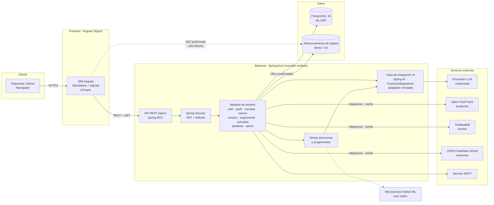

# NutriSport AI — Propuesta de Proyecto

> **"Tu nutrición deportiva, impulsada por inteligencia artificial."**

| Campo | Valor |
|---|---|
| Documento | Especificación funcional y técnica del producto |
| Versión | 1.2 (integración de APIs externas; v1.1 revisada tras la auditoría) |
| Fecha | 21/11/2026 |
| Estado | Base para iniciar el desarrollo |
| Contexto | Proyecto final individual de 2.º DAW (ver §1.7) |
| Documentos relacionados | [`DESIGN.md`](DESIGN.md) (identidad visual y sistema de diseño) · [`design/mockups/`](design/mockups/index.html) · [`review/`](review/FINAL_REVIEW.md) (auditoría) · [`API_INTEGRATIONS.md`](API_INTEGRATIONS.md) (APIs externas) |

---

## Índice

1. [Visión general](#1-visión-general)
2. [Usuarios y roles](#2-usuarios-y-roles)
3. [Módulos y funcionalidades](#3-módulos-y-funcionalidades)
4. [Inteligencia artificial](#4-inteligencia-artificial)
5. [Arquitectura tecnológica](#5-arquitectura-tecnológica)
6. [Base de datos](#6-base-de-datos)
7. [API REST](#7-api-rest)
8. [Seguridad y privacidad](#8-seguridad-y-privacidad)
9. [Requisitos](#9-requisitos)
10. [Historias de usuario](#10-historias-de-usuario)
11. [Planificación del desarrollo](#11-planificación-del-desarrollo)
12. [Viabilidad](#12-viabilidad)
13. [Glosario](#13-glosario)

---

## 1. Visión general

### 1.1. Descripción del proyecto

NutriSport AI es una aplicación web que ayuda a deportistas a **organizar, registrar y analizar su alimentación** en función de sus objetivos físicos, sus hábitos alimentarios y su actividad deportiva real.

La plataforma combina programación convencional (cálculo de necesidades energéticas, registro, estadísticas, lista de la compra) con capacidades de inteligencia artificial (reconocimiento de alimentos en fotografías, un asistente conversacional y, como visión de producto, lectura de etiquetas nutricionales). La generación de menús es un algoritmo de reglas, no IA (§4.5). El resultado es un asistente que reduce el esfuerzo de registro y convierte los datos del usuario en propuestas accionables.

NutriSport AI **no sustituye a un dietista-nutricionista ni ofrece diagnósticos médicos**. Todas las estimaciones y recomendaciones son orientativas y se presentan como tales en la interfaz.

### 1.2. Problema que resuelve

| Problema | Consecuencia para el deportista |
|---|---|
| Registrar comidas manualmente es lento y tedioso | Abandono del seguimiento a las pocas semanas |
| Las apps generalistas no conectan alimentación y entrenamiento | Objetivos calóricos estáticos que no reflejan los días de carga o descanso |
| Planificar menús ajustados a macronutrientes exige conocimientos y tiempo | Improvisación, déficit de proteína o de carbohidratos en días clave |
| Los datos registrados rara vez se transforman en conclusiones | El usuario no sabe qué hábitos cambiar |
| Las recomendaciones genéricas ignoran restricciones (alergias, dieta vegetariana, intolerancias) | Propuestas inservibles o, en el peor caso, peligrosas |

### 1.3. Público objetivo

- **Principal:** deportistas amateurs y semiprofesionales de 18 a 45 años (running, ciclismo, gimnasio/fuerza, deportes de equipo, triatlón, crossfit) que entrenan 3 o más días por semana y quieren mejorar rendimiento o composición corporal.
- **Secundario:** personas activas que inician un cambio de hábitos con un objetivo concreto (perder grasa, ganar masa muscular, preparar una competición).
- **Fuera de alcance:** menores de edad, pacientes con patologías que requieren dieta clínica, personas con trastornos de la conducta alimentaria (la aplicación incluye salvaguardas específicas, ver §8.6).

### 1.4. Propuesta de valor

1. **Registro en segundos:** fotografía del plato → propuesta de alimentos y cantidades → confirmación o corrección del usuario.
2. **Objetivos dinámicos:** el objetivo diario de energía y macronutrientes se ajusta con el entrenamiento registrado.
3. **Del objetivo al plato (Ampliación):** menús semanales personalizados que se convierten automáticamente en lista de la compra.
4. **Datos que explican (Ampliación):** estadísticas, tendencias y un asistente que responde con los datos reales del usuario.
5. **Confianza:** los valores nutricionales proceden de bases de datos estructuradas, no de la "imaginación" de un modelo de lenguaje.

### 1.5. Objetivos principales

Los objetivos se expresan como criterios **demostrables en la entrega** (no como métricas de un producto con usuarios reales).

| Código | Objetivo | Criterio de éxito verificable |
|---|---|---|
| OBJ-01 | Reducir el tiempo de registro de una comida | En la demostración, una comida se registra por foto (con revisión) en < 30 s |
| OBJ-02 | Ajustar los objetivos a la actividad real | Registrar un entrenamiento cambia el objetivo del día según la fórmula de §3.G (test automatizado) |
| OBJ-03 | Respetar las restricciones alimentarias | El 100 % de los alimentos con un alérgeno restringido o con alérgenos sin revisar generan un aviso al registrarlos (test automatizado); en la Ampliación, el 100 % de los menús de prueba las respetan |
| OBJ-04 | Garantizar fiabilidad nutricional | El 100 % de los valores nutricionales mostrados son trazables a una fuente del catálogo |
| OBJ-05 | Proteger datos sensibles | Ninguna foto ni recurso personal es accesible por otro usuario (tests de autorización) |

### 1.6. Diferenciación

| Aspecto | Apps nutricionales generalistas | NutriSport AI |
|---|---|---|
| Enfoque | Pérdida de peso genérica | Rendimiento deportivo y composición corporal |
| Objetivos | Fijos | Ajustados por entrenamiento (gasto estimado por MET) |
| Registro | Búsqueda manual o código de barras | Fotografía + búsqueda, siempre editable (código de barras y OCR en la ampliación y la visión) |
| Planificación (Ampliación) | Planes cerrados o de pago | Menús generados según perfil, restricciones y macros |
| Compra (Ampliación) | Inexistente o manual | Lista de la compra automática agrupada y sumada |
| Análisis (Ampliación) | Gráficas descriptivas | Detección de patrones con reglas y relación alimentación-actividad |
| IA conversacional (Ampliación) | Chatbot genérico | Asistente de solo lectura con acceso controlado a los datos del usuario |
| Transparencia | Valores de origen opaco | Fuente de cada valor nutricional visible (BEDCA, USDA, Open Food Facts, admin) |

### 1.7. Contexto y alcance del proyecto académico

NutriSport AI se desarrolla como **proyecto final individual de 2.º DAW**, con una dedicación estimada de **unas 400 horas** (ajústala al calendario real del módulo). Este documento describe la **visión completa del producto**, pero el alcance comprometido para la entrega es el **MVP de entrega** de §11.1. El resto se documenta como **Ampliación** (si sobra tiempo) o **Visión de producto** (evolución futura).

Etiquetas de alcance que se usan en todo el documento:

| Etiqueta | Significado |
|---|---|
| **MVP** | Se implementa y se defiende en la entrega |
| **Ampliación** | Se implementa solo si el MVP está terminado y probado |
| **Visión** | Se documenta como evolución; no se implementa en el proyecto |

Durante el proyecto **solo se usan cuentas de prueba con datos ficticios o del propio autor** (ver §8.3).

---

## 2. Usuarios y roles

El sistema define dos roles. Un usuario anónimo solo puede acceder a las páginas públicas (landing, login, registro, recuperación de contraseña).

### 2.1. Deportista (`ROLE_DEPORTISTA`)

Usuario final de la aplicación. Solo puede acceder a **sus propios datos**.

| Área | Permisos |
|---|---|
| Cuenta | Registrarse, iniciar/cerrar sesión, recuperar contraseña, cambiar email y contraseña, revocar o volver a dar el consentimiento de salud, eliminar su cuenta y exportar sus datos (Ampliación) |
| Perfil | Crear y editar su perfil deportivo y nutricional, preferencias y restricciones |
| Comidas | Registrar, editar y eliminar comidas; analizar fotografías y etiquetas; consultar historial |
| Menús | Generar, editar, sustituir comidas, marcar favoritos, eliminar |
| Lista de la compra | Generar, editar, marcar productos comprados |
| Actividad | Registrar, editar y eliminar entrenamientos |
| Seguimiento | Consultar estadísticas, registrar peso |
| Asistente IA | Crear conversaciones, enviar mensajes, eliminar conversaciones |
| Catálogo | Consultar alimentos y recetas públicos; crear alimentos y recetas privados |
| Incidencias | Reportar errores en alimentos, recetas o análisis de IA (Visión) |

### 2.2. Administrador (`ROLE_ADMIN`)

Responsable de la calidad del catálogo y de la operación de la plataforma. **No accede al contenido personal de los deportistas** (comidas, fotografías, conversaciones) salvo el estrictamente necesario para resolver una incidencia reportada por el propio usuario, y siempre con registro de auditoría.

| Área | Permisos |
|---|---|
| Usuarios | Listar, buscar, ver datos de cuenta (no datos de salud), bloquear/desbloquear, cambiar rol |
| Alimentos | CRUD del catálogo público, revisión de alérgenos, importación CSV; validar alimentos creados por usuarios (Visión) |
| Recetas | CRUD de recetas públicas, publicar/despublicar |
| Categorías | CRUD de categorías de alimentos y recetas |
| Incidencias | Ver, asignar, resolver y cerrar incidencias (Visión) |
| Métricas | Panel con uso agregado y anonimizado: usuarios activos, análisis de IA y tasa de corrección (Ampliación); coste de IA (Visión) |

> Un usuario puede tener los dos roles (tabla `UsuarioRol`, §6.1): así el administrador también puede usar la aplicación como deportista.

---

## 3. Módulos y funcionalidades

Cada módulo se corresponde con un paquete del backend (`com.nutrisport.<modulo>`) y con una *feature* lazy-loaded del frontend.

### A. Registro y autenticación · MVP

**Objetivo:** permitir el acceso seguro a la plataforma y la gestión autónoma de la cuenta.

**Funcionalidades**

- Registro con nombre, email, contraseña, **declaración de mayoría de edad**, aceptación de términos y **consentimiento explícito y separado** para el tratamiento de datos de salud (se guarda la versión del texto aceptado).
- Verificación de email mediante enlace con token de un solo uso (validez 24 h) y opción de **reenviar** el correo.
- Inicio de sesión con email y contraseña → *access token* JWT (15 min) + *refresh token* rotatorio en cookie `HttpOnly`. Con "Mantener la sesión iniciada" la cookie dura 7 días; sin marcarla, es una cookie de sesión.
- **Se permite iniciar sesión sin haber verificado el email**; las funciones de IA y la exportación de datos exigen el email verificado.
- Cierre de sesión (revoca el refresh token; funciona solo con la cookie) y cierre de todas las sesiones.
- Recuperación de contraseña por email con token de un solo uso (validez 30 min).
- Gestión de cuenta: cambio de email (requiere reverificación), cambio de contraseña, preferencias de unidades, **revocación del consentimiento de salud** y eliminación de cuenta (MVP); exportación de datos en JSON (Ampliación).

**Reglas**

- El registro responde siempre `202` con el mismo mensaje: si el email ya existe, se envía un aviso al titular y no se revela nada en la respuesta.
- Los intentos fallidos de login se limitan **por IP y por email con retardo progresivo** (Bucket4j). No se cambia el estado de la cuenta, para que un atacante no pueda bloquear cuentas ajenas.
- Estados de la cuenta: `ACTIVO`, `BLOQUEADO` (por un administrador) y `ELIMINADO`. La verificación del email es un dato aparte (`emailVerificadoEn`).
- Revocar el consentimiento de salud bloquea las funciones que tratan datos de salud (perfil, comidas, peso, IA) y ofrece exportar y eliminar la cuenta.

**Interacciones principales**

1. Usuario se registra → recibe email → verifica → accede al asistente de configuración inicial (módulo B).
2. Access token caduca → el interceptor HTTP de Angular solicita uno nuevo con el refresh token de forma transparente.
3. Tras 5 intentos fallidos en 15 min con el mismo email o IP → respuesta `429` con `Retry-After`.

### B. Perfil deportivo y nutricional · MVP

**Objetivo:** recoger los datos necesarios para calcular necesidades energéticas y personalizar menús y recomendaciones.

**Funcionalidades**

- **Datos personales:** fecha de nacimiento y sexo biológico (necesario para las ecuaciones de gasto basal).
- **Antropometría:** altura (cm), peso actual (kg) y opcionalmente porcentaje de grasa.
- **Objetivo deportivo:** perder grasa, mantener, ganar masa muscular, mejorar rendimiento, preparar competición (con fecha).
- **Tipo de deporte** principal (catálogo `TipoActividad`).
- **Nivel de actividad** fuera del entrenamiento (sedentario, ligero, moderado, alto).
- **Frecuencia de entrenamiento:** días por semana (0–7) y duración media.
- **Preferencias:** alimentos favoritos y rechazados, número de comidas al día (3–6) y tiempo máximo de cocina.
- **Restricciones:** alergias (14 alérgenos de declaración obligatoria del Reglamento UE 1169/2011, incluida la celiaquía como alergia al gluten), intolerancia a la lactosa y dietas (vegetariana, vegana, pescetariana). Halal y kosher se guardan como preferencia blanda (Visión: filtro duro).
- **Objetivos calculados** (programación convencional):
  - Metabolismo basal con **Mifflin-St Jeor**.
  - Gasto energético total = basal × factor de actividad **sin entrenamiento** (sedentario 1,2 · ligero 1,3 · moderado 1,4 · alto 1,5) + gasto **neto** de los entrenamientos del día (§3.G).
  - Ajuste según objetivo (perder grasa −15 %, ganar músculo +10 %).
  - Reparto de macronutrientes con rangos de referencia para deportistas (proteína 1,4–2,0 g/kg, grasa 20–35 % de la energía, carbohidratos el resto, ajustados al volumen de entrenamiento).
  - El usuario puede **sobrescribir manualmente** los objetivos (p. ej. si sigue las pautas de su nutricionista).

**Interacciones principales:** asistente de configuración inicial en 4 pasos tras el primer login; edición posterior desde "Mi perfil"; cualquier cambio de peso u objetivo recalcula los objetivos diarios.

### C. Registro inteligente de comidas · MVP

**Objetivo:** registrar lo que el usuario come con el menor esfuerzo posible y con datos nutricionales fiables.

**Funcionalidades**

- **Registro manual:** seleccionar fecha y tipo de comida (desayuno, media mañana, comida, merienda, cena, pre-entreno, post-entreno, otro).
- **Búsqueda en base de datos** con texto libre tolerante a errores tipográficos y tildes (`pg_trgm` sobre un nombre normalizado), filtros por categoría y alimentos recientes y frecuentes.
- **Buscador de alimentos y productos** (Ampliación, Open Food Facts): el buscador consulta primero el catálogo local (que incluye los productos ya guardados) y, **solo si el usuario lo pide** ("Buscar en productos comerciales"), Open Food Facts. Cada resultado muestra su procedencia, nutrientes por 100 g, imagen, ingredientes y alérgenos; el usuario elige cantidad o porción y lo añade a una comida.
- **Escáner de código de barras** (Ampliación): cámara del móvil (o introducción manual del código) → Angular envía el código al backend → el backend lo busca en el catálogo y, si no está, en Open Food Facts → normaliza la respuesta → Angular muestra el producto → el usuario indica la cantidad → se añade al registro. Si el producto no existe o no tiene datos nutricionales suficientes, se ofrece buscar otro o registrar un alimento propio.
- **Cantidades** en gramos, mililitros o medidas caseras (unidad, taza, cucharada, ración) convertidas a gramos según el alimento.
- **Reconocimiento por fotografía:** el usuario sube o hace una foto → el sistema propone una lista de alimentos con su **preparación** (crudo, cocido, a la plancha, frito…), cantidad estimada y nivel de confianza.
- **Lectura de etiquetas (OCR, Visión):** foto de la tabla nutricional de un envase → alimento nuevo prellenado.
- **Estimación nutricional:** se calcula siempre a partir de los valores por 100 g del alimento del catálogo × cantidad.
- **Edición y confirmación:** ningún resultado de IA se guarda sin que el usuario lo confirme; puede cambiar alimentos, cantidades, añadir o eliminar elementos.
- **Historial:** listado por días con totales, filtro por rango de fechas y tipo de comida; posibilidad de duplicar una comida anterior ("repetir desayuno de ayer").

**Interacciones principales**

```
Foto → subida a almacenamiento → AnalisisImagen (PENDIENTE)
     → servicio de visión → candidatos {nombre, preparación, gramos estimados, confianza}
     → emparejamiento con catálogo → AnalisisImagen (COMPLETADO)
     → pantalla de resultado editable → usuario confirma → RegistroComida + AlimentoRegistrado
```

### D. Planificador de menús · Ampliación

**Objetivo:** proponer menús diarios o semanales alineados con los objetivos, preferencias y restricciones del usuario.

**Funcionalidades**

- **Generación** de menú diario o semanal (lunes–domingo) con el número de comidas configurado.
- **Personalización:** respeta restricciones (filtro duro), preferencias (puntuación), la **franja** a la que es apta cada receta, los objetivos de macros del día y los **entrenamientos planificados** (más carbohidratos en días de sesión).
- **Catálogo de recetas** (TheMealDB + recetas propias): buscar por nombre, filtrar por ingrediente principal, categoría y cocina, ver imagen, ingredientes con cantidades, instrucciones y nutrientes calculados por ración (§4.9), guardar favoritas y ver recetas relacionadas. Los filtros nutricionales ("alta en proteína", "menos de X kcal") y los de restricciones solo se aplican a recetas con cálculo nutricional y alérgenos verificados.
- **Recetas e ingredientes:** cada comida planificada referencia una receta del catálogo con raciones ajustadas. Desde el detalle de una receta se puede añadir al planificador y llevar sus ingredientes a la lista de la compra.
- **Sustitución:** el usuario puede pedir alternativas para una comida concreta; se proponen 3 recetas con perfil nutricional similar.
- **Edición manual:** añadir y quitar comidas, moverlas entre días, cambiar raciones y bloquear comidas para que no cambien al regenerar.
- **Favoritos:** guardar un menú como favorito y reutilizarlo en otra semana.
- **Registro rápido:** marcar una comida planificada como "comida" crea el `RegistroComida` correspondiente.

**Interacciones principales:** "Generar menú" → vista calendario con totales diarios frente a objetivo → sustituir/bloquear/editar → "Generar lista de la compra". La selección de recetas es un **algoritmo de reglas** (§4.5); la IA, si se usa, solo personaliza dentro de las recetas candidatas y propone sustituciones que el backend valida (§4.5).

### E. Lista de la compra · Ampliación

**Objetivo:** transformar un menú en una lista de compra práctica.

**Funcionalidades**

- **Generación automática** a partir de un menú (o un rango de días).
- **Agrupación** por categoría de supermercado (frutas y verduras, carnes, pescados, lácteos, despensa, congelados…).
- **Suma de cantidades** del mismo ingrediente con normalización (g/kg, ml/l) y, si el alimento tiene una porción "unidad", conversión a unidades ("6 huevos" en lugar de "360 g").
- **Gestión de comprados:** marcar/desmarcar, ocultar comprados, progreso visual.
- **Edición manual:** añadir productos libres, editar cantidad, eliminar.
- **Compartir/exportar:** copiar como texto (Visión: PDF).

### F. Seguimiento nutricional · MVP (resumen y peso) / Ampliación (estadísticas)

**Objetivo:** mostrar el progreso diario y a lo largo del tiempo.

**Funcionalidades**

- **Resumen diario:** calorías, proteínas, carbohidratos y grasas consumidos frente a objetivo (anillos/barras de progreso).
- **Evolución del peso:** registro de pesajes y gráfico con media móvil de 7 días.
- **Historial:** tabla de días con totales y adherencia (% del objetivo **de ese día**, guardado en `ObjetivoDiario`).
- **Estadísticas:** medias semanales y mensuales, distribución de macros, reparto por comidas, alimentos más consumidos, días que cumplen objetivo.
- **Comparativas:** semana actual vs. anterior, días de entrenamiento vs. días de descanso.

### G. Actividad deportiva · MVP

**Objetivo:** registrar el entrenamiento para ajustar objetivos y relacionarlo con la alimentación.

**Funcionalidades**

- **Registro de entrenamientos:** fecha y hora, tipo de actividad (catálogo `TipoActividad` con valor MET), duración, intensidad (baja/media/alta; el RPE 1–10 es informativo), notas y **estado** (`PLANIFICADO` o `REALIZADO`).
- **Gasto neto estimado:** `kcal = (MET − 1) × peso (kg) × horas × factor de intensidad` (baja 0,85 · media 1 · alta 1,15). Se resta 1 MET porque el gasto en reposo de ese tiempo ya está en el basal. Se muestra como estimación.
- **Objetivo del día:** incluye los entrenamientos planificados y realizados de ese día (para poder comer antes de entrenar). Un entrenamiento planificado que no se marca como realizado pasa a `OMITIDO` al día siguiente (tarea nocturna) y deja de contar: se recalcula el `ObjetivoDiario` de ese día.
- **Historial** con filtros y calendario semanal de carga.
- **Relación alimentación-actividad (Ampliación):** energía y carbohidratos ingeridos en días de entrenamiento frente a descanso y comparación entre gasto estimado y consumo.
- **Importación** desde Strava/Garmin/Google Fit: Visión.

### H. Asistente nutricional con IA · Ampliación

**Objetivo:** permitir al usuario consultar y entender su alimentación en lenguaje natural.

**Funcionalidades**

- **Conversación contextualizada:** el asistente conoce el objetivo, el deporte y las restricciones del usuario.
- **Consulta de datos (solo lectura):** "¿Cuánta proteína tomé ayer?", "¿Qué ceno hoy según mi plan?" → el asistente invoca **herramientas de solo lectura** del backend (`getResumenDiario`, `getComidas`, `getEntrenamientos` y, si existe el planificador, `getMenu`).
- **Recomendaciones orientativas** con aviso visible de que no constituyen consejo médico.
- **Gestión de conversaciones:** historial, renombrar, eliminar.
- **Visión:** acciones de escritura desde el chat ("cámbiame la cena del jueves") y análisis de hábitos con *insights* generados por ML.

**Interacciones principales:** sugerencias rápidas ("Resumen de mi semana", "Idea de cena alta en proteína"); tarjetas enriquecidas en la respuesta (tabla de macros, receta enlazada). Cualquier cambio en los datos lo hace el usuario con los botones de la interfaz, nunca el modelo. La respuesta en *streaming* es opcional (§5.2).

### I. Administración · MVP (mínima) / Visión (resto)

**Objetivo:** mantener la calidad del catálogo y supervisar el funcionamiento.

**Funcionalidades**

- **Usuarios (MVP):** búsqueda, estado (activo, bloqueado), cambio de rol y bloqueo. Nunca se muestran datos de salud.
- **Alimentos (MVP):** CRUD del catálogo público, **revisión de alérgenos** (`alergenosRevisados`), importación por lotes desde CSV y borrado lógico (`activo = false`) de los alimentos ya usados.
- **Recetas (Ampliación, con el planificador):** CRUD, ingredientes, pasos, franjas aptas, etiquetas y publicación.
- **Categorías (MVP):** de alimentos (con la sección de la lista de la compra) y de recetas.
- **Validación (Visión):** revisión de alimentos creados por usuarios u OCR antes de hacerlos públicos.
- **Incidencias (Visión):** bandeja de reportes ("valor nutricional incorrecto", "reconocimiento erróneo", "receta con alérgeno no indicado") con estados ABIERTA → EN_REVISIÓN → RESUELTA/DESCARTADA.
- **Panel de métricas (Ampliación):** usuarios activos, análisis de IA y tasa de corrección, siempre agregados y anonimizados.

## 4. Inteligencia artificial

### 4.1. Principios

1. **La IA propone, el usuario decide.** Todo resultado de IA que modifica datos (comidas, alimentos, menús) requiere confirmación.
2. **Los números salen de datos estructurados.** Los valores nutricionales se calculan con el catálogo; los modelos solo identifican alimentos y estiman cantidades. La única excepción es el OCR de etiquetas (Visión), donde el modelo **transcribe** los valores impresos, que se validan por reglas y los confirma el usuario antes de guardarse.
3. **Precisión no absoluta.** La interfaz muestra el nivel de confianza y permite corregir cantidades e ingredientes. Las porciones estimadas a partir de una foto tienen un error típico elevado (del orden de ±20–40 % según la literatura sobre estimación visual de porciones), por lo que se presentan como punto de partida.
4. **Proveedores intercambiables.** Cada capacidad se define como una interfaz Java (*puerto*) con adaptadores para distintos proveedores.
5. **Minimización de datos.** A los proveedores externos nunca se envían nombre, email ni identificadores. Lo que sí se envía en cada función se detalla en §8.3.

### 4.2. Qué usa IA y qué no

| Funcionalidad | Técnica | ¿IA? |
|---|---|---|
| Identificar alimentos en una foto | Visión artificial (modelo multimodal / API especializada) | Sí |
| Estimar gramos de cada alimento en la foto | Visión artificial | Sí (editable) |
| Leer tabla nutricional de un envase | OCR + extracción estructurada | Sí (Visión; validado por reglas) |
| Generar menús semanales | Algoritmo heurístico de reglas y puntuación (§4.5) | **No** (el LLM solo redacta una explicación opcional) |
| Redactar explicaciones breves (menú, *insight*) | LLM | Sí (Ampliación, opcional) |
| Asistente conversacional | LLM con *tool calling* | Sí |
| Detectar patrones y tendencias | Estadística y reglas (Ampliación); ML en Visión | **No** en el proyecto |
| Calcular calorías y macros de una comida | Aritmética sobre catálogo | **No** |
| Calcular gasto basal y objetivos | Ecuaciones (Mifflin-St Jeor, MET) | **No** |
| Filtrar alérgenos y restricciones | Reglas sobre datos estructurados | **No** |
| Lista de la compra (agrupar y sumar) | Agregación y conversión de unidades | **No** |
| Búsqueda de alimentos | Full-text + trigramas en PostgreSQL | **No** |
| Código de barras | Lectura en cliente + API Open Food Facts | **No** (Ampliación) |
| Estadísticas y gráficos | Consultas SQL agregadas | **No** |

### 4.3. Visión artificial: reconocimiento de alimentos

| Aspecto | Descripción |
|---|---|
| Función | Detectar los alimentos presentes en una foto y estimar su cantidad aproximada |
| Datos de entrada | Imagen JPEG o PNG (≤ 10 MB; el cliente convierte HEIC y WebP a JPEG), redimensionada a 1024 px en el lado largo y sin EXIF, tipo de comida y, opcionalmente, una descripción textual del usuario ("arroz con pollo, sin salsa") |
| Datos de salida | Lista de candidatos `{nombreDetectado, preparacion (CRUDO, COCIDO, PLANCHA, FRITO, HORNO…), gramosEstimados, confianza, alternativas[]}` |
| Opciones de proveedor | (a) **LLM multimodal** con salida estructurada en JSON Schema; (b) **API especializada** en alimentos (p. ej. LogMeal, Passio, Clarifai Food); (c) **modelo propio** (clasificador entrenado con Food-101 / datasets propios) en fases futuras |
| Decisión MVP | LLM multimodal con salida estructurada: no requiere entrenamiento, entiende platos combinados y cocina mediterránea, y admite la descripción del usuario como contexto. La interfaz `FoodRecognitionPort` permite cambiar a una API especializada si las métricas de precisión lo aconsejan |

**Funcionamiento**

1. La foto llega al backend por **multipart** (nunca se sube directamente al *bucket*). El backend valida la firma de bytes y el tamaño, **recodifica a JPEG** (lo que elimina EXIF y geolocalización), guarda la imagen y la miniatura y crea `AnalisisImagen` en estado `PENDIENTE`.
2. Un ejecutor asíncrono (`@Async` con pool limitado) envía la imagen al proveedor con un *prompt* fijo y un JSON Schema de respuesta.
3. Cada `nombreDetectado` se empareja con el catálogo mediante búsqueda por similitud (trigramas + sinónimos), **priorizando la variante con la misma preparación** (por eso el catálogo semilla incluye variantes cocinadas de los básicos); se guardan las 3 mejores coincidencias. Si la preparación es frito o salteado, se añade un candidato editable "Aceite de oliva (estimado)".
4. Se calculan los nutrientes estimados con los valores del catálogo × gramos estimados.
5. Estado `COMPLETADO` (o `FALLIDO` con motivo). El frontend consulta el estado por *polling* (cada 1,5 s, máx. 30 s). Una tarea programada marca como `FALLIDO` los análisis que lleven más de 2 minutos en `PENDIENTE` o `PROCESANDO` (por ejemplo, tras un reinicio del servidor).
6. El usuario corrige y confirma; las correcciones se guardan en `AnalisisImagen.correcciones` para medir la precisión real (métrica: % de alimentos aceptados sin cambio y error medio de gramos).

**Integración con Spring Boot:** `Spring AI` (`ChatClient` con soporte multimodal y *structured output*) detrás de `FoodRecognitionPort`; *timeout* de 20 s, un reintento y degradación a registro manual si el proveedor no responde. En desarrollo y en los tests se usa un **adaptador simulado** con respuestas fijas.

### 4.4. LLM: asistente y explicaciones

| Aspecto | Descripción |
|---|---|
| Función | Responder en el asistente (Ampliación) y, opcionalmente, redactar explicaciones breves de menús e *insights* |
| Datos necesarios | Perfil resumido (edad aproximada, objetivo, deporte, restricciones) y los datos que devuelven las herramientas para la pregunta concreta (ver §8.3) |
| Funcionamiento | *Prompts* versionados en el repositorio (`resources/prompts/*.st`), plantillas con variables, salida estructurada cuando el resultado se procesa en código |
| Integración | `Spring AI ChatClient` con *tool calling*; respuesta completa o, opcionalmente, en *streaming* |

**Restricciones de diseño**

- El LLM **no genera menús ni recetas con nutrientes**: el algoritmo de §4.5 selecciona recetas del catálogo. Las variantes de recetas generadas por el LLM son Visión.
- Las cifras del usuario que aparecen en una respuesta salen siempre de **herramientas de solo lectura** que consultan la base de datos filtrando por el `usuarioId` del contexto de seguridad, nunca de la memoria del modelo.
- *System prompt* con límites: no diagnosticar, no prescribir suplementos ni fármacos, derivar a profesionales ante síntomas, embarazo, patologías o señales de trastorno alimentario. Un filtro previo detecta estos temas y responde con un texto seguro sin llamar al modelo.

### 4.5. Generación de menús (algoritmo de reglas, no IA)

| Aspecto | Descripción |
|---|---|
| Función | Seleccionar recetas y combinaciones de comidas que cumplan los objetivos y las restricciones del usuario |
| Datos necesarios | Recetas **publicadas** del catálogo (propias o importadas de TheMealDB) con cálculo nutricional `COMPLETO` o `APROXIMADO`, etiquetas y **franjas aptas**; restricciones y preferencias; objetivos de cada día y entrenamientos planificados |
| Enfoque | **Heurística determinista**: (1) filtro duro por alérgenos, intolerancias, dieta, alimentos rechazados y franja apta; (2) puntuación por ajuste a los macros de la franja, preferencias, variedad (penaliza repetir receta en 3 días) y tiempo de preparación; (3) construcción del día por búsqueda voraz con *backtracking* limitado para que el total quede dentro de ±10 % del objetivo energético y ±15 % de proteína |
| Datos mínimos | 40–60 recetas publicadas (propias o importadas de TheMealDB y revisadas, §11.2) bastan para demostrarlo |
| Personalización con IA (opcional) | Un LLM puede (a) **reordenar** las 5 mejores candidatas de cada franja según las preferencias en lenguaje natural del usuario ("me apetece algo de cuchara"), (b) **proponer sustituciones de ingredientes** ("cambia la nata por yogur sin lactosa") y (c) sugerir un producto ya guardado de Open Food Facts como tentempié. En los tres casos **solo elige entre elementos del catálogo**: el backend comprueba restricciones y alérgenos y **recalcula los nutrientes**; si la propuesta no supera la validación, se descarta. Se muestra con la marca "Sugerencia IA" |
| Visión | Filtrado colaborativo, búsqueda semántica de recetas con `pgvector` |
| Integración | Servicio Java puro (`MenuRecommendationService`), testeable con datos sintéticos; no requiere proveedor externo |

### 4.6. Tendencias y patrones (*insights*)

| Aspecto | Descripción |
|---|---|
| Función | Detectar patrones (p. ej. "los días de entrenamiento consumes un 18 % menos de carbohidratos de lo recomendado") |
| Ampliación | **Reglas y estadística en Java/SQL**: medias móviles, regresión lineal del peso, comparación entreno/descanso y umbrales (p. ej. proteína < 80 % del objetivo en ≥ 4 de 7 días). Una tarea nocturna guarda los resultados en `Insight`; el LLM, si se usa, solo redacta el consejo a partir de las cifras ya calculadas |
| Visión | Modelos de series temporales o *clustering* de hábitos, solo si las reglas no bastan (posible microservicio Python, §5.10) |

### 4.7. OCR de etiquetas nutricionales · Visión

| Aspecto | Descripción |
|---|---|
| Función | Crear un alimento a partir de la foto de la tabla nutricional de un envase |
| Datos necesarios | Foto de la tabla; opcionalmente foto del código de barras o el código leído |
| Funcionamiento | (1) Si hay código de barras, se consulta primero **Open Food Facts** (sin IA); (2) si no existe, OCR + extracción a campos estructurados (energía kJ/kcal, grasas, saturadas, hidratos, azúcares, fibra, proteínas, sal, por 100 g/ml y por ración); (3) **validación por reglas**: kcal ≈ 4·P + 4·HC + 9·G (+2·fibra) con tolerancia del 15 %, saturadas ≤ grasas, azúcares ≤ hidratos, conversión kJ↔kcal coherente; (4) el usuario revisa y confirma; (5) el alimento queda privado hasta que un administrador lo valide |
| Opciones | LLM multimodal con JSON Schema (el mismo proveedor que el reconocimiento de fotos) o OCR dedicado (Google Cloud Vision, AWS Textract, Tesseract local) |
| Integración | `NutritionLabelOcrPort` con el mismo patrón asíncrono que `AnalisisImagen` (tipo `ETIQUETA`) |

### 4.8. Fuentes de datos nutricionales

| Fuente | Uso | Licencia / notas |
|---|---|---|
| BEDCA (Base de Datos Española de Composición de Alimentos) | Alimentos genéricos en español | Uso con atribución; **condiciones de reutilización a verificar** antes de importar |
| USDA FoodData Central | Alimentos genéricos y micronutrientes | Dominio público; nombres en inglés (hay que traducirlos y revisarlos) |
| Open Food Facts | Productos envasados por código de barras y por nombre (Ampliación) | Base ODbL, contenidos DbCL, imágenes CC BY-SA: atribución y *share-alike* de la base adaptada (§4.9) |
| TheMealDB | Recetas: ingredientes, medidas, instrucciones e imágenes (Ampliación). **Sin nutrientes ni raciones** | Clave de prueba `1` para desarrollo y uso educativo; publicar exige ser *supporter*; citar la fuente |
| Administración | Alimentos y recetas revisados manualmente | Propia |
| Usuario / OCR | Alimentos privados | Propia |

Cada `Alimento` guarda su `fuente` y `referenciaExterna` para garantizar la trazabilidad (OBJ-04). **Los alérgenos de los alimentos genéricos los asigna y revisa el administrador** (las bases genéricas no siempre los incluyen; a verificar por fuente).

#### Catálogo semilla del MVP

El catálogo es una dependencia de la ruta crítica (registro manual, emparejamiento de fotos y menús), por eso tiene tarea y horas propias en §11.2:

- **200–300 alimentos genéricos en español** (ampliable después): importados de BEDCA si su licencia lo permite o de USDA con los nombres traducidos y revisados. Incluye **variantes cocinadas** de los básicos (arroz cocido, pasta cocida, legumbres cocidas, pollo a la plancha…) y porciones caseras.
- **Ampliación:** 40–60 recetas propias con franjas aptas y etiquetas (`pre-entreno`, `post-entreno`, `alta-proteina`), suficientes para demostrar el planificador.
- Los datos de desarrollo que no procedan de una fuente oficial se marcan con `referenciaExterna = DEV` y no se presentan como datos oficiales.

### 4.9. Integración con fuentes externas (Ampliación)

Detalle técnico, ejemplos reales, límites y licencias en [`API_INTEGRATIONS.md`](API_INTEGRATIONS.md). Resumen:

| Proveedor | Responsabilidad | Restricción principal |
|---|---|---|
| **Open Food Facts** | Productos comerciales: código de barras, nombre, marca, ingredientes, alérgenos y trazas, nutrientes, imagen | 10 búsquedas/min y 15 productos/min **por IP**, compartidos por todos los usuarios porque las llamadas salen del backend: se consulta solo bajo demanda y se guarda en PostgreSQL. La búsqueda por texto usa Search-a-licious (la API v2 no la ofrece) |
| **TheMealDB** | Recetas: ingredientes, medidas, instrucciones, categoría, cocina e imagen | Sin nutrientes, raciones ni alérgenos; solo en inglés; clave `1` solo para desarrollo y uso educativo |
| **USDA FoodData Central** | Nutrientes de ingredientes genéricos y pesos de medidas caseras, para **calcular las recetas** de TheMealDB | Clave gratuita (1.000 peticiones/h); descripciones en inglés |

**Cálculo nutricional de recetas externas** (programación convencional, no IA): ingredientes de TheMealDB → emparejamiento con el catálogo o USDA (`MapeoIngrediente`, revisable por el administrador) → interpretación de la medida ("1 tbsp", "200g", "10") → gramos → nutrientes → suma → división por raciones (4 **supuestas** si no se han fijado). Cada receta lleva un **estado del cálculo** (`COMPLETO`, `APROXIMADO`, `INCOMPLETO`) y su completitud, que se muestran siempre; un cálculo incompleto no se usa en menús automáticos. Los alérgenos de una receta externa se derivan de sus ingredientes emparejados; si alguno no está revisado, la receta queda como **"alérgenos sin verificar"** y se excluye de los menús de usuarios con alergias estrictas.

**Procedencia visible:** cada dato muestra su origen (catálogo, Open Food Facts, TheMealDB, USDA, cálculo propio). Lo generado por IA lleva siempre la marca de IA.

## 5. Arquitectura tecnológica

### 5.1. Arquitectura general

Se propone un **monolito modular** en Spring Boot más una SPA en Angular. Es la opción con mejor relación complejidad/beneficio para un único desarrollador: un único despliegue, transacciones locales y límites de módulo explícitos que permitirían extraer servicios en el futuro.



### 5.2. Responsabilidades de Angular

- **Versión:** Angular 19+ con componentes *standalone* y *signals*; el estado compartido de cada *feature* se guarda en servicios con *signals* (sin librerías de estado adicionales).
- **Estructura:** `core/` (auth, interceptores, guards, layout), `shared/` (sistema de diseño, pipes, utilidades), `features/<modulo>/` con carga diferida por ruta.
- **Autenticación:** access token **en memoria** (no en `localStorage`), refresh mediante cookie `HttpOnly`; `authInterceptor` que adjunta el token y reintenta tras refrescar; `authGuard` y `roleGuard`.
- **Formularios:** *Reactive Forms* tipados con validaciones equivalentes a las del backend.
- **Gráficos:** **Apache ECharts** vía `ngx-echarts` (buen rendimiento con series largas y tema configurable con los *tokens* de `DESIGN.md`).
- **Cámara y archivos:** `<input type="file" accept="image/*" capture="environment">`; compresión, redimensionado y **conversión a JPEG en el cliente** antes de subir (resuelve HEIC y WebP). Lectura de códigos de barras con la API `BarcodeDetector` o `@zxing/browser` como *fallback* (Ampliación).
- **Accesibilidad:** Angular CDK (a11y, overlay, drag & drop). Textos de la interfaz externalizados en español (la traducción a otros idiomas es Visión).
- ***Streaming* del asistente (opcional):** `EventSource` no permite `POST` ni la cabecera `Authorization`, así que se consumiría con `fetch` + `ReadableStream`. Si no se implementa, el asistente devuelve la respuesta completa.
- **PWA:** Visión.

### 5.3. Responsabilidades de Spring Boot

- **Versión:** Java 21 LTS, Spring Boot 3.x.
- API REST, validación (Bean Validation), reglas de negocio, cálculos nutricionales, algoritmo de menús, orquestación de IA, seguridad, auditoría, tareas programadas y envío de correo.
- **Persistencia:** Spring Data JPA + Hibernate, migraciones con **Flyway**, DTOs con **MapStruct**.
- **Documentación:** `springdoc-openapi` (Swagger UI solo en entornos no productivos).
- **Observabilidad:** Spring Boot Actuator (`/health`) y logs sin datos personales ni tokens.
- **Pruebas:** JUnit 5, Mockito, **Testcontainers** (PostgreSQL y MinIO reales), WireMock para simular proveedores de IA.

Organización de paquetes por módulo (*package-by-feature*):

```
com.nutrisport
├── auth          (controladores, servicios, JWT, tokens)
├── perfil
├── catalogo      (alimentos, recetas, categorías)
├── comidas       (registro, análisis de imagen)
├── menus
├── compra
├── seguimiento   (peso, estadísticas, insights)
├── actividad
├── asistente
├── admin         (usuarios, incidencias, métricas)
├── ia            (puertos y adaptadores de proveedores)
├── almacenamiento
└── comun         (errores, auditoría, configuración)
```

### 5.4. API REST

- Prefijo versionado `/api/v1`, recursos en plural y en español coherentes con el dominio.
- JSON en `camelCase`, fechas ISO-8601 (`2026-11-21`, `2026-11-21T08:30:00Z`).
- Paginación `?page=0&size=20&sort=fecha,desc` con respuesta `{content, page, size, totalElements, totalPages}`.
- Errores con **RFC 9457 (Problem Details)**: `{type, title, status, detail, instance, codigo, errors[]}` (catálogo de códigos en §7.12).
- Códigos: `200`, `201` + `Location`, `202`, `204`, `400`, `401`, `403`, `404`, `409`, `413`, `415`, `422`, `429`, `503`.
- Operaciones de IA asíncronas: `202 Accepted` + `Location` del recurso consultable.
- Detalle de endpoints en §7, DTO principales en §7.11.

### 5.5. Seguridad JWT

- *Access token* JWT firmado con HS256 (secreto ≥ 256 bits), caducidad 15 min, *claims*: `sub` (id usuario), `roles`, `iat`, `exp`, `jti`.
- *Refresh token* opaco aleatorio (256 bits), guardado **hasheado** en BD, rotación en cada uso y detección de reutilización (si se reutiliza uno ya rotado se revoca toda la familia).
- Cookie del refresh: `HttpOnly; Secure; SameSite=Strict; Path=/api/v1/auth` (con `Max-Age` de 7 días solo si el usuario marca "Mantener la sesión iniciada").
- Spring Security *stateless* con `OncePerRequestFilter` para validar JWT y `@PreAuthorize` para roles y propiedad de recursos. El filtro carga el usuario en cada petición y rechaza los `BLOQUEADO` y `ELIMINADO`, así que un bloqueo tiene efecto inmediato aunque el *access token* siga vigente.
- Detalle adicional en §8.

### 5.6. PostgreSQL

- PostgreSQL 16 con la extensión `pg_trgm`. Para que la búsqueda ignore tildes, cada alimento y receta guarda un `nombreNormalizado` (minúsculas y sin tildes, calculado en Java) con un índice GIN de trigramas; así no hace falta `unaccent`, que no se puede usar directamente en un índice.
- Claves primarias `UUID` ordenables por tiempo (generadas por Hibernate) para no exponer identificadores secuenciales.
- Columnas `JSONB` solo para datos semiestructurados (resultado bruto de IA, correcciones), nunca para datos que se consultan con frecuencia.
- Índices en claves foráneas, `(usuario_id, fecha)` en tablas de registro y GIN trigram en `nombre_normalizado`.
- Esquema versionado con migraciones Flyway. Copias de seguridad diarias en una puesta en producción.

### 5.7. Integración con servicios de IA

```
Módulo de dominio ──> Puerto (interfaz) ──> Adaptador real (Spring AI) ──> Proveedor externo
                                       └──> Adaptador simulado (desarrollo y tests)
  comidas      FoodRecognitionPort      (MVP)
  asistente    AssistantChatPort        (Ampliación)
  menus        TextGenerationPort       (Ampliación, opcional)
  catalogo     NutritionLabelOcrPort    (Visión)
```

- **Proveedor:** un LLM multimodal con soporte de imágenes, salida estructurada y *tool calling* en Spring AI. Se elige al empezar la fase de IA comparando precio, región de procesamiento y política de retención (a verificar); el adaptador permite cambiarlo.
- Configuración por propiedades (`nutrisport.ia.modo = simulado | real`, `modelo`, `timeout`).
- **Límites por usuario** configurables (Bucket4j o un contador diario): p. ej. 20 análisis de imagen y 50 mensajes al día.
- **Registro de uso** (`UsoIA`: tokens, latencia, coste estimado) para controlar el gasto.
- *Timeout*, un reintento y mensajes de degradación ("El análisis no está disponible; registra la comida manualmente").
- *Prompts* y esquemas versionados; tests con el adaptador simulado.

### 5.8. Almacenamiento de fotografías

- **Desarrollo:** MinIO en Docker. **Producción:** S3 o compatible en región UE.
- **Subida solo por el backend (multipart)**: así la validación y la eliminación de EXIF ocurren siempre **antes** de guardar.
- *Bucket* **privado**; lectura solo mediante **URLs prefirmadas GET** de 5 minutos.
- Clave de objeto sin datos personales: `usuarios/{uuid}/comidas/{yyyy}/{MM}/{uuid}.jpg`.
- Proceso: validación de firma y tamaño → recodificación a JPEG (elimina EXIF y geolocalización) → miniatura de 320 px.
- Retención: las fotos de análisis se eliminan automáticamente a los 90 días (valor de configuración); borrado total al eliminar la cuenta.
- Cifrado en reposo del proveedor y TLS en tránsito.

### 5.9. Docker

`docker-compose.yml` para desarrollo y base para producción:

| Servicio | Imagen | Notas |
|---|---|---|
| `frontend` | Build multi-etapa Node → `nginx:alpine` | Sirve la SPA y hace *proxy* de `/api` |
| `backend` | Build multi-etapa Maven → `eclipse-temurin:21-jre` | Usuario no root, *healthcheck* con Actuator |
| `postgres` | `postgres:16-alpine` | Volumen persistente |
| `minio` | `cgr.dev/chainguard/minio` | Solo desarrollo; en producción, servicio gestionado. `minio/minio` ya no está en Docker Hub |
| `mailpit` | `axllent/mailpit` | Solo desarrollo, captura de correos |

Secretos mediante variables de entorno (`.env`, que no se sube), nunca en el repositorio. CI (GitHub Actions): build y tests.

### 5.10. Microservicio Python (Visión)

**No se incluye en el proyecto.** La visión y el OCR se resuelven con APIs externas desde Java, y las tendencias con reglas en Java/SQL. Solo se justificaría un microservicio FastAPI si se entrenara un modelo propio (visión o series temporales) o si el volumen hiciera más rentable un modelo auto-alojado.

### 5.11. Tecnologías complementarias propuestas

**Criterio:** solo se incorpora una tecnología si resuelve un requisito del MVP o de la Ampliación.

| Tecnología | Justificación |
|---|---|
| Spring AI | Abstracción del proveedor LLM, salida estructurada y *tool calling* sin código ad hoc |
| Flyway | Migraciones versionadas y reproducibles |
| MapStruct (opcional) | Mapeo entidad↔DTO verificado en compilación |
| Bucket4j | Limitación de peticiones propias (login, IA) y hacia los proveedores externos (Ampliación) sin infraestructura adicional |
| Caffeine (Ampliación) | Caché en memoria de las búsquedas en APIs externas, imprescindible por sus límites de peticiones |
| Testcontainers | Tests de integración con PostgreSQL y MinIO reales |
| ngx-echarts | Integración de ECharts en Angular |
| Mailpit | Pruebas de correo en local |

**Pasan a Visión:** Resilience4j (basta un *timeout* y un reintento), `@ngrx/signals`, `@angular/localize`, PWA, Trivy, publicación de imágenes en CI y logs JSON con `traceId`. **Se descartan:** Redis, Kafka/RabbitMQ y Kubernetes (Docker Compose es suficiente).

## 6. Base de datos

### 6.1. Entidades principales

> **Convenciones:** todas las tablas tienen `id UUID PK` (salvo `TipoActividad`, cuya clave es su código, y `UsuarioRol`, de clave compuesta), `creado_en` y `actualizado_en` (`timestamptz`). Los enumerados se guardan como texto con una restricción `CHECK`. Se omiten en las tablas siguientes salvo que aporten algo. La columna **Alcance** indica cuándo se crea la tabla.

#### Usuario · MVP
| Atributo | Tipo | Notas |
|---|---|---|
| email | varchar(254) | Único, normalizado en minúsculas |
| passwordHash | varchar | BCrypt (coste 12) |
| nombre | varchar(80) | |
| estado | enum `ACTIVO`, `BLOQUEADO`, `ELIMINADO` | `BLOQUEADO` solo lo pone un administrador |
| emailVerificadoEn | timestamptz | `NULL` mientras no se verifica |
| mayorEdadDeclaradaEn | timestamptz | Declaración en el registro |
| consentimientoSaludEn | timestamptz | Consentimiento explícito (art. 9 RGPD) |
| consentimientoSaludVersion | varchar(10) | Versión del texto aceptado |
| consentimientoSaludRevocadoEn | timestamptz | `NULL` si está vigente |
| unidades | varchar | `METRICO` |
| ultimoAcceso | timestamptz | |
| eliminadoEn | timestamptz | Borrado físico diferido 30 días |

**UsuarioRol** (Usuario 1:N): `usuarioId`, `rol` (`DEPORTISTA`, `ADMIN`), PK compuesta. Un usuario puede tener los dos roles.

#### PerfilDeportivo (1:1 con Usuario) · MVP
| Atributo | Tipo | Notas |
|---|---|---|
| fechaNacimiento | date | Edad ≥ 18 |
| sexo | enum `HOMBRE`, `MUJER` | Necesario para la ecuación de gasto basal |
| alturaCm | numeric(5,1) | 120–230 |
| pesoActualKg | numeric(5,2) | 30–250; sincronizado con el último `RegistroPeso` |
| porcentajeGrasa | numeric(4,1) | Opcional |
| objetivo | enum `PERDER_GRASA`, `MANTENER`, `GANAR_MUSCULO`, `RENDIMIENTO`, `COMPETICION` | |
| fechaCompeticion | date | Obligatoria solo si `objetivo = COMPETICION` |
| deportePrincipal | FK `TipoActividad` | |
| nivelActividad | enum `SEDENTARIO`, `LIGERO`, `MODERADO`, `ALTO` | Actividad fuera del entrenamiento |
| diasEntrenamientoSemana | smallint | 0–7 |
| duracionMediaMin | smallint | |
| comidasPorDia | smallint | 3–6 |
| tiempoMaxCocinaMin | smallint | Opcional |
| objetivoKcal, objetivoProteinaG, objetivoCarbohidratosG, objetivoGrasaG | numeric | Objetivos **base** (sin entrenamiento), calculados o manuales |
| objetivosManuales | boolean | Si `true`, no se recalculan |

#### PreferenciaAlimentaria (N:1 con Usuario) · MVP
| Atributo | Tipo | Notas |
|---|---|---|
| tipo | enum `ALERGIA`, `INTOLERANCIA`, `DIETA`, `RECHAZO`, `FAVORITO` | |
| alergeno | enum (14 alérgenos UE) | Obligatorio si `tipo = ALERGIA` |
| intolerancia | enum `LACTOSA` | Obligatorio si `tipo = INTOLERANCIA` (ampliable) |
| dieta | enum `VEGETARIANA`, `VEGANA`, `PESCETARIANA`, `HALAL`, `KOSHER` | Obligatorio si `tipo = DIETA`. `HALAL` y `KOSHER` solo como preferencia blanda |
| alimentoId | FK `Alimento` (nullable) | Para `RECHAZO` o `FAVORITO` |
| categoriaId | FK `Categoria` (nullable) | Para `RECHAZO` o `FAVORITO` de una categoría |
| severidad | enum `ESTRICTA`, `PREFERENCIA` | Las estrictas son filtro duro |

> La celiaquía se registra como `ALERGIA` a `GLUTEN` (el filtro es el mismo). No hay dietas "sin gluten" ni "sin lactosa": son alergias o intolerancias.

#### Categoria · MVP
| Atributo | Tipo | Notas |
|---|---|---|
| nombre | varchar(80) | Único por tipo |
| tipo | enum `ALIMENTO`, `RECETA` | |
| padreId | FK `Categoria` (nullable) | Jerarquía |
| seccionCompra | varchar(40) | Sección del supermercado para la lista de la compra (solo `ALIMENTO`) |
| codigoExterno | varchar(40) | Categoría equivalente de TheMealDB (solo `RECETA`), p. ej. `Chicken` → "Pollo" |

#### Alimento · MVP
| Atributo | Tipo | Notas |
|---|---|---|
| nombre, marca | varchar | |
| nombreNormalizado | varchar | Minúsculas y sin tildes; índice GIN trigram |
| categoriaId | FK `Categoria` | Obligatoria (los productos de Open Food Facts van a "Otros") |
| preparacion | enum `CRUDO`, `COCIDO`, `PLANCHA`, `FRITO`, `HORNO`, `ENVASADO`, `OTRA` | Distingue las variantes de un mismo alimento |
| codigoBarras | varchar(14) | Único si existe |
| kcal100, proteinas100, carbohidratos100, grasas100 | numeric(7,2) | Por 100 g o 100 ml. Obligatorios para poder registrar el alimento |
| azucares100, saturadas100, fibra100, sal100 | numeric(7,2) | **Opcionales**: `NULL` = dato no disponible (habitual en Open Food Facts), nunca 0 |
| ingredientesTexto, imagenUrl | text / varchar | Productos de Open Food Facts (la imagen no se copia: se enlaza con atribución) |
| racionGramos, racionDescripcion | numeric / varchar | Ración del envase, si el proveedor la informa |
| unidadBase | enum `G`, `ML` | |
| porciones | jsonb | Medidas caseras: `[{"nombre":"unidad","gramos":120}]` |
| alergenosContiene | text[] | Alérgenos que **contiene** |
| alergenosTrazas | text[] | Alérgenos que **puede contener** (trazas) |
| alergenosRevisados | boolean | `false` hasta que un administrador los revisa |
| contieneLactosa | boolean | Para la intolerancia a la lactosa (un producto sin lactosa puede contener el alérgeno `LACTEOS`) |
| aptoVegano, aptoVegetariano, aptoPescetariano | boolean | |
| fuente | enum `BEDCA`, `USDA`, `OPEN_FOOD_FACTS`, `ADMIN`, `USUARIO`, `OCR` | Trazabilidad |
| referenciaExterna | varchar | `DEV` en los datos de desarrollo; el detalle por proveedor está en `AlimentoFuente` |
| visibilidad | enum `PUBLICO`, `PRIVADO` | |
| propietarioId | FK `Usuario` (nullable) | Obligatorio si es privado |
| validado | boolean | Para alimentos de usuario u OCR (Visión) |
| activo | boolean | Borrado lógico: un alimento usado en registros o recetas nunca se borra físicamente |

**AlimentoFuente** (Alimento 1:N, Ampliación): procedencia de un alimento en cada proveedor. Un mismo alimento puede tener varias (p. ej. el mismo producto en el catálogo y en Open Food Facts).

| Atributo | Tipo | Notas |
|---|---|---|
| alimentoId | FK `Alimento` | |
| proveedor | enum `OPEN_FOOD_FACTS`, `USDA`, `BEDCA` | |
| referenciaExterna | varchar | Código de barras o `fdcId`. **Único** con `proveedor` |
| url | varchar | Enlace a la ficha del proveedor (atribución) |
| licencia | varchar | `ODbL`, `CC0`… |
| sincronizadoEn | timestamptz | Para refrescar los productos de más de 30 días |

#### Receta · Ampliación

> Una receta puede ser **propia** o **importada de TheMealDB**. Las importadas se guardan al consultarlas por primera vez, con sus ingredientes y su cálculo nutricional, y solo entran en el planificador cuando el administrador las publica.
| Atributo | Tipo | Notas |
|---|---|---|
| nombre, descripcion, nombreNormalizado | varchar / text | |
| categoriaId | FK `Categoria` | |
| raciones | smallint | |
| tiempoPreparacionMin | smallint | |
| dificultad | enum `FACIL`, `MEDIA`, `DIFICIL` | |
| franjasAptas | text[] de `TipoComida` | Evita proponer lentejas en el desayuno |
| pasos | jsonb | Lista ordenada de pasos |
| imagenKey | varchar | Clave en almacenamiento |
| etiquetas | text[] | `alta-proteina`, `pre-entreno`… |
| kcalRacion, proteinaRacion, carbohidratosRacion, grasaRacion | numeric | **Calculados** a partir de los ingredientes |
| alergenosContiene, alergenosTrazas, contieneLactosa, aptoVegano, aptoVegetariano, aptoPescetariano | | **Derivados** de los ingredientes |
| visibilidad, propietarioId, publicada | | |
| origen | enum `PROPIA`, `THEMEALDB` | |
| referenciaExterna | varchar | `idMeal` de TheMealDB. **Único** con `origen` |
| idioma | varchar(5) | `en` para TheMealDB |
| categoriaExterna, area | varchar | `strCategory` y `strArea` originales |
| imagenUrl | varchar | `strMealThumb` (con atribución) |
| racionesSupuestas | boolean | `true` mientras las raciones no las fije el administrador (por defecto 4) |
| estadoNutricional | enum `COMPLETO`, `APROXIMADO`, `INCOMPLETO` | §4.9 |
| completitudPct | smallint | % de la masa de ingredientes resuelta |
| alergenosVerificados | boolean | `true` solo si todos los ingredientes están emparejados con alimentos con alérgenos revisados |
| sincronizadoEn | timestamptz | |

**RecetaIngrediente** (Receta 1:N): `id`, `recetaId`, `alimentoId` (**nullable** mientras el ingrediente no está emparejado), `nombreOriginal` ("Chicken Breast"), `medidaOriginal` ("200g", "1 tbsp"), `cantidadGramos` (nullable), `estadoConversion` (`EXACTA`, `ESTIMADA`, `DESPRECIABLE`, `SIN_DATOS`), `orden`.

**MapeoIngrediente** (Ampliación): emparejamiento reutilizable entre un nombre de ingrediente de TheMealDB y un alimento del catálogo (que puede venir de USDA). `nombreNormalizado` (**único**), `alimentoId` (FK, nullable), `metodo` (`AUTOMATICO`, `MANUAL`), `confianza` (0–1), `revisado` (boolean). Evita repetir búsquedas en USDA y permite que el administrador corrija emparejamientos.

**RecetaFavorita** (Ampliación): `usuarioId` + `recetaId` (PK compuesta), `creadoEn`.

> **Entidades valoradas y descartadas para no duplicar:**
> - `ProductoAlimentario` → es un `Alimento` con código de barras.
> - `ProveedorAlimentario` → enum `proveedor` (solo hay tres y no tienen atributos propios).
> - `Ingrediente` → `MapeoIngrediente` + `Alimento`.
> - `CategoriaReceta` → `Categoria` con `tipo = RECETA` y `codigoExterno` (la `strCategory` de TheMealDB).
> - `Alergeno` → enum de los 14 alérgenos UE (lista cerrada por el reglamento).

#### TipoActividad · MVP
| Atributo | Tipo | Notas |
|---|---|---|
| codigo | varchar(40) PK | `CARRERA_10KMH`… |
| nombre | varchar | |
| met | numeric(4,1) | Valores del *Compendium of Physical Activities* (a revisar) |
| categoria | varchar | Carrera, ciclismo, fuerza… |

#### Entrenamiento · MVP
| Atributo | Tipo | Notas |
|---|---|---|
| usuarioId | FK `Usuario` | |
| tipoActividadCodigo | FK `TipoActividad` | |
| fechaHora | timestamptz | |
| duracionMin | smallint | 1–600 |
| intensidad | enum `BAJA`, `MEDIA`, `ALTA` | Ajusta el gasto |
| rpe | smallint | 1–10, opcional e informativo |
| estado | enum `PLANIFICADO`, `REALIZADO`, `OMITIDO` | Solo planificados y realizados cuentan para el objetivo |
| kcalEstimadas | numeric | Gasto neto calculado (§3.G) |
| distanciaKm, notas | | Opcionales |

#### ObjetivoDiario · MVP
Guarda el objetivo **de cada día** para que el historial y la adherencia no cambien cuando el usuario actualiza su perfil.

| Atributo | Tipo | Notas |
|---|---|---|
| usuarioId, fecha | FK, date | Único (usuario, fecha) |
| kcalBase, proteinaG, carbohidratosG, grasaG | numeric | Objetivos base del perfil ese día |
| kcalEntreno | numeric | Suma del gasto neto de los entrenamientos que cuentan |
| kcalTotal, carbohidratosTotalG | numeric | Base + entrenamiento (el extra se asigna a carbohidratos) |
| origen | enum `CALCULADO`, `MANUAL` | |

> Se crea o recalcula cuando se registra una comida de ese día y cuando se crea, edita, cambia de estado o borra un entrenamiento de esa fecha (aunque sea pasada). Un cambio de perfil solo recalcula hoy y los días futuros. Una tarea nocturna marca como `OMITIDO` los entrenamientos planificados del día anterior que no se han realizado y recalcula su `ObjetivoDiario`.

#### RegistroComida · MVP
| Atributo | Tipo | Notas |
|---|---|---|
| usuarioId | FK `Usuario` | Índice `(usuario_id, fecha)` |
| fecha, hora | date / time | |
| tipoComida | enum `DESAYUNO`, `MEDIA_MANANA`, `COMIDA`, `MERIENDA`, `CENA`, `PRE_ENTRENO`, `POST_ENTRENO`, `OTRO` | Enum `TipoComida` compartido por todo el modelo |
| origen | enum `MANUAL`, `FOTO`, `PLAN`, `RECETA`, `COPIA`, `CODIGO_BARRAS` | `PLAN` y `RECETA` en la Ampliación |
| notas | varchar(500) | |
| totalKcal, totalProteina, totalCarbohidratos, totalGrasa | numeric | Desnormalizados, recalculados al guardar |

#### AlimentoRegistrado (N:1 con RegistroComida) · MVP
| Atributo | Tipo | Notas |
|---|---|---|
| alimentoId | FK `Alimento` (`ON DELETE RESTRICT`) | |
| cantidad, unidad | numeric / varchar | Cantidad introducida por el usuario |
| gramos | numeric(7,1) | Cantidad normalizada (≤ 5000) |
| kcal, proteina, carbohidratos, grasa | numeric | **Instantánea** de los valores en el momento del registro |
| origenIa | boolean | |
| confianzaIa | numeric(3,2) | 0–1, si procede |

#### AnalisisImagen · MVP (tipo `COMIDA`) / Visión (tipo `ETIQUETA`)
| Atributo | Tipo | Notas |
|---|---|---|
| usuarioId | FK `Usuario` | |
| tipo | enum `COMIDA`, `ETIQUETA` | |
| imagenKey, miniaturaKey | varchar | `NULL` cuando la foto se elimina por retención |
| estado | enum `PENDIENTE`, `PROCESANDO`, `COMPLETADO`, `FALLIDO`, `CONFIRMADO`, `DESCARTADO` | |
| tipoComida, descripcionUsuario | | Contexto enviado al modelo |
| proveedor, modelo, versionPrompt | varchar | Reproducibilidad |
| candidatos | jsonb | Candidatos (con preparación) emparejados con el catálogo |
| correcciones | jsonb | Diferencias entre la propuesta y lo confirmado |
| latenciaMs, costeEstimado | int / numeric | |
| registroComidaId | FK `RegistroComida` (nullable) | Al confirmar una comida |
| alimentoCreadoId | FK `Alimento` (nullable) | Al confirmar una etiqueta (Visión) |
| errorMensaje | varchar | |

#### RegistroPeso · MVP
`usuarioId`, `fecha`, `pesoKg` (30–250). Único (usuario, fecha).

#### MenuSemanal · Ampliación
| Atributo | Tipo | Notas |
|---|---|---|
| usuarioId | FK `Usuario` | |
| nombre | varchar | "Semana carga 10K" |
| tipo | enum `DIARIO`, `SEMANAL` | |
| fechaInicio, fechaFin | date | |
| favorito | boolean | |
| estado | enum `BORRADOR`, `ACTIVO`, `ARCHIVADO` | |
| generadoAutomaticamente | boolean | Generado por el algoritmo de §4.5 |
| explicacion | text | Opcional (LLM) |

#### ComidaPlanificada (N:1 con MenuSemanal) · Ampliación
| Atributo | Tipo | Notas |
|---|---|---|
| fecha | date | Dentro del rango del menú |
| tipoComida | enum `TipoComida` | |
| recetaId | FK `Receta` | |
| raciones | numeric(4,2) | |
| bloqueada | boolean | No cambia al regenerar |
| consumida | boolean | |
| registroComidaId | FK `RegistroComida` (nullable) | Si se ha registrado |

#### ListaCompra / ProductoCompra · Ampliación
| ListaCompra | | ProductoCompra | |
|---|---|---|---|
| usuarioId | FK | listaCompraId | FK |
| menuSemanalId | FK (nullable) | alimentoId | FK (nullable si es un producto libre) |
| nombre | varchar | nombreLibre | varchar |
| fechaDesde, fechaHasta | date | cantidad, unidad | numeric / enum `G`, `KG`, `ML`, `L`, `UD` |
| estado | enum `ACTIVA`, `COMPLETADA` | seccion | varchar (de `Categoria.seccionCompra`) |
| | | comprado, manual | boolean |
| | | desglose | jsonb (cantidad por día) |

#### ConversacionIA / MensajeIA · Ampliación
| ConversacionIA | | MensajeIA | |
|---|---|---|---|
| usuarioId | FK | conversacionId | FK |
| titulo | varchar | rol | enum `USUARIO`, `ASISTENTE` |
| archivada | boolean | contenido | text |
| ultimoMensajeEn | timestamptz | herramientasUsadas | jsonb |
| | | tokensEntrada, tokensSalida | int |
| | | valoracion | smallint (−1, 1, nullable) |

#### Insight · Ampliación
`usuarioId`, `tipo` (`PROTEINA_BAJA`, `CARBOHIDRATOS_ENTRENO_BAJOS`…), `severidad` (`INFO`, `POSITIVO`, `ADVERTENCIA`), `titulo`, `texto`, `datos` (jsonb con las cifras calculadas), `periodoDesde`, `periodoHasta`, `vigente`.

#### Entidades de soporte

| Entidad | Alcance | Propósito |
|---|---|---|
| RefreshToken | MVP | `usuarioId`, `tokenHash`, `familia`, `expiraEn`, `revocado`, `reemplazadoPor` |
| TokenUsuario | MVP | Verificación de email, cambio de email y recuperación (`tipo`, `tokenHash`, `datoExtra`, `expiraEn`, `usadoEn`) |
| UsoIA | MVP | Consumo por petición (`usuarioId`, `funcion`, `tokens`, `latenciaMs`, `costeEstimado`) |
| Auditoria | MVP | Acciones de administración (`adminId`, `accion`, `entidad`, `entidadId`, `detalle`) |
| Incidencia | Visión | `usuarioId`, `tipo`, `entidadTipo`, `entidadId` (polimórfico, sin FK), `descripcion`, `estado`, `asignadoA` (FK `Usuario`) |

### 6.2. Diagrama entidad-relación

El diagrama muestra las entidades de dominio con sus claves. Las entidades de soporte de seguridad y uso (`RefreshToken`, `TokenUsuario`, `UsoIA`, `Auditoria`) dependen todas de `Usuario` (1:N) y se describen en la tabla anterior.

```mermaid
erDiagram
    USUARIO ||--|{ USUARIO_ROL : tiene
    USUARIO ||--o| PERFIL_DEPORTIVO : tiene
    USUARIO ||--o{ PREFERENCIA_ALIMENTARIA : define
    USUARIO ||--o{ OBJETIVO_DIARIO : "tiene por dia"
    USUARIO ||--o{ REGISTRO_COMIDA : registra
    USUARIO ||--o{ ANALISIS_IMAGEN : solicita
    USUARIO ||--o{ ENTRENAMIENTO : realiza
    USUARIO ||--o{ REGISTRO_PESO : anota
    USUARIO ||--o{ MENU_SEMANAL : planifica
    USUARIO ||--o{ LISTA_COMPRA : posee
    USUARIO ||--o{ CONVERSACION_IA : mantiene
    USUARIO ||--o{ INSIGHT : recibe
    USUARIO |o--o{ ALIMENTO : "crea (privados)"
    USUARIO |o--o{ RECETA : "crea (privadas)"

    TIPO_ACTIVIDAD ||--o{ ENTRENAMIENTO : clasifica
    TIPO_ACTIVIDAD ||--o{ PERFIL_DEPORTIVO : "deporte principal"

    ALIMENTO |o--o{ PREFERENCIA_ALIMENTARIA : "rechazo o favorito"
    CATEGORIA |o--o{ PREFERENCIA_ALIMENTARIA : "rechazo o favorito"
    CATEGORIA ||--o{ ALIMENTO : clasifica
    CATEGORIA ||--o{ RECETA : clasifica
    CATEGORIA |o--o{ CATEGORIA : "subcategoria de"

    RECETA ||--|{ RECETA_INGREDIENTE : contiene

    REGISTRO_COMIDA ||--|{ ALIMENTO_REGISTRADO : contiene
    ALIMENTO ||--o{ ALIMENTO_REGISTRADO : "se registra en"
    ANALISIS_IMAGEN |o--o| REGISTRO_COMIDA : "origina (comida)"
    ANALISIS_IMAGEN |o--o| ALIMENTO : "origina (etiqueta)"

    MENU_SEMANAL ||--|{ COMIDA_PLANIFICADA : incluye
    RECETA ||--o{ COMIDA_PLANIFICADA : "se planifica en"
    COMIDA_PLANIFICADA |o--o| REGISTRO_COMIDA : "se registra como"
    MENU_SEMANAL |o--o{ LISTA_COMPRA : genera
    LISTA_COMPRA ||--o{ PRODUCTO_COMPRA : contiene
    ALIMENTO |o--o{ PRODUCTO_COMPRA : referencia
    ALIMENTO ||--o{ ALIMENTO_FUENTE : "procede de"
    ALIMENTO |o--o{ RECETA_INGREDIENTE : "empareja"
    ALIMENTO |o--o{ MAPEO_INGREDIENTE : "equivale a"
    USUARIO ||--o{ RECETA_FAVORITA : guarda
    RECETA ||--o{ RECETA_FAVORITA : "es favorita en"

    CONVERSACION_IA ||--o{ MENSAJE_IA : contiene

    USUARIO {
        uuid id PK
        string email UK
        string estado
        timestamp emailVerificadoEn
        timestamp consentimientoSaludEn
        string consentimientoSaludVersion
    }
    USUARIO_ROL {
        uuid usuarioId PK, FK
        string rol PK
    }
    PERFIL_DEPORTIVO {
        uuid id PK
        uuid usuarioId FK, UK
        string deportePrincipal FK
        date fechaNacimiento
        decimal pesoActualKg
        string objetivo
        decimal objetivoKcal
        boolean objetivosManuales
    }
    PREFERENCIA_ALIMENTARIA {
        uuid id PK
        uuid usuarioId FK
        uuid alimentoId FK
        uuid categoriaId FK
        string tipo
        string alergeno
        string intolerancia
        string dieta
        string severidad
    }
    OBJETIVO_DIARIO {
        uuid id PK
        uuid usuarioId FK
        date fecha
        decimal kcalTotal
        decimal kcalEntreno
    }
    TIPO_ACTIVIDAD {
        string codigo PK
        string nombre
        decimal met
    }
    CATEGORIA {
        uuid id PK
        uuid padreId FK
        string nombre
        string tipo
        string seccionCompra
    }
    ALIMENTO {
        uuid id PK
        uuid categoriaId FK
        uuid propietarioId FK
        string nombre
        string preparacion
        string codigoBarras UK
        decimal kcal100
        boolean alergenosRevisados
        string fuente
        boolean activo
    }
    RECETA {
        uuid id PK
        uuid categoriaId FK
        uuid propietarioId FK
        string nombre
        string origen
        string referenciaExterna
        int raciones
        decimal kcalRacion
        string estadoNutricional
        boolean publicada
    }
    RECETA_INGREDIENTE {
        uuid id PK
        uuid recetaId FK
        uuid alimentoId FK
        string nombreOriginal
        string medidaOriginal
        decimal cantidadGramos
        string estadoConversion
    }
    ALIMENTO_FUENTE {
        uuid id PK
        uuid alimentoId FK
        string proveedor
        string referenciaExterna
        timestamp sincronizadoEn
    }
    MAPEO_INGREDIENTE {
        uuid id PK
        uuid alimentoId FK
        string nombreNormalizado UK
        decimal confianza
        boolean revisado
    }
    RECETA_FAVORITA {
        uuid usuarioId PK, FK
        uuid recetaId PK, FK
        timestamp creadoEn
    }
    ENTRENAMIENTO {
        uuid id PK
        uuid usuarioId FK
        string tipoActividadCodigo FK
        timestamp fechaHora
        int duracionMin
        string estado
        decimal kcalEstimadas
    }
    REGISTRO_COMIDA {
        uuid id PK
        uuid usuarioId FK
        date fecha
        string tipoComida
        string origen
        decimal totalKcal
    }
    ALIMENTO_REGISTRADO {
        uuid id PK
        uuid registroComidaId FK
        uuid alimentoId FK
        decimal gramos
        decimal kcal
        boolean origenIa
    }
    ANALISIS_IMAGEN {
        uuid id PK
        uuid usuarioId FK
        uuid registroComidaId FK
        uuid alimentoCreadoId FK
        string tipo
        string estado
    }
    REGISTRO_PESO {
        uuid id PK
        uuid usuarioId FK
        date fecha
        decimal pesoKg
    }
    MENU_SEMANAL {
        uuid id PK
        uuid usuarioId FK
        date fechaInicio
        date fechaFin
        boolean favorito
    }
    COMIDA_PLANIFICADA {
        uuid id PK
        uuid menuSemanalId FK
        uuid recetaId FK
        uuid registroComidaId FK
        date fecha
        string tipoComida
        boolean bloqueada
    }
    LISTA_COMPRA {
        uuid id PK
        uuid usuarioId FK
        uuid menuSemanalId FK
        string estado
    }
    PRODUCTO_COMPRA {
        uuid id PK
        uuid listaCompraId FK
        uuid alimentoId FK
        decimal cantidad
        string unidad
        boolean comprado
    }
    CONVERSACION_IA {
        uuid id PK
        uuid usuarioId FK
        string titulo
    }
    MENSAJE_IA {
        uuid id PK
        uuid conversacionId FK
        string rol
        string contenido
    }
    INSIGHT {
        uuid id PK
        uuid usuarioId FK
        string tipo
        boolean vigente
    }
```



### 6.3. Decisiones de modelado

- **Instantánea nutricional en `AlimentoRegistrado`:** si el administrador corrige un alimento, el historial del usuario no cambia retroactivamente.
- **`ObjetivoDiario` guardado por día:** la adherencia histórica no cambia cuando el usuario actualiza su peso o su objetivo.
- **Totales desnormalizados** en `RegistroComida` y `Receta` para que el dashboard y las estadísticas no sumen miles de filas por petición; se recalculan en el servicio dentro de la misma transacción.
- **Borrado lógico de alimentos** (`activo = false`) cuando ya están referenciados; las FK de los registros usan `ON DELETE RESTRICT`.
- **Borrado de cuenta:** estado `ELIMINADO` y borrado físico en cascada a los 30 días, salvo petición de supresión inmediata.
- **Alérgenos conservadores:** un alimento con `alergenosRevisados = false` se excluye de los menús de usuarios con alergias estrictas y muestra un aviso al registrarlo.


---

## 7. API REST

Leyenda de permisos: **P** = público · **D** = deportista autenticado (solo sus recursos) · **A** = administrador · **D/A** = cualquier usuario autenticado. La columna **Alcance** usa las etiquetas de §1.7. Un recurso de otro usuario devuelve siempre `404`.

### 7.1. Autenticación y cuenta — `/api/v1/auth`, `/api/v1/cuenta`

| Método | Ruta | Descripción | Permiso | Alcance |
|---|---|---|---|---|
| POST | `/auth/registro` | Crear cuenta y enviar email de verificación (responde siempre `202`) | P | MVP |
| POST | `/auth/verificar-email` | Verificar email (o confirmar cambio de email) con token | P | MVP |
| POST | `/auth/reenviar-verificacion` | Reenviar el email de verificación (respuesta siempre `202`) | P | MVP |
| POST | `/auth/login` | Obtener access token (+ cookie refresh) | P | MVP |
| POST | `/auth/refresh` | Rotar refresh token y emitir nuevo access token | P (cookie) | MVP |
| POST | `/auth/logout` | Revocar el refresh token actual | P (cookie) | MVP |
| POST | `/auth/logout-todas` | Revocar todas las sesiones | D/A | MVP |
| POST | `/auth/recuperar-password` | Solicitar email de recuperación (respuesta siempre `202`) | P | MVP |
| POST | `/auth/restablecer-password` | Cambiar contraseña con token | P | MVP |
| GET | `/cuenta` | Datos de la cuenta | D/A | MVP |
| PATCH | `/cuenta` | Actualizar nombre y unidades | D/A | MVP |
| PUT | `/cuenta/password` | Cambiar contraseña (requiere la actual) | D/A | MVP |
| PUT | `/cuenta/email` | Cambiar email (reverificación) | D/A | MVP |
| DELETE | `/cuenta/consentimiento-salud` | Revocar el consentimiento de datos de salud | D | MVP |
| POST | `/cuenta/consentimiento-salud` | Volver a dar el consentimiento (versión vigente del texto) | D | MVP |
| DELETE | `/cuenta` | Eliminar cuenta (requiere contraseña) | D | MVP |
| GET | `/cuenta/exportacion` | Exportar todos los datos (JSON) | D | Ampliación |

### 7.2. Perfil — `/api/v1/perfil`

| Método | Ruta | Descripción | Permiso | Alcance |
|---|---|---|---|---|
| GET | `/perfil` | Obtener perfil deportivo | D | MVP |
| PUT | `/perfil` | Crear/actualizar perfil (recalcula objetivos) | D | MVP |
| GET | `/perfil/objetivos` | Objetivos base y desglose del cálculo | D | MVP |
| PUT | `/perfil/objetivos` | Fijar objetivos manuales | D | MVP |
| DELETE | `/perfil/objetivos/manuales` | Volver al cálculo automático | D | MVP |
| GET | `/perfil/preferencias` | Listar preferencias y restricciones | D | MVP |
| PUT | `/perfil/preferencias` | Reemplazar preferencias | D | MVP |

### 7.3. Catálogo — `/api/v1/alimentos`, `/api/v1/recetas`, `/api/v1/categorias`

| Método | Ruta | Descripción | Permiso | Alcance |
|---|---|---|---|---|
| GET | `/alimentos?q=&categoria=&page=` | Buscar alimentos activos (públicos + privados propios) | D/A | MVP |
| GET | `/alimentos/recientes` | Alimentos usados recientemente | D | MVP |
| GET | `/alimentos/frecuentes` | Alimentos más usados por el usuario | D | MVP |
| GET | `/alimentos/{id}` | Detalle de alimento | D/A | MVP |
| POST | `/alimentos` | Crear alimento privado | D | MVP |
| PUT / DELETE | `/alimentos/{id}` | Editar / desactivar un alimento privado propio | D | MVP |
| GET | `/productos?q=&page=` | Buscar productos comerciales en Open Food Facts (**solo bajo demanda**; caché de 1 h). Devuelve `ProductoResumenResponse[]` | D | Ampliación |
| GET | `/productos/{codigoBarras}` | Producto por código (catálogo → Open Food Facts). Devuelve `ProductoResponse` con nutrientes, ingredientes, alérgenos, imagen y atribución; el producto se guarda en el catálogo como caché | D | Ampliación |
| GET | `/recetas?q=&ingrediente=&categoria=&area=&origen=&franja=&maxKcal=&minProteina=&page=` | Buscar en el catálogo (propias e importadas) y, si `origen=themealdb`, en TheMealDB. Los resultados aún no importados llevan `referenciaExterna` en lugar de `id` | D/A | Ampliación |
| GET | `/recetas/categorias` | Categorías de receta (traducidas) | D/A | Ampliación |
| GET | `/recetas/externas/themealdb/{idMeal}` | Detalle de una receta de TheMealDB; la importa (caché) y devuelve el `RecetaResponse` con su `id` propio | D | Ampliación |
| GET | `/recetas/{id}/nutricion?raciones=` | Desglose del cálculo por ingrediente (gramos, estado, fuente) y totales por ración | D/A | Ampliación |
| GET | `/recetas/{id}/relacionadas` | Hasta 6 recetas de la misma categoría o con el mismo ingrediente principal | D | Ampliación |
| GET | `/recetas/favoritas` | Mis recetas favoritas | D | Ampliación |
| PUT / DELETE | `/recetas/{id}/favorita` | Marcar / quitar favorita (`204`) | D | Ampliación |
| GET | `/recetas/{id}?raciones=` | Detalle con nutrientes escalados | D/A | Ampliación |
| POST / PUT / DELETE | `/recetas[/{id}]` | Recetas privadas propias | D | Ampliación |
| GET | `/categorias?tipo=` | Listar categorías | D/A | MVP |

### 7.4. Comidas — `/api/v1/comidas`, `/api/v1/analisis`

| Método | Ruta | Descripción | Permiso | Alcance |
|---|---|---|---|---|
| GET | `/comidas?desde=&hasta=&tipo=` | Historial de comidas | D | MVP |
| GET | `/comidas/dia/{fecha}` | Comidas y totales de un día | D | MVP |
| GET | `/comidas/{id}` | Detalle de comida | D | MVP |
| POST | `/comidas` | Registrar comida con alimentos del catálogo (en la Ampliación, también por `codigoBarras`: el producto de Open Food Facts se da de alta aquí) | D | MVP |
| POST | `/comidas/desde-receta` | Registrar una receta `{recetaId, raciones, fecha, tipoComida}` (origen `RECETA`) | D | Ampliación |
| PUT | `/comidas/{id}` | Editar comida | D | MVP |
| DELETE | `/comidas/{id}` | Eliminar comida | D | MVP |
| POST | `/comidas/{id}/duplicar` | Duplicar en otra fecha/tipo | D | MVP |
| POST | `/analisis/imagenes` | Subir foto (**multipart**) → `202` + `Location` | D | MVP |
| GET | `/analisis/{id}` | Estado y resultado del análisis (*polling*) | D | MVP |
| POST | `/analisis/{id}/confirmar` | Confirmar con correcciones y crear el `RegistroComida` | D | MVP |
| POST | `/analisis/{id}/descartar` | Descartar el análisis | D | MVP |
| GET | `/analisis/{id}/imagen` | URL prefirmada de la imagen (5 min) | D | MVP |
| POST | `/analisis/etiquetas` | Subir foto de etiqueta nutricional → `202` | D | Visión |
| POST | `/analisis/{id}/confirmar-etiqueta` | Confirmar la etiqueta y crear un `Alimento` privado | D | Visión |

### 7.5. Menús — `/api/v1/menus` · Ampliación

| Método | Ruta | Descripción | Permiso |
|---|---|---|---|
| GET | `/menus?favorito=&desde=` | Listar menús | D |
| POST | `/menus/generar` | Generar menú `{tipo, fechaInicio}` → `201` + `Location` | D |
| GET | `/menus/{id}` | Detalle con comidas y totales por día frente a `ObjetivoDiario` | D |
| PATCH | `/menus/{id}` | Renombrar, marcar favorito, cambiar estado | D |
| DELETE | `/menus/{id}` | Eliminar menú | D |
| POST | `/menus/{id}/regenerar` | Regenerar comidas no bloqueadas ni consumidas | D |
| POST | `/menus/{id}/duplicar` | Reutilizar el menú en otra semana | D |
| POST | `/menus/{id}/comidas` | Añadir una receta al menú `{recetaId, fecha, tipoComida, raciones}`; rechaza recetas con cálculo `INCOMPLETO` o incompatibles (`422`) | D |
| GET | `/menus/recetas-disponibles?fecha=&tipoComida=&q=` | Recetas publicadas aptas para la franja y compatibles con las restricciones, ordenadas por ajuste al objetivo | D |
| PUT | `/menus/{id}/comidas/{comidaId}` | Cambiar receta, raciones, día o bloqueo | D |
| DELETE | `/menus/{id}/comidas/{comidaId}` | Quitar una comida del menú | D |
| GET | `/menus/{id}/comidas/{comidaId}/alternativas` | 3 alternativas equivalentes | D |
| POST | `/menus/{id}/comidas/{comidaId}/registrar` | Registrar como consumida | D |

### 7.6. Lista de la compra — `/api/v1/listas-compra` · Ampliación

| Método | Ruta | Descripción | Permiso |
|---|---|---|---|
| GET | `/listas-compra` | Listar listas | D |
| POST | `/listas-compra/desde-menu/{menuId}` | Generar lista desde menú (rango opcional) | D |
| GET | `/listas-compra/{id}` | Detalle agrupado por sección | D |
| PATCH | `/listas-compra/{id}` | Renombrar, completar | D |
| DELETE | `/listas-compra/{id}` | Eliminar | D |
| POST | `/listas-compra/{id}/productos` | Añadir producto manual | D |
| POST | `/listas-compra/{id}/productos/desde-receta` | Añadir los ingredientes de una receta `{recetaId, raciones}` (suma con los existentes; los no emparejados se añaden como texto libre) | D |
| PATCH | `/listas-compra/{id}/productos/{pid}` | Editar cantidad o marcar comprado | D |
| DELETE | `/listas-compra/{id}/productos/{pid}` | Eliminar producto | D |

### 7.7. Seguimiento — `/api/v1/seguimiento`

| Método | Ruta | Descripción | Permiso | Alcance |
|---|---|---|---|---|
| GET | `/seguimiento/resumen?fecha=` | Resumen diario: consumido vs. objetivo del día, entrenamientos | D | MVP |
| GET | `/seguimiento/peso?desde=&hasta=` | Serie de peso con media móvil de 7 días | D | MVP |
| POST | `/seguimiento/peso` | Registrar pesaje | D | MVP |
| DELETE | `/seguimiento/peso/{id}` | Eliminar pesaje | D | MVP |
| GET | `/seguimiento/estadisticas?desde=&hasta=&agrupacion=dia\|semana\|mes` | Series de energía y macros | D | Ampliación |
| GET | `/seguimiento/comparativa?periodo=semana` | Periodo actual vs. anterior | D | Ampliación |
| GET | `/seguimiento/insights` | Patrones detectados | D | Ampliación |

### 7.8. Actividad — `/api/v1/entrenamientos`

| Método | Ruta | Descripción | Permiso | Alcance |
|---|---|---|---|---|
| GET | `/entrenamientos?desde=&hasta=&estado=` | Historial y próximos entrenamientos | D | MVP |
| GET | `/entrenamientos/tipos` | Catálogo de actividades con MET | D/A | MVP |
| POST | `/entrenamientos` | Registrar o planificar un entrenamiento | D | MVP |
| PUT / DELETE | `/entrenamientos/{id}` | Editar (incluido marcar como realizado) / eliminar | D | MVP |
| GET | `/entrenamientos/relacion-nutricion?desde=&hasta=` | Consumo en días de entreno vs. descanso | D | Ampliación |

### 7.9. Asistente IA — `/api/v1/asistente` · Ampliación

| Método | Ruta | Descripción | Permiso |
|---|---|---|---|
| GET | `/asistente/conversaciones` | Listar conversaciones | D |
| POST | `/asistente/conversaciones` | Crear conversación | D |
| GET | `/asistente/conversaciones/{id}` | Mensajes de la conversación | D |
| PATCH | `/asistente/conversaciones/{id}` | Renombrar / archivar | D |
| DELETE | `/asistente/conversaciones/{id}` | Eliminar | D |
| POST | `/asistente/conversaciones/{id}/mensajes` | Enviar mensaje; respuesta completa (o en *streaming*, opcional) | D |
| POST | `/asistente/mensajes/{id}/valoracion` | Valorar una respuesta (👍/👎) | D |
| GET | `/asistente/sugerencias` | Preguntas sugeridas según contexto | D |

### 7.10. Administración — `/api/v1/admin` (e incidencias)

| Método | Ruta | Descripción | Permiso | Alcance |
|---|---|---|---|---|
| GET | `/admin/usuarios?q=&estado=&page=` | Listar usuarios | A | MVP |
| GET | `/admin/usuarios/{id}` | Datos de cuenta (sin datos de salud) | A | MVP |
| PATCH | `/admin/usuarios/{id}` | Cambiar estado o rol | A | MVP |
| GET | `/admin/alimentos?q=&fuente=&revisados=&validado=` | Listar todo el catálogo, incluidos los alimentos pendientes de revisar | A | MVP |
| POST / PUT / DELETE | `/admin/alimentos[/{id}]` | Gestión del catálogo público (DELETE desactiva si está en uso) | A | MVP |
| POST | `/admin/alimentos/importar` | Importación por lotes (CSV) | A | MVP |
| POST / PUT / DELETE | `/admin/recetas[/{id}]` | Gestión de recetas públicas | A | Ampliación |
| PATCH | `/admin/recetas/{id}/publicacion` | Publicar / despublicar (fija las raciones reales) | A | Ampliación |
| GET | `/admin/mapeos-ingredientes?revisado=false` | Cola de ingredientes pendientes de emparejar o revisar | A | Ampliación |
| PUT | `/admin/mapeos-ingredientes/{id}` | Fijar el alimento equivalente; recalcula las recetas afectadas | A | Ampliación |
| POST / PUT / DELETE | `/admin/categorias[/{id}]` | Gestión de categorías | A | MVP |
| GET | `/admin/metricas` | Métricas agregadas de uso | A | Ampliación |
| PATCH | `/admin/alimentos/{id}/validar` | Validar un alimento de usuario/OCR y publicarlo | A | Visión |
| POST | `/incidencias` · GET `/incidencias/mias` | Reportar y consultar mis incidencias | D | Visión |
| GET / PATCH | `/admin/incidencias[/{id}]` | Bandeja y resolución de incidencias | A | Visión |

### 7.11. DTO principales

Solo se fijan los contratos de los flujos clave; el resto se documenta con OpenAPI (RNF-15).

| DTO | Campos principales |
|---|---|
| `RegistroRequest` | `nombre`, `email`, `password`, `mayorDeEdad: true`, `aceptaTerminos: true`, `consentimientoSalud: true` |
| `TokenResponse` | `accessToken`, `tipo: "Bearer"`, `expiraEn` (s), `cuenta {id, nombre, email, roles, emailVerificado, consentimientoSaludVigente}` (+ cookie `ns_refresh`) |
| `PerfilRequest` | `fechaNacimiento`, `sexo`, `alturaCm`, `pesoKg`, `objetivo`, `fechaCompeticion?`, `deportePrincipal`, `nivelActividad`, `diasEntrenamientoSemana`, `duracionMediaMin`, `comidasPorDia`, `porcentajeGrasa?`, `tiempoMaxCocinaMin?` |
| `ObjetivosResponse` | `kcal`, `proteinaG`, `carbohidratosG`, `grasaG`, `manuales`, `desglose {basal, factorActividad, ajustePct}`, `avisos[]` |
| `RegistroComidaRequest` | `fecha`, `hora?`, `tipoComida`, `notas?`, `alimentos[{alimentoId (o codigoBarras en la Ampliación), cantidad, unidad}]` |
| `RegistroComidaResponse` | `id`, `fecha`, `tipoComida`, `origen`, `alimentos[{nombre, gramos, kcal, proteina, carbohidratos, grasa, origenIa, confianzaIa}]`, `totales`, `avisos[]` (alérgenos) |
| `ProductoResponse` | `id?`, `codigoBarras`, `nombre`, `marca`, `imagenUrl`, `por100 {kcal, proteinas, carbohidratos, grasas, azucares?, saturadas?, fibra?, sal?}`, `racion? {gramos, descripcion}`, `ingredientesTexto`, `alergenosContiene[]`, `alergenosTrazas[]`, `alergenosRevisados: false`, `nutricionCompleta`, `fuente {proveedor, url, licencia, atribucion}` |
| `RecetaResponse` | `id`, `origen`, `nombre`, `idioma`, `categoria`, `area`, `imagenUrl`, `raciones`, `racionesSupuestas`, `ingredientes[{nombre, nombreOriginal, medidaOriginal, gramos?, estadoConversion, alimentoId?}]`, `instrucciones`, `nutricionRacion? {kcal, proteinas, carbohidratos, grasas}`, `estadoNutricional`, `completitudPct`, `alergenos[]`, `alergenosVerificados`, `compatible`, `favorita`, `fuente {proveedor, url, atribucion}` |
| `AnalisisResponse` | `id`, `estado`, `candidatos[{nombreDetectado, preparacion, gramosEstimados, confianza, nivelConfianza, coincidencias[{alimentoId, nombre, nutrientes, fuente}]}]`, `totalEstimado`, `errorMensaje?` |
| `ConfirmarAnalisisRequest` | `fecha`, `hora?`, `tipoComida`, `alimentos[{alimentoId, gramos, indiceCandidato?}]` |
| `ResumenDiarioResponse` | `fecha`, `objetivo {kcal, proteina, carbohidratos, grasa, kcalEntreno}`, `consumido`, `restante`, `porcentajes`, `comidas[]`, `entrenamientos[]` |

### 7.12. Códigos de error

Todos los errores son Problem Details (`application/problem+json`) con la propiedad `codigo`.

| Código | HTTP | Cuándo |
|---|---|---|
| `VALIDACION` | 400 | Datos de entrada no válidos (`errors[]` con un elemento por campo) |
| `TOKEN_NO_VALIDO` | 400 | Token de verificación o recuperación caducado o ya usado |
| `NO_AUTENTICADO` | 401 | Sin token, token caducado o credenciales incorrectas |
| `SIN_PERMISO` | 403 | Rol insuficiente (por ejemplo, rutas `/admin`) |
| `EMAIL_NO_VERIFICADO` | 403 | Función de IA o exportación sin email verificado |
| `CONSENTIMIENTO_REVOCADO` | 403 | Función que trata datos de salud tras revocar el consentimiento |
| `NO_ENCONTRADO` | 404 | El recurso no existe o es de otro usuario |
| `CONFLICTO` | 409 | Estado incompatible (p. ej. confirmar un análisis ya confirmado) |
| `ARCHIVO_DEMASIADO_GRANDE` | 413 | Foto de más de 10 MB |
| `ARCHIVO_NO_VALIDO` | 415 | La foto no es JPEG ni PNG |
| `PERFIL_REQUERIDO` | 422 | Operación que necesita el perfil (objetivos, entrenamientos) |
| `LIMITE_EXCEDIDO` | 429 | Demasiados intentos de login o límite diario de IA (cabecera `Retry-After`) |
| `SERVICIO_NO_DISPONIBLE` | 503 | El proveedor de IA no responde |
| `PROVEEDOR_NO_DISPONIBLE` | 503 | Open Food Facts, TheMealDB o USDA no responden (o se ha agotado su cupo) y no hay datos locales; incluye `Retry-After` |
| `NUTRICION_INCOMPLETA` | 422 | Producto o receta sin datos nutricionales suficientes para registrarlo o planificarlo |

### 7.13. Pantallas y endpoints

| Pantalla (`DESIGN.md` §7) | Endpoints principales |
|---|---|
| Login, registro y recuperación | `/auth/*` |
| Configuración inicial del perfil | `PUT /perfil`, `PUT /perfil/preferencias`, `GET /perfil/objetivos`, `GET /entrenamientos/tipos` |
| Dashboard | `GET /seguimiento/resumen`, `GET /seguimiento/peso`, `GET /comidas?desde=&hasta=`, `GET /seguimiento/insights` (si existe) |
| Registro de comidas | `GET /alimentos`, `/alimentos/recientes`, `/alimentos/frecuentes`, `POST /comidas` |
| Foto y resultado del análisis | `POST /analisis/imagenes`, `GET /analisis/{id}`, `POST /analisis/{id}/confirmar`, `/descartar` |
| Historial de comidas | `GET /comidas`, `PUT`/`DELETE /comidas/{id}`, `POST /comidas/{id}/duplicar` |
| Actividad | `/entrenamientos`, `/entrenamientos/tipos` |
| Mi perfil y configuración | `/perfil/*`, `/cuenta/*` |
| Buscador de productos y escáner | `GET /alimentos`, `GET /productos?q=`, `GET /productos/{codigoBarras}`, `POST /comidas` |
| Catálogo y detalle de receta | `GET /recetas`, `/recetas/categorias`, `/recetas/externas/themealdb/{idMeal}`, `/recetas/{id}/nutricion`, `/recetas/{id}/relacionadas`, `/recetas/{id}/favorita` |
| Planificador | `/menus/*`, `GET /menus/recetas-disponibles`, `POST /listas-compra/{id}/productos/desde-receta` |
| Lista de la compra | `/listas-compra/*` |
| Estadísticas | `/seguimiento/estadisticas`, `/seguimiento/comparativa`, `/entrenamientos/relacion-nutricion` |
| Asistente IA | `/asistente/*` |
| Administración | `/admin/*` |


---

## 8. Seguridad y privacidad

### 8.1. Autenticación

- Contraseñas: entre 10 y 72 caracteres, comprobación contra una lista de contraseñas comunes y hash **BCrypt (coste 12)**.
- JWT de corta duración + refresh token rotatorio (§5.5). Access token solo en memoria del cliente.
- Se permite iniciar sesión sin verificar el email; la verificación es obligatoria para las funciones de IA y la exportación (§3.A).
- Protección contra enumeración: mensajes genéricos en registro, login y recuperación.
- *Rate limiting* sin bloquear cuentas: login 5 intentos fallidos/15 min por email y por IP con retardo progresivo (`429`); registro, reenvío y recuperación 3/hora por IP.
- (Visión) Doble factor TOTP para administradores.

### 8.2. Autorización

- RBAC con `ROLE_DEPORTISTA` y `ROLE_ADMIN` mediante `@PreAuthorize`.
- **Control de propiedad** en todos los recursos personales: las consultas se filtran siempre por el `usuarioId` del token (`findByIdAndUsuarioId`), devolviendo `404` (no `403`) para no revelar la existencia de recursos ajenos.
- Las herramientas del asistente IA reciben el `usuarioId` desde el contexto de seguridad, nunca desde el texto del modelo.
- Auditoría de acciones administrativas (quién, qué, cuándo, desde dónde).

### 8.3. Protección de datos (RGPD / LOPDGDD)

**Qué se implementa en el proyecto**

- Los datos de peso, composición corporal, alimentación y alergias son **datos relativos a la salud** (art. 9 RGPD): base legal = **consentimiento explícito**, separado de los términos de uso. Se guarda la fecha y la **versión del texto** aceptado.
- **Revocación** del consentimiento (`DELETE /cuenta/consentimiento-salud`): bloquea las funciones que tratan datos de salud (`403 CONSENTIMIENTO_REVOCADO`) y ofrece exportar y eliminar la cuenta.
- **Minimización:** solo se piden datos con finalidad clara; el porcentaje de grasa y la fecha de competición son opcionales.
- **Derechos:** rectificación (edición) y supresión (`DELETE /cuenta`) en el MVP; acceso y portabilidad (`/cuenta/exportacion`) en la Ampliación.
- **Qué se envía al proveedor de IA** (nunca nombre, email ni identificadores):

| Función | Datos enviados |
|---|---|
| Reconocimiento de fotos | La imagen sin metadatos, el tipo de comida y la descripción opcional del usuario |
| Asistente (Ampliación) | Edad aproximada, objetivo, deporte, restricciones y **los datos de salud que devuelvan las herramientas para la pregunta** (comidas, peso, entrenamientos de unos días). El usuario lo sabe por el texto del consentimiento |
| Explicaciones e *insights* (opcional) | Solo cifras agregadas ya calculadas |

- Cifrado TLS en tránsito y bucket privado para las fotos.

**Ámbito académico**

Durante el proyecto **solo se usan cuentas de prueba con datos ficticios o del propio autor**. No se hacen pilotos con terceros: para ello harían falta un consentimiento informado específico y los requisitos siguientes.

**Requisitos para una puesta en producción (Visión)**

- Contratos de encargado de tratamiento (DPA) con los proveedores de IA, almacenamiento y correo, eligiendo proveedores con procesamiento en la UE o garantías adecuadas y **sin uso de los datos para entrenamiento** (a verificar en el proveedor elegido).
- Registro de actividades de tratamiento y evaluación de impacto (EIPD).
- Cifrado en reposo de la base de datos y del almacenamiento, y copias de seguridad.

### 8.4. Fotografías

- Subida solo a través del backend; *bucket* privado; URLs prefirmadas de lectura de corta duración; rutas sin datos personales.
- Eliminación de EXIF (geolocalización, dispositivo) **antes** de almacenar o enviar a terceros.
- Validación de tipo por firma de bytes, tamaño máximo 10 MB, dimensiones máximas, reprocesado (re-codificación) para neutralizar contenido malicioso.
- Retención limitada (§5.8) y borrado en cascada con la cuenta.
- Aviso al usuario de que no debe fotografiar personas ni documentos; si el modelo no detecta comida, el análisis termina con "No hemos detectado alimentos".

### 8.5. Validaciones y seguridad de la aplicación

- Validación en cliente (UX) **y** servidor (autoridad) con Bean Validation; rangos fisiológicos razonables (altura, peso, duración, cantidades ≤ 5 kg por alimento).
- Consultas parametrizadas (JPA) contra inyección SQL; escapado por defecto de Angular contra XSS; sanitización del Markdown de las respuestas del asistente.
- **Prompt injection:** el contenido del usuario se delimita en los *prompts*; las herramientas del asistente son de solo lectura; las salidas estructuradas se validan contra esquema.
- Cabeceras: `Content-Security-Policy`, `Strict-Transport-Security`, `X-Content-Type-Options`, `Referrer-Policy`; CORS restringido al dominio del frontend.
- CSRF: no aplica a la API con JWT en cabecera; el endpoint `/auth/refresh` (cookie) se protege con `SameSite=Strict` y verificación de `Origin`.
- Dependencias: Dependabot en el repositorio.
- Revisión frente a OWASP Top 10 y OWASP Top 10 for LLM Applications.

### 8.6. Limitaciones de las recomendaciones nutricionales

- Aviso permanente y visible: *"NutriSport AI ofrece estimaciones orientativas y no sustituye el consejo de un profesional sanitario o dietista-nutricionista."*
- Valores de reconocimiento por foto marcados como **"Estimación IA"** con nivel de confianza.
- **Alérgenos:** los de los alimentos genéricos los asigna y revisa el administrador; un alimento sin revisar (`alergenosRevisados = false`) se excluye de los menús de usuarios con alergias estrictas y muestra un aviso al registrarlo. Se distingue entre "contiene" y "puede contener trazas" (las trazas también excluyen en las alergias estrictas).
- Límites de seguridad en objetivos: déficit máximo del 25 % del gasto estimado; energía nunca inferior a un umbral mínimo (p. ej. 1.500 kcal en hombres y 1.200 kcal en mujeres) sin objetivos manuales; avisos si el usuario fija valores extremos.
- El asistente no diagnostica, no prescribe medicación ni suplementos y deriva a profesionales ante síntomas, lesiones, embarazo, patologías o indicios de trastorno de la conducta alimentaria (p. ej. peticiones de dietas muy restrictivas o pérdidas de peso rápidas), mostrando recursos de ayuda.
- Solo mayores de 18 años: se declara en el registro y se comprueba con la fecha de nacimiento del perfil.

---

## 9. Requisitos

### 9.1. Requisitos funcionales

| Código | Módulo | Requisito | Alcance | HU |
|---|---|---|---|---|
| RF-01 | A | El sistema permitirá registrarse con nombre, email, contraseña, declaración de mayoría de edad y consentimiento de salud, y verificar el email | MVP | HU-01 |
| RF-02 | A | El sistema permitirá iniciar y cerrar sesión con JWT y refresh token | MVP | HU-02 |
| RF-03 | A | El sistema permitirá recuperar la contraseña mediante email | MVP | HU-03 |
| RF-04 | A | El usuario podrá cambiar su contraseña y su email, y revocar el consentimiento de salud | MVP | — |
| RF-05 | A | El usuario podrá eliminar su cuenta (MVP) y exportar sus datos (Ampliación) | MVP / Ampliación | HU-21 |
| RF-06 | B | El usuario completará un asistente de configuración inicial del perfil | MVP | HU-04 |
| RF-07 | B | El sistema calculará automáticamente objetivos diarios de energía y macronutrientes | MVP | HU-04 |
| RF-08 | B | El usuario podrá fijar objetivos manuales | MVP | — |
| RF-09 | B | El usuario podrá definir alergias, intolerancias, dietas, rechazos y favoritos | MVP | HU-05 |
| RF-10 | C | El usuario podrá registrar comidas buscando alimentos e indicando cantidades | MVP | HU-06 |
| RF-11 | C | El sistema convertirá medidas caseras a gramos | MVP | HU-06 |
| RF-12 | C | El usuario podrá analizar una fotografía y obtener alimentos, preparación y cantidades estimadas | MVP | HU-07 |
| RF-13 | C | El usuario podrá editar, añadir o eliminar elementos del análisis antes de confirmarlo | MVP | HU-07 |
| RF-14 | C | El sistema calculará los nutrientes a partir del catálogo, no de la respuesta del modelo | MVP | HU-07 |
| RF-15 | C | El usuario podrá consultar, editar, duplicar y eliminar comidas del historial | MVP | HU-08 |
| RF-16 | C | El usuario podrá buscar productos por código de barras | Ampliación | — |
| RF-17 | C | El usuario podrá crear un alimento a partir de la foto de una etiqueta nutricional | Visión | HU-17 |
| RF-18 | D | El sistema generará menús diarios y semanales que respeten las restricciones estrictas | Ampliación | HU-12 |
| RF-19 | D | El usuario podrá añadir, quitar, sustituir, bloquear y mover comidas planificadas | Ampliación | HU-13 |
| RF-20 | D | El usuario podrá guardar menús como favoritos y reutilizarlos | Ampliación | — |
| RF-21 | D | El usuario podrá consultar el detalle de una receta con ingredientes, pasos y nutrientes escalados y registrarla como comida | Ampliación | — |
| RF-22 | E | El sistema generará una lista de la compra agrupada y con cantidades sumadas desde un menú | Ampliación | HU-14 |
| RF-23 | E | El usuario podrá marcar productos comprados y editar la lista | Ampliación | HU-14 |
| RF-24 | F | El sistema mostrará el resumen diario consumido vs. objetivo del día | MVP | HU-10 |
| RF-25 | F | El usuario podrá registrar su peso y ver su evolución | MVP | HU-11 |
| RF-26 | F | El sistema mostrará estadísticas semanales/mensuales y comparativas | Ampliación | HU-15 |
| RF-27 | F | El sistema detectará patrones con reglas y los presentará como *insights* | Ampliación | — |
| RF-28 | G | El usuario podrá registrar y planificar entrenamientos con tipo, duración e intensidad | MVP | HU-09 |
| RF-29 | G | El sistema estimará el gasto neto del entrenamiento y ajustará el objetivo del día | MVP | HU-09 |
| RF-30 | G | El sistema mostrará la relación entre alimentación y actividad | Ampliación | HU-15 |
| RF-31 | H | El usuario podrá conversar con un asistente que consulte (solo lectura) sus comidas, menús y estadísticas | Ampliación | HU-16 |
| RF-32 | H | El asistente mostrará avisos orientativos y derivará a profesionales cuando proceda | Ampliación | HU-16 |
| RF-33 | I | El administrador podrá gestionar usuarios (bloquear, cambiar rol) | MVP | HU-20 |
| RF-34 | I | El administrador podrá gestionar alimentos (incluidos sus alérgenos), recetas y categorías | MVP | HU-18 |
| RF-35 | I | El administrador podrá validar alimentos creados por usuarios u OCR | Visión | HU-18 |
| RF-36 | I | Los usuarios podrán reportar incidencias y el administrador gestionarlas | Visión | HU-19 |
| RF-37 | I | El administrador podrá consultar métricas agregadas de uso | Ampliación | — |
| RF-38 | C | El usuario podrá buscar productos comerciales de Open Food Facts por nombre y ver su ficha nutricional, ingredientes, alérgenos e imagen | Ampliación | HU-22 |
| RF-39 | C | El usuario podrá escanear o teclear un código de barras y añadir el producto a una comida | Ampliación | HU-23 |
| RF-40 | D | El usuario podrá explorar recetas de TheMealDB por nombre, ingrediente, categoría y cocina | Ampliación | HU-24 |
| RF-41 | D | El sistema calculará los nutrientes por ración de las recetas externas e indicará si el cálculo es completo, aproximado o incompleto | Ampliación | HU-24 |
| RF-42 | D | El usuario podrá guardar recetas favoritas y ver recetas relacionadas | Ampliación | HU-24 |
| RF-43 | D/E | El usuario podrá añadir una receta al planificador y sus ingredientes a la lista de la compra | Ampliación | HU-25 |
| RF-44 | I | El administrador podrá revisar los emparejamientos de ingredientes y publicar recetas importadas | Ampliación | — |
| RF-45 | — | Si un proveedor externo no responde, la aplicación seguirá funcionando con los datos locales | Ampliación | HU-23 |

### 9.2. Requisitos no funcionales

Todos se pueden comprobar en el proyecto; los de un producto en producción se indican como Visión.

| Código | Categoría | Requisito | Cómo se verifica |
|---|---|---|---|
| RNF-01 | Rendimiento | El p95 de las peticiones REST no relacionadas con IA será < 300 ms con 20 usuarios simulados | Prueba de carga con k6 o JMeter |
| RNF-02 | Rendimiento | El análisis de una fotografía se completará en < 15 s en el p90 | Registro de latencia en `AnalisisImagen` |
| RNF-03 | Rendimiento | La búsqueda de alimentos responderá en < 200 ms sobre el catálogo semilla | Test con el catálogo cargado |
| RNF-04 | Rendimiento | El dashboard cargará (LCP) en < 2,5 s con la red simulada "Fast 4G" | Lighthouse |
| RNF-05 | Seguridad | Todo el tráfico desplegado irá cifrado con TLS | Configuración del despliegue |
| RNF-06 | Seguridad | Las contraseñas se almacenarán con BCrypt (coste ≥ 12) | Revisión de código |
| RNF-07 | Seguridad | Ningún recurso personal será accesible por otro usuario | Tests de autorización automatizados |
| RNF-08 | Privacidad | Las fotografías se almacenarán en un bucket privado sin metadatos EXIF | Test que comprueba la ausencia de EXIF |
| RNF-09 | Privacidad | Consentimiento explícito, versionado y revocable para los datos de salud | Tests de la API de cuenta |
| RNF-10 | Fiabilidad | Si el proveedor de IA no está disponible, el registro manual seguirá funcionando | Test con el adaptador simulado en modo error |
| RNF-11 | Usabilidad | Interfaz responsive desde 360 px de ancho | Revisión en 360, 768 y 1280 px |
| RNF-12 | Accesibilidad | WCAG 2.2 AA en las 5 pantallas principales | axe DevTools + revisión de teclado |
| RNF-13 | Mantenibilidad | Cobertura de tests ≥ 70 % en los servicios de dominio del backend | JaCoCo |
| RNF-14 | Mantenibilidad | API documentada con OpenAPI 3 generada automáticamente | Swagger UI |
| RNF-15 | Portabilidad | Arranque completo con `docker compose up` | Prueba en un equipo limpio |
| RNF-16 | Trazabilidad | Cada valor nutricional del catálogo indicará su fuente | Restricción `NOT NULL` en `fuente` |
| RNF-17 | Coste | El gasto de IA en desarrollo y demostración no superará el tope configurado en la cuenta del proveedor | Límite de gasto del proveedor + `UsoIA` |
| RNF-18 | Mantenibilidad | Textos de la interfaz externalizados (español como idioma base) | Revisión de código |
| RNF-19 | Integración | Ninguna clave de proveedor externo llega al frontend; las llamadas respetan los límites oficiales de cada proveedor | Revisión de código + tests con respuestas grabadas |
| RNF-20 | Licencias | La atribución de Open Food Facts, TheMealDB y USDA es visible donde se muestran sus datos | Revisión de pantallas |
| — | Visión | Disponibilidad 99,5 %, observabilidad con trazas y catálogos de más de 100.000 alimentos | — |

## 10. Historias de usuario

> Formato: *Como* [rol], *quiero* [acción], *para* [beneficio]. Criterios de aceptación en formato Dado/Cuando/Entonces.

**HU-01 · Registro de cuenta** (RF-01) — MVP
Como deportista, quiero crear una cuenta con mi email, para guardar mi información nutricional.
- Dado un email no registrado y una contraseña válida, cuando envío el formulario declarando ser mayor de edad y aceptando términos y consentimiento de datos de salud, entonces se crea la cuenta y recibo un email de verificación.
- Dado un email ya registrado, cuando intento registrarme, entonces veo el mismo mensaje (respuesta `202`) y el titular recibe un aviso por correo.
- Dado que no acepto el consentimiento de datos de salud o no declaro ser mayor de edad, entonces no puedo completar el registro.

**HU-02 · Inicio de sesión** (RF-02) — MVP
Como deportista, quiero iniciar sesión, para acceder a mis datos desde cualquier dispositivo.
- Dadas credenciales correctas, cuando inicio sesión, entonces accedo al dashboard (o al asistente de configuración si no tengo perfil), aunque todavía no haya verificado el email.
- Dados 5 intentos fallidos en 15 minutos, entonces recibo un aviso de esperar antes de reintentar; mi cuenta no se bloquea.
- Dado que mi access token caduca, cuando sigo usando la app, entonces la sesión se renueva sin que lo note.

**HU-03 · Recuperar contraseña** (RF-03) — MVP
Como deportista, quiero restablecer mi contraseña, para recuperar el acceso si la olvido.
- Cuando solicito la recuperación, siempre veo el mismo mensaje de confirmación.
- Dado un enlace válido de menos de 30 minutos, cuando defino una nueva contraseña, entonces se actualiza y se cierran mis otras sesiones.
- Dado un enlace caducado o ya usado, entonces se me informa y puedo solicitar otro.

**HU-04 · Configuración inicial del perfil** (RF-06, RF-07) — MVP
Como deportista, quiero introducir mis datos físicos, deporte y objetivo, para obtener objetivos diarios adaptados.
- Dado que completo los 4 pasos, entonces veo mis objetivos de kcal y macros con una explicación del cálculo.
- Dado un valor fuera de rango (p. ej. altura 300 cm), entonces el formulario muestra el error y no avanza.
- Dado que cierro el asistente a mitad, cuando vuelvo, entonces se conserva el progreso.

**HU-05 · Restricciones alimentarias** (RF-09) — MVP
Como deportista celíaco, quiero indicar mis restricciones, para no recibir propuestas que me perjudiquen.
- Dado que marco la alergia al gluten como estricta, cuando registro o busco un alimento con gluten, trazas de gluten o alérgenos sin revisar, entonces veo un aviso (MVP).
- (Ampliación) Ningún menú, alternativa o receta sugerida contiene gluten, ni trazas, ni alimentos con los alérgenos sin revisar.
- Dado que registro manualmente un alimento con un alérgeno declarado o sin revisar, entonces veo un aviso (sin bloquear el registro).

**HU-06 · Registro manual de comida** (RF-10, RF-11) — MVP
Como deportista, quiero buscar alimentos y añadir cantidades, para registrar lo que como.
- Cuando escribo "platno" en el buscador, entonces aparece "Plátano" entre los primeros resultados.
- Dado que elijo "1 unidad mediana", entonces se convierte a gramos y se muestran los nutrientes calculados.
- Cuando guardo, entonces el resumen diario se actualiza inmediatamente.

**HU-07 · Registro por fotografía** (RF-12, RF-13, RF-14) — MVP
Como deportista, quiero fotografiar mi plato, para registrar la comida en segundos.
- Dada una foto válida, cuando la envío, entonces veo un estado de progreso y, en menos de 15 s, una lista de alimentos con cantidad estimada y confianza.
- Dado un alimento mal identificado, cuando lo cambio por otro del catálogo, entonces los nutrientes se recalculan.
- Dado que modifico los gramos, entonces los totales se actualizan en tiempo real.
- Dado que el análisis falla o tarda más de 30 s, entonces se me ofrece continuar con registro manual sin perder la foto.
- Nada se guarda en mi historial hasta que pulso "Confirmar".

**HU-08 · Historial de comidas** (RF-15) — MVP
Como deportista, quiero consultar y editar comidas pasadas, para corregir errores y revisar mis hábitos.
- Cuando filtro por rango de fechas, entonces veo las comidas agrupadas por día con totales.
- Cuando duplico el desayuno de ayer en hoy, entonces se crea un nuevo registro idéntico con la fecha de hoy.

**HU-09 · Registrar entrenamiento** (RF-28, RF-29) — MVP
Como corredor, quiero registrar mi sesión, para que mi objetivo calórico del día refleje el gasto.
- Dado que registro 60 min de carrera a 10 km/h (≈ 9,8 MET) a intensidad media pesando 70 kg, entonces veo un gasto neto estimado de ≈ 616 kcal [(9,8 − 1) × 70 × 1] y el objetivo del día aumenta en esa cantidad.
- Dado que planifico un entrenamiento para mañana, entonces aparece como "próximo entrenamiento" y suma al objetivo de mañana.
- Cuando elimino el entrenamiento, entonces el objetivo vuelve al valor anterior.

**HU-10 · Dashboard diario** (RF-24) — MVP
Como deportista, quiero ver de un vistazo cómo voy hoy, para decidir qué comer a continuación.
- Cuando abro el dashboard, entonces veo kcal y macros consumidos vs. objetivo, comidas del día, próximo entrenamiento y comidas planificadas.
- Dado que no he registrado nada hoy, entonces veo un estado vacío con accesos directos para registrar.

**HU-11 · Evolución del peso** (RF-25) — MVP
Como deportista, quiero registrar mi peso, para ver si avanzo hacia mi objetivo.
- Cuando registro un pesaje, entonces se actualiza el gráfico con la media móvil de 7 días y el perfil recalcula objetivos.

**HU-12 · Generar menú semanal** (RF-18) — Ampliación
Como deportista, quiero generar un menú para la semana, para no improvisar.
- Dado mi perfil y restricciones, cuando genero el menú, entonces cada día queda dentro de ±10 % del objetivo energético y ninguna receta incumple restricciones estrictas.
- Dados días con entrenamientos planificados, entonces esos días tienen más carbohidratos que los de descanso.
- Ninguna receta se propone en una franja para la que no es apta.

**HU-13 · Sustituir comida del menú** (RF-19) — Ampliación
Como deportista, quiero cambiar una comida que no me apetece, para mantener el plan sin romper mis objetivos.
- Cuando pido alternativas, entonces recibo 3 recetas con energía dentro de ±15 % de la original.
- Dada una comida bloqueada, cuando regenero la semana, entonces esa comida no cambia.

**HU-14 · Lista de la compra** (RF-22, RF-23) — Ampliación
Como deportista, quiero generar la lista de la compra de mi menú, para comprar solo lo necesario.
- Dado un menú con "200 g de arroz" el lunes y "150 g de arroz" el miércoles, entonces la lista muestra "Arroz · 350 g" en "Despensa".
- Cuando marco un producto como comprado, entonces queda tachado y se actualiza el progreso.

**HU-15 · Estadísticas** (RF-26, RF-30) — Ampliación
Como deportista, quiero ver mis medias semanales y compararlas, para saber si mejoro.
- Cuando selecciono "últimas 4 semanas", entonces veo energía y macros medios por semana y su comparación con el objetivo.
- Cuando consulto la relación con la actividad, entonces veo el consumo medio en días de entrenamiento vs. descanso.

**HU-16 · Asistente IA** (RF-31, RF-32) — Ampliación
Como deportista, quiero preguntar en lenguaje natural por mi alimentación, para obtener respuestas basadas en mis datos.
- Cuando pregunto "¿cuánta proteína tomé ayer?", entonces la cifra coincide exactamente con la del resumen diario.
- Cuando pregunto por un síntoma médico, entonces el asistente indica que no puede diagnosticar y recomienda consultar a un profesional.
- Si se implementa el *streaming*, la respuesta se muestra progresivamente; si no, se muestra un indicador de "escribiendo".

**HU-17 · Etiqueta nutricional** (RF-17) — Visión
Como deportista, quiero fotografiar la etiqueta de un producto que no aparece en el buscador, para añadirlo.
- Dada una foto legible, entonces los campos se rellenan y puedo corregirlos antes de guardar.
- Dados valores incoherentes (kcal no cuadra con macros), entonces se resalta el aviso.

**HU-18 · Gestión del catálogo** (RF-34) — MVP
Como administrador, quiero gestionar alimentos y recetas, para mantener la calidad de los datos.
- Cuando creo un alimento sin fuente, entonces el formulario lo impide.
- Cuando marco los alérgenos de un alimento como revisados, entonces puede aparecer en los menús de usuarios con alergias.
- Cuando elimino un alimento usado en registros, entonces se desactiva en lugar de borrarse.
- (Visión, RF-35) Cuando valido un alimento creado por un usuario u OCR, entonces pasa a ser público.

**HU-19 · Incidencias** (RF-36) — Visión
Como deportista, quiero reportar un valor nutricional incorrecto, para que se corrija.
Como administrador, quiero ver y resolver incidencias, para mejorar el catálogo.
- Cuando reporto, entonces la incidencia aparece en la bandeja del administrador con estado "Abierta".
- Cuando el administrador la resuelve, entonces veo el nuevo estado en "Mis incidencias".

**HU-20 · Gestión de usuarios** (RF-33) — MVP
Como administrador, quiero bloquear una cuenta abusiva, para proteger la plataforma.
- Cuando bloqueo un usuario, entonces sus sesiones se revocan y no puede iniciar sesión.
- En la ficha de usuario no se muestran sus datos de salud.

**HU-22 · Buscar un producto comercial** (RF-38) — Ampliación
Como deportista, quiero buscar un yogur concreto por su nombre, para registrar exactamente lo que he comido.
- Cuando busco, primero veo los resultados del catálogo; cuando pulso "Buscar en productos comerciales", veo resultados de Open Food Facts con imagen, marca y kcal por 100 g y la atribución de la fuente.
- Dado un producto sin energía o sin macronutrientes, entonces veo "Información nutricional incompleta" y no puedo añadirlo.

**HU-23 · Escanear un código de barras** (RF-39, RF-45) — Ampliación
Como deportista, quiero escanear el envase, para no tener que escribir.
- Dado un código válido, cuando lo escaneo o lo tecleo, entonces veo el producto con sus nutrientes por 100 g y por ración (si existe), sus alérgenos y trazas, y puedo indicar la cantidad y añadirlo a una comida.
- Dado un código que no existe, entonces veo "No encontramos este producto" con las opciones "Buscar otro" y "Crear alimento".
- Dado que Open Food Facts no responde, entonces un código ya guardado funciona igual y uno nuevo muestra un aviso con las mismas alternativas.

**HU-24 · Descubrir recetas** (RF-40, RF-41, RF-42) — Ampliación
Como deportista, quiero explorar recetas por ingrediente, para variar mis comidas.
- Cuando filtro por "pollo", entonces veo recetas con imagen, categoría y kcal y proteína por ración, o "Cálculo pendiente" si aún no se han calculado.
- En el detalle veo ingredientes con su cantidad original y en gramos, instrucciones (con el aviso de que están en inglés), el estado del cálculo y las raciones (marcadas como "supuestas" si no están fijadas).
- Puedo guardar la receta como favorita y ver recetas relacionadas.

**HU-25 · Usar una receta en mi plan** (RF-43) — Ampliación
Como deportista, quiero añadir una receta a mi semana y comprar sus ingredientes.
- Cuando añado una receta a una franja, entonces el total del día se recalcula frente a su objetivo.
- Dada una receta con cálculo incompleto o incompatible con mis restricciones, entonces no puedo añadirla y veo el motivo.
- Cuando añado sus ingredientes a la lista de la compra, entonces se suman con los que ya había.

**HU-21 · Eliminar mi cuenta** (RF-05) — MVP
Como deportista, quiero eliminar mi cuenta, para que no se conserven mis datos de salud.
- Dado que confirmo con mi contraseña, cuando elimino la cuenta, entonces se cierran mis sesiones, se borran mis fotos y no puedo volver a iniciar sesión.
- A los 30 días se borran físicamente todos mis datos (o en el momento, si lo pido).

---

## 11. Planificación del desarrollo

### 11.1. Alcance

| Alcance | Contenido |
|---|---|
| **MVP de entrega** | Autenticación (registro, verificación, login JWT + refresh, recuperación, consentimiento) · perfil y cálculo de objetivos · restricciones y alérgenos · catálogo semilla de alimentos y búsqueda · registro manual e historial · **registro por foto con edición** · entrenamientos (realizados y planificados) con gasto neto · dashboard diario con `ObjetivoDiario` · peso · administración del catálogo de alimentos y de usuarios · eliminación de cuenta · Docker Compose |
| **Ampliación** (si sobra tiempo, en este orden) | **A1** Open Food Facts (búsqueda y código de barras) · **A2** TheMealDB (catálogo de recetas y favoritos) · **A3** cálculo nutricional de recetas con USDA · **A4** planificador de menús por reglas con recetas (y personalización IA opcional) · **A5** lista de la compra · escáner con cámara y ajuste de cachés · después, si queda tiempo: estadísticas, asistente de solo lectura, exportación de datos, *insights* y métricas |
| **Visión de producto** | OCR de etiquetas · validación de alimentos de usuario · incidencias · *streaming* del asistente y acciones de escritura · variantes de recetas por LLM · ML de tendencias · recomendación colaborativa · `pgvector` · integraciones con Strava/Garmin · modelo de visión propio · 2FA · PWA · multi-idioma · modo oscuro · rol de nutricionista · aplicación móvil nativa |

### 11.2. Fases y horas

Estimación orientativa para un único desarrollador. Las horas incluyen backend, frontend y tests de cada bloque.

| Fase | Contenido | Horas |
|---|---|---|
| 0. Fundamentos | Repositorio, Docker Compose, CI, esqueleto Angular con layout y *tokens*, esqueleto Spring Boot con Flyway y Testcontainers | 25 |
| 1. Autenticación y cuenta | Registro, verificación, login, refresh, recuperación, consentimiento, eliminación de cuenta | 45 |
| 2. Perfil | Asistente de configuración, cálculo de objetivos, restricciones | 25 |
| 3. Catálogo semilla | Preparar 200–300 alimentos, revisar sus alérgenos, importador CSV y búsqueda | 30 |
| 4. Registro manual | Registro, unidades caseras, historial, duplicar | 35 |
| 5. Registro por foto | Almacenamiento, procesado de imagen, puerto de IA (simulado y real), emparejamiento, revisión y confirmación | 50 |
| 6. Actividad | Entrenamientos con gasto neto, planificados y `ObjetivoDiario` | 15 |
| 7. Dashboard y peso | Resumen diario, peso con media móvil | 30 |
| 8. Administración | Usuarios y catálogo de alimentos con auditoría | 20 |
| 9. Cierre del MVP | Docker de la aplicación, tests de autorización, accesibilidad, documentación OpenAPI | 40 |
| **Total MVP** | | **≈ 315 h** |
| Colchón (20 %) | Memoria, imprevistos y preparación de la defensa | ≈ 65 h |
| **Total comprometido** | | **≈ 380 h** |
| A1 · Open Food Facts | Cliente, búsqueda bajo demanda, código de barras tecleado, normalización, `AlimentoFuente`, caché y atribución | ≈ 25 h |
| A2 · TheMealDB | Cliente, catálogo, filtros, detalle, importación, favoritos y relacionadas | ≈ 30 h |
| A3 · Cálculo nutricional | Cliente USDA, `MapeoIngrediente`, analizador de medidas, cálculo y estado, cola de revisión del administrador | ≈ 35 h |
| A4 · Planificador | Menús por reglas con recetas publicadas, edición, recetas disponibles; personalización IA opcional | ≈ 50 h |
| A5 · Lista y mejoras | Lista de la compra (incluida "desde receta"), escáner con cámara, ajuste de cachés | ≈ 30 h |
| Resto de la Ampliación | Estadísticas ≈ 25 h · asistente ≈ 35 h · exportación ≈ 10 h · *insights* ≈ 15 h | ≈ 85 h |

> **Lectura honesta:** con unas 400 h, el MVP y su colchón ocupan casi todo el tiempo. La Ampliación solo es realista si el MVP se termina antes de lo previsto, y debe abordarse por partes en el orden A1 → A5. A1 (Open Food Facts) es la más rentable: con unas 25 h da productos reales al registro de comidas. Las recetas de TheMealDB sustituyen a las 40–60 recetas escritas a mano, pero exigen el cálculo de A3 para poder usarlas en menús. Si el calendario del módulo da menos horas, se recorta primero el cambio de email y después la administración de usuarios.

**Criterio de salida del MVP:** `docker compose up` levanta todo; un usuario de prueba puede registrarse, configurar su perfil, registrar comidas manualmente y por foto, registrar entrenamientos y ver su dashboard; los tests de autorización y de cálculo pasan. La demostración se hace con **usuarios de prueba y datos sintéticos**.

### 11.3. Orden de trabajo

1. Fases 0–2 (cuenta y perfil): primera demo interna.
2. Fases 3–4 (catálogo y registro manual): la aplicación ya es útil sin IA.
3. Fase 5 (foto con IA): pieza diferencial; se desarrolla con el adaptador simulado y se conecta al proveedor real al final.
4. Fases 6–9: MVP completo.
5. Ampliación en el orden de §11.1, solo con el MVP cerrado.

## 12. Viabilidad

### 12.1. Complejidad por módulo

| Módulo | Complejidad | Motivo |
|---|---|---|
| A. Autenticación | Media | Refresh rotatorio, emails, consentimiento, *rate limiting* |
| B. Perfil | Baja | Formularios y fórmulas conocidas |
| C. Registro de comidas | **Alta** | Búsqueda tolerante, unidades, flujo asíncrono de IA, emparejamiento con catálogo y preparación |
| D. Planificador | **Alta** | Optimización con restricciones y buena UX de edición |
| E. Lista de la compra | Media | Normalización de unidades |
| F. Seguimiento | Media | Consultas agregadas y gráficos |
| G. Actividad | Baja | CRUD + fórmula MET |
| H. Asistente | Media-alta | *Tool calling*, salvaguardas, coste (sin *streaming* en la Ampliación) |
| I. Administración | Media | Importación CSV y revisión de alérgenos |

### 12.2. Costes de APIs (estimación)

> Cifras orientativas en orden de magnitud; **deben verificarse con los precios vigentes del proveedor elegido** antes de comprometer gasto.

**Coste del proyecto (lo que realmente se paga):**

| Uso | Supuesto | Coste estimado |
|---|---|---|
| Desarrollo | Casi todo con el **adaptador simulado** (sin llamadas); unas 200 llamadas reales para ajustar *prompts* | Pocos euros |
| Demostración y pruebas finales | Unas 300 llamadas reales (fotos y asistente) | Pocos euros |
| Infraestructura | Demo en local con Docker Compose; despliegue opcional en un servicio con capa gratuita (a verificar) | 0 € |

Se configura un **tope de gasto** en la cuenta del proveedor y se registra cada llamada en `UsoIA`.

**Coste por usuario activo en un producto real (Visión):**

| Uso | Supuesto por usuario activo/mes | Coste unitario estimado | Coste estimado |
|---|---|---|---|
| Análisis de foto (LLM multimodal) | 60 fotos | 0,003–0,015 € | 0,18–0,90 € |
| Asistente (mensajes con contexto y herramientas) | 60 mensajes | 0,002–0,01 € | 0,12–0,60 € |
| **Total IA** | | | **≈ 0,30–1,50 €/usuario activo/mes** |

Medidas de control: límites diarios por usuario, redimensionado de imágenes, ventana de contexto acotada (últimos mensajes) y modelos más económicos para tareas simples.

### 12.3. Riesgos

| Riesgo | Prob. | Impacto | Mitigación |
|---|---|---|---|
| Baja precisión del reconocimiento en platos mixtos, porciones o preparación (crudo/cocido, aceite) | Alta | Alto | Edición obligatoria, preparación en la salida del modelo, variantes cocinadas en el catálogo, candidato de aceite, descripción opcional, medición de correcciones |
| Valores nutricionales o alérgenos incorrectos | Media | Alto | Fuentes estructuradas, trazabilidad, revisión de alérgenos por el administrador, exclusión de alimentos sin revisar |
| Coste de IA mayor de lo previsto | Baja | Medio | Adaptador simulado en desarrollo, tope de gasto, límites diarios |
| Dependencia de un proveedor de IA | Media | Medio | Puertos/adaptadores, Spring AI, adaptador simulado |
| Incumplimiento normativo (datos de salud) | Baja | **Muy alto** | Solo datos ficticios en el proyecto, consentimiento versionado y revocable, minimización documentada (§8.3) |
| Uso por personas con TCA o fines dañinos | Baja | Alto | Límites de objetivos, salvaguardas del asistente, solo mayores de edad |
| *Prompt injection* en el asistente | Media | Medio | Herramientas de solo lectura, `usuarioId` desde contexto, validación de esquema |
| Límites de Open Food Facts (10 búsquedas/min por IP) agotados por la concurrencia | Media | Medio | Búsqueda local primero y OFF solo bajo demanda, caché, guardado en PostgreSQL, Bucket4j por debajo del límite oficial, staging en desarrollo |
| Recetas de TheMealDB sin nutrientes ni raciones, en inglés | Alta | Medio | Cálculo propio con USDA y estado visible, raciones supuestas y editables, publicación revisada por el administrador |
| Condiciones de uso de proveedores externos | Baja | Medio | Clave `1` solo para uso educativo, atribución visible, datos de OFF separados (ODbL), revisión de términos antes de publicar |
| Catálogo semilla insuficiente o sin licencia clara | Media | Alto | Fase propia con horas (§11.2), revisión de licencias antes de importar, datos de desarrollo marcados como `DEV` |
| Alcance excesivo para un único desarrollador | Alta | Alto | MVP de entrega cerrado (§11.1), planificación en horas, Ampliación solo con el MVP terminado |

### 12.4. Limitaciones conocidas

- La estimación de porciones a partir de una única foto 2D es intrínsecamente imprecisa (ocultación de ingredientes, aceites y salsas no visibles, profundidad del plato).
- El gasto calórico por MET es una aproximación poblacional; no sustituye a medidas de potencia, frecuencia cardiaca o calorimetría.
- La estimación a partir de una foto no ve el aceite ni distingue siempre crudo de cocido: por eso se pide la preparación y se ofrece un candidato de aceite editable.
- Las ecuaciones de gasto basal tienen un error individual apreciable, por eso se permite el ajuste manual.
- La calidad de los menús (Ampliación) depende del tamaño y la variedad del catálogo de recetas: 40–60 recetas bastan para la demostración; un producto real necesitaría cientos.

### 12.5. Decisiones técnicas clave

| Decisión | Alternativas consideradas | Motivo |
|---|---|---|
| Monolito modular | Microservicios | Un único desarrollador, menor coste operativo, límites claros que permiten extraer servicios después |
| LLM multimodal para visión en MVP | API especializada, modelo propio | Sin entrenamiento, buen rendimiento en platos combinados, mismo proveedor para OCR; intercambiable |
| Nutrientes desde catálogo | Nutrientes devueltos por LLM | Fiabilidad, trazabilidad y reproducibilidad |
| Menús por algoritmo de reglas (no IA) | Menús generados íntegramente por LLM | Garantía de cumplir restricciones y macros; testeable |
| Spring AI | SDKs de proveedor directos | Abstracción, *structured output* y *tool calling* homogéneos |
| ECharts | Chart.js | Mejor rendimiento con series largas, más tipos de gráfico, temas configurables |
| Sin Python en el proyecto | Microservicio FastAPI desde el inicio | Evitar complejidad hasta que exista un modelo propio que lo justifique |
| Adaptador simulado de IA | Usar siempre el proveedor real | Desarrollo y tests sin coste ni dependencia de red |
| JWT + refresh rotatorio en cookie | Sesiones de servidor, JWT en `localStorage` | API *stateless* con menor exposición a XSS |
| MinIO/S3, subida por el backend y lectura con URLs prefirmadas | Fotos en PostgreSQL (BYTEA); subida directa al bucket | Escalabilidad y garantía de eliminar EXIF antes de guardar |

---

## 13. Glosario

| Término | Definición |
|---|---|
| **Macronutrientes (macros)** | Proteínas, carbohidratos y grasas |
| **Mifflin-St Jeor** | Ecuación para estimar el metabolismo basal a partir de peso, altura, edad y sexo |
| **MET** | Equivalente metabólico; múltiplo del gasto en reposo asociado a una actividad |
| **RPE** | Escala de esfuerzo percibido (1–10) |
| **LLM** | Modelo de lenguaje de gran tamaño |
| **OCR** | Reconocimiento óptico de caracteres |
| **Tool calling** | Capacidad de un LLM para invocar funciones definidas por la aplicación |
| **SSE** | Server-Sent Events, canal unidireccional servidor→cliente para *streaming* (opcional en el asistente) |
| **URL prefirmada** | URL temporal que concede acceso a un objeto privado del almacenamiento |
| **EIPD** | Evaluación de impacto relativa a la protección de datos |
| **TCA** | Trastorno de la conducta alimentaria |
| **MVP / Ampliación / Visión** | Etiquetas de alcance del proyecto (§1.7) |
