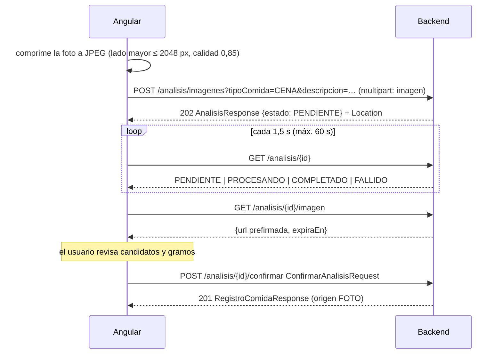

# NutriSport API · Análisis de fotos con IA

> Fragmento de `docs/NutriSport_API.md` (la referencia completa). Los números de sección (§) son los de ese documento. Lo común a todos los módulos está en `docs/api/general.md`, `docs/api/sesion-errores.md` y `docs/api/tipos-comunes.md`. Rutas relativas a `/api/v1`; 🔓 = público.

Subida de la foto, polling del resultado, confirmación como comida y descarte.

## §5 · Tipos

Los enumerados y los tipos comunes (`Pagina<T>`, `Nutrientes`, `TipoComida`…) están en `tipos-comunes.md`.

```ts
// ---- Análisis de fotos
export interface AnalisisResponse {
  id: string; // UUID
  tipo: TipoAnalisis;
  estado: EstadoAnalisis;
  tipoComida: TipoComida | null;
  candidatos: CandidatoAnalisis[];
  totalEstimado: Nutrientes | null;
  errorMensaje: string | null;
  creadoEn: string; // ISO con zona, p. ej. "2026-11-25T08:30:00+01:00"
  completadoEn: string | null; // ISO con zona, p. ej. "2026-11-25T08:30:00+01:00"
}
export interface CandidatoAnalisis {
  nombreDetectado: string;
  preparacion: Preparacion | null;
  gramosEstimados: number | null;
  confianza: number | null;
  nivelConfianza: string;
  estimado: boolean;
  coincidencias: CoincidenciaCatalogo[];
}
export interface CoincidenciaCatalogo {
  alimentoId: string | null; // UUID
  nombre: string;
  similitud: number;
  estimados: Nutrientes | null;
  fuente: string;
}
export interface ConfirmarAnalisisRequest {
  fecha: string; // "AAAA-MM-DD"
  hora?: string; // "HH:mm:ss"
  tipoComida: TipoComida;
  alimentos: AlimentoConfirmadoRequest[]; // 1–20 elementos
}
export interface AlimentoConfirmadoRequest {
  alimentoId: string; // UUID
  gramos: number; // >0 y ≤5000
  indiceCandidato?: number; // ≥0
}
export interface UrlImagenResponse {
  url: string;
  expiraEn: string; // ISO con zona, p. ej. "2026-11-25T08:30:00+01:00"
}
```

## §6 · Endpoints

### §6 · Análisis

Reconocimiento de alimentos en fotos con IA: subida, consulta del resultado (polling), confirmación como comida y descarte. Los valores son estimaciones orientativas; la IA solo identifica alimentos y gramos, y los nutrientes salen del catálogo.

| Método | Ruta | Qué hace | Consulta | Cuerpo | Respuesta | Errores |
|---|---|---|---|---|---|---|
| GET | `/analisis/{id}` | Estado y resultado de un análisis | — | — | `200` `AnalisisResponse` | 401, 403, 404 |
| POST | `/analisis/{id}/confirmar` | Confirmar un análisis y registrar la comida | — | `ConfirmarAnalisisRequest` | `201` `RegistroComidaResponse` | 400, 401, 403, 404, 409 |
| POST | `/analisis/{id}/descartar` | Descartar un análisis | — | — | `204` sin cuerpo | 401, 403, 404, 409 |
| GET | `/analisis/{id}/imagen` | URL prefirmada de la foto del análisis | — | — | `200` `UrlImagenResponse` | 401, 403, 404 |
| POST | `/analisis/imagenes` | Subir una foto para analizarla | `tipoComida` (TipoComida), `descripcion?` (string) | `multipart/form-data` con el campo `imagen` (fichero) | `202` `AnalisisResponse` | 400, 401, 403, 413, 415, 429, 503 |

**Reglas de cada endpoint** (resumen de la descripción del OpenAPI):

- `GET /analisis/{id}`: Consultar hasta que el estado deje de ser PENDIENTE o PROCESANDO. COMPLETADO trae los candidatos con sus coincidencias del catálogo y el total estimado; FALLIDO trae errorMensaje (p. ej. "No hemos detectado alimentos").
- `POST /analisis/{id}/confirmar`: Registra una comida con origen FOTO con los alimentos que el usuario ha revisado: puede aceptar, corregir los gramos, cambiar el alimento, quitar candidatos o añadir alimentos (sin indiceCandidato). Cada candidato se confirma como mucho una vez. Solo para análisis COMPLETADO (409 ANALISIS_NO_CONFIRMABLE).
- `POST /analisis/{id}/descartar`: Para análisis COMPLETADO o FALLIDO (409 ANALISIS_NO_DESCARTABLE en otro estado). La foto se borra con la limpieza periódica de imágenes de los análisis terminados.
- `GET /analisis/{id}/imagen`: URL de lectura temporal (caduca a los pocos minutos) de la foto reprocesada. 404 si la foto ya se borró por la política de retención.
- `POST /analisis/imagenes`: JPEG o PNG de hasta 10 MB y 40 megapíxeles (se valida la firma de bytes). La foto se recodifica sin metadatos EXIF antes de guardarla o enviarla a la IA. Requiere el email verificado (403 EMAIL_NO_VERIFICADO) y tiene un límite diario (429). Responde 202 con el análisis PENDIENTE: consulta su estado en la URL de Location.

## §7 · Flujos

### §7.1. Registro de una comida por foto (MVP)



- **Subida:** `FormData` con el campo `imagen` (un `Blob` JPEG con nombre `foto.jpg`); `tipoComida` y `descripcion` van **en la query**, no en el `FormData`. No pongas `Content-Type` a mano: lo pone el navegador con el `boundary`.
- **Límites:** 10 MB y 40 megapíxeles; JPEG o PNG. Convierte siempre a JPEG en el cliente (resuelve HEIC y WebP).
- **Polling:** `timer(0, 1500).pipe(switchMap(() => get(id)), takeWhile(a => a.estado === 'PENDIENTE' || a.estado === 'PROCESANDO', true), timeout(60000))`. Cancela al salir de la pantalla.
- **COMPLETADO:** `candidatos[]` con `nombreDetectado`, `gramosEstimados`, `confianza` (0–1), `nivelConfianza` (texto) y `coincidencias[]` del catálogo ordenadas por `similitud` (la primera es la propuesta). `totalEstimado` suma la primera coincidencia de cada candidato.
- **Confirmar:** un `AlimentoConfirmadoRequest` por alimento que se guarda: `alimentoId` (la coincidencia elegida u otro alimento buscado), `gramos` (editados) e `indiceCandidato` (posición en `candidatos`; omítelo para un alimento añadido a mano). Cada candidato como mucho una vez; los quitados simplemente no se envían.
- **FALLIDO:** `errorMensaje` ("No hemos detectado alimentos"). Ofrece "Reintentar" (nueva subida) y "Continuar manualmente" (pantalla de registro manual con el tipo de comida ya elegido).
- **Descartar:** `POST /analisis/{id}/descartar` (solo COMPLETADO o FALLIDO).
- **Imagen:** la URL prefirmada apunta a MinIO (`http://localhost:9000/…`) y caduca en 5 minutos; pídela al mostrar la pantalla, no la guardes. 404 si la foto ya se borró (retención de 90 días).

## §8 · Validaciones que el formulario debe replicar

Replica estas reglas en el formulario, pero trata siempre los errores 400 del servidor (`errors[]`).

| Petición | Campo | Regla |
|---|---|---|
| `AlimentoConfirmadoRequest` | `alimentoId` | obligatorio |
| `AlimentoConfirmadoRequest` | `gramos` | obligatorio; mayor que 0 y como mucho 5000 |
| `AlimentoConfirmadoRequest` | `indiceCandidato` | ≥ 0 |
| `ConfirmarAnalisisRequest` | `fecha` | obligatorio |
| `ConfirmarAnalisisRequest` | `tipoComida` | obligatorio |
| `ConfirmarAnalisisRequest` | `alimentos` | obligatorio; 1–20 elementos |
