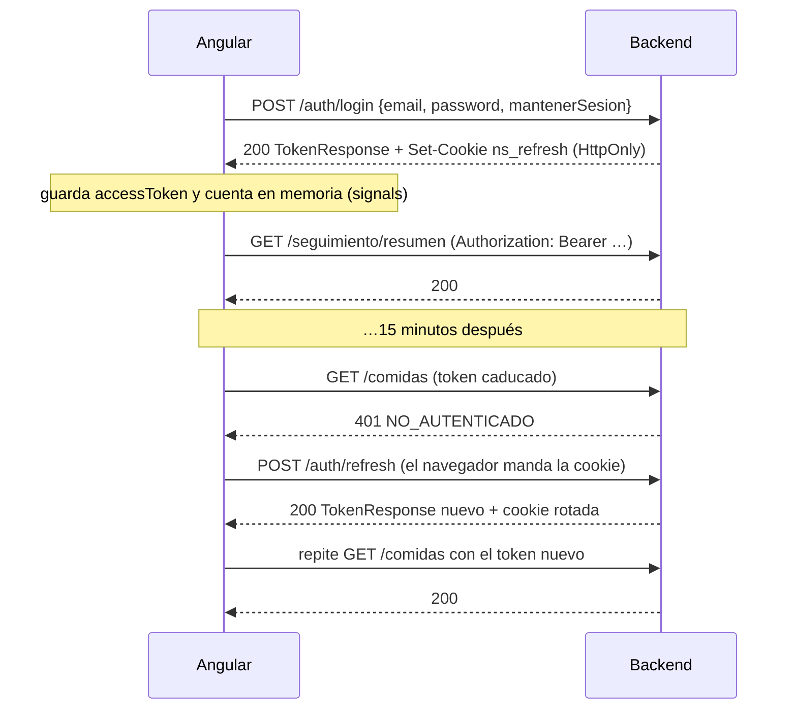

# NutriSport API · Sesión y errores

> Fragmento de `docs/NutriSport_API.md` (la referencia completa). Los números de sección (§) son los de ese documento. Lo común a todos los módulos está en `docs/api/general.md`, `docs/api/sesion-errores.md` y `docs/api/tipos-comunes.md`. Rutas relativas a `/api/v1`; 🔓 = público.

Ciclo de la sesión (access token en memoria y refresh con cookie), enlaces de los correos, límites, Problem Details y catálogo de códigos de error.

## §2. Autenticación y sesión

### 2.1. Ciclo de vida



| Momento | Qué hace el frontend |
|---|---|
| Arranque de la aplicación | `POST /auth/refresh` (con `provideAppInitializer`). 200 → sesión restaurada; 401 → sin sesión (no es un error) |
| Login | `POST /auth/login`. Guarda `accessToken`, `expiraEn` (segundos) y `cuenta` **solo en memoria** (nunca en `localStorage` ni `sessionStorage`) |
| Cada petición | El interceptor añade `Authorization: Bearer …` salvo a `/auth/login`, `/auth/registro`, `/auth/refresh`, `/auth/logout`, `/auth/verificar-email`, `/auth/reenviar-verificacion`, `/auth/recuperar-password` y `/auth/restablecer-password` |
| 401 en una petición protegida | Un único `POST /auth/refresh` compartido por todas las peticiones que fallen a la vez (`shareReplay`); si va bien, se repiten; si falla, se cierra la sesión y se navega a `/login?volver=<url>` |
| Logout | `POST /auth/logout` (borra la cookie) y limpia el estado en memoria |
| Cerrar todas las sesiones | `POST /auth/logout-todas` (con token) y después lo mismo que el logout |
| Cambio de contraseña o restablecimiento | El backend cierra todas las sesiones: el frontend hace logout local y pide iniciar sesión de nuevo |

- `TokenResponse.tipo` es `"Bearer"` y `expiraEn` son **segundos** (900). Puedes programar un refresco silencioso un minuto antes, pero el reintento tras 401 ya es suficiente.
- El refresh token **rota** en cada uso y reutilizar uno ya usado cierra toda su familia de sesiones: no lances dos `refresh` en paralelo.
- `/auth/refresh` comprueba que la cabecera `Origin`, si llega, sea la del frontend (`http://localhost:4200` en desarrollo, que es la que pone el navegador detrás del proxy).
- La cookie es `Secure` fuera del perfil `local`: en producción el frontend tiene que servirse por HTTPS.

### 2.2. Enlaces de los correos

Los correos (Mailpit en desarrollo: <http://localhost:8025>) llevan el token en el **fragmento** de la URL, para que no llegue a los logs ni al `Referer`:

| Correo | Enlace | Qué hace la pantalla |
|---|---|---|
| Verificación del registro | `http://localhost:4200/verificar-email#token=…` | Lee `token` del fragmento → `POST /auth/verificar-email {token}` → 204 "Email verificado" |
| Confirmación de cambio de email | `http://localhost:4200/verificar-email#token=…` | La misma pantalla y el mismo endpoint: el backend sabe qué tipo de token es. Si el email nuevo ya está ocupado: 409 `EMAIL_EN_USO` |
| Recuperación de contraseña | `http://localhost:4200/restablecer-password#token=…` | Formulario de contraseña nueva → `POST /auth/restablecer-password {token, nuevaPassword}` → 204 |

Lee el fragmento con `inject(ActivatedRoute).snapshot.fragment` (formato `token=…`) y bórralo de la barra de direcciones con `history.replaceState` en cuanto lo tengas. Token caducado o usado → 400 `TOKEN_NO_VALIDO` (muestra "El enlace ha caducado" con "Reenviar").

### 2.3. Límites (429)

| Acción | Límite | Respuesta |
|---|---|---|
| Login fallido | 5 cada 15 min por email y por IP | 429 `LIMITE_EXCEDIDO` + `Retry-After` (segundos) |
| Registro y reenvío de verificación | 3 por hora por IP | 429 |
| Recuperación de contraseña | 3 por hora por IP | 429 |
| Análisis de fotos | 20 al día por usuario | 429 |
| Mensajes al asistente | 50 al día por usuario | 429 |

Muestra el tiempo de espera a partir de `Retry-After` ("Inténtalo de nuevo en 12 minutos") y desactiva el botón mientras tanto.

### 2.4. Mensajes genéricos (no revelar si un email existe)

`POST /auth/registro`, `/auth/reenviar-verificacion`, `/auth/recuperar-password` y `PUT /cuenta/email` responden **siempre 202** con el mismo `MensajeResponse`. La interfaz muestra siempre el mismo texto ("Si los datos son correctos, te hemos enviado un correo") y no debe intentar deducir nada. El login responde 401 con el mismo mensaje para credenciales incorrectas y cuentas bloqueadas o eliminadas.

## §3. Errores

Todos los errores son **Problem Details (RFC 9457)** con `Content-Type: application/problem+json` y dos propiedades del proyecto, `codigo` y `errors`:

```json
{
  "type": "urn:nutrisport:error:validacion",
  "title": "Datos no válidos",
  "status": 400,
  "detail": "Los datos enviados no son válidos",
  "instance": "/api/v1/auth/registro",
  "codigo": "VALIDACION",
  "errors": [
    { "campo": "mayorDeEdad", "mensaje": "Debes declarar que eres mayor de edad" },
    { "campo": "password", "mensaje": "Debe tener entre 10 y 72 caracteres" }
  ]
}
```

(Respuesta real del backend a un registro incompleto.) `errors` es `[]` cuando el error no es de un campo. En los errores de validación, `campo` es el nombre de la propiedad en `camelCase`; en listas puede llevar índice (`alimentos[0].cantidad`).

```ts
export interface ProblemDetail {
  type: string;        // urn:nutrisport:error:<codigo en minúsculas>
  title: string;       // título corto en castellano
  status: number;
  detail: string;      // mensaje para el usuario
  instance?: string;   // ruta de la petición
  codigo: string;      // ver la tabla
  errors: { campo: string; mensaje: string }[];
}
```

### 3.1. Catálogo de códigos

| HTTP | `codigo` | Cuándo | Qué hace la interfaz |
|---|---|---|---|
| 400 | `VALIDACION` | Datos no válidos, cuerpo mal formado o con propiedades desconocidas, parámetro con formato incorrecto. También contraseña actual incorrecta en `PUT /cuenta/password`, `PUT /cuenta/email` y `DELETE /cuenta` (`errors[campo=passwordActual` o `password]`: "La contraseña no es correcta") | Asigna cada `errors[]` a su control (`setErrors({ servidor: mensaje })`); sin campo, `detail` en un `ns-alert` |
| 400 | `TOKEN_NO_VALIDO` | Token de verificación, cambio de email o recuperación caducado o ya usado | "El enlace ha caducado o ya se ha usado" + reenviar |
| 401 | `NO_AUTENTICADO` | Sin token, token caducado, refresh no válido o credenciales incorrectas | Interceptor: refresh y reintento; en login, mensaje bajo el formulario |
| 403 | `SIN_PERMISO` | Rol insuficiente (rutas `/admin`) o `Origin` no permitido en el refresh | Página "No tienes permiso" |
| 403 | `EMAIL_NO_VERIFICADO` | IA (foto, asistente, sugerencia IA) o exportación sin el email verificado | Aviso con "Reenviar verificación" |
| 403 | `CONSENTIMIENTO_REVOCADO` | Perfil, comidas, análisis, entrenamientos o seguimiento tras revocar el consentimiento de salud | Banner global → Configuración › Privacidad "Volver a dar el consentimiento" |
| 404 | `NO_ENCONTRADO` | No existe, es de otro usuario o la ruta no existe | Estado vacío |
| 404 | `PERFIL_NO_ENCONTRADO` | `GET /perfil` cuando el usuario aún no tiene perfil deportivo | Llevar al onboarding (`/bienvenida`). Decide por el 404, no por el texto |
| 409 | `CONFLICTO` | Estado incompatible (categoría con elementos, nombre duplicado…) | `detail` en un toast |
| 409 | `EMAIL_EN_USO` | Al confirmar un cambio de email que otra cuenta ya usa | Mensaje en la pantalla de verificación |
| 409 | `CODIGO_BARRAS_EN_USO` | El código de barras ya lo tiene un alimento privado | Toast |
| 409 | `COMIDA_CONSUMIDA` | Cambiar o registrar una comida planificada ya consumida | Recargar el menú |
| 409 | `SUGERENCIA_APLICADA` · `SUGERENCIA_OBSOLETA` | Sugerencia IA ya aplicada o la comida ya tiene otra receta | Recargar el menú |
| 409 | `RECETA_PLANIFICADA` | Borrar (admin) una receta que está en algún menú | "Despublícala en su lugar" |
| 409 | `ANALISIS_NO_CONFIRMABLE` · `ANALISIS_NO_DESCARTABLE` | Confirmar o descartar un análisis en un estado que no lo permite | Recargar el análisis |
| 413 | `ARCHIVO_DEMASIADO_GRANDE` | Foto o CSV de más de 10 MB | Comprueba el tamaño antes de subir |
| 415 | `ARCHIVO_NO_VALIDO` | La foto no es JPEG ni PNG (se valida la firma de bytes) | Convierte siempre a JPEG en el cliente |
| 422 | `PERFIL_REQUERIDO` | Resumen, objetivos, entrenamientos o menús sin perfil | Llevar al onboarding (`/bienvenida`) |
| 422 | `NUTRICION_INCOMPLETA` | Receta o producto sin datos suficientes para registrarlo o planificarlo | Botón desactivado con el motivo |
| 422 | `RECETA_NO_PUBLICADA` · `RECETA_INCOMPATIBLE` · `SIN_RECETAS_COMPATIBLES` · `SUGERENCIA_NO_VALIDA` | Reglas del planificador | `detail` en un `ns-alert` |
| 422 | `REGLA_NEGOCIO` | Otras reglas (p. ej. un administrador que intenta bloquearse o quitarse el rol `ADMIN`, valorar un mensaje del usuario) | `detail` en un toast |
| 429 | `LIMITE_EXCEDIDO` | Límites del §2.3 (`Retry-After`) | Tiempo de espera |
| 503 | `SERVICIO_NO_DISPONIBLE` | El proveedor de IA no responde (o el almacenamiento de fotos) | "Puedes reintentarlo o registrar la comida manualmente" |
| 503 | `PROVEEDOR_NO_DISPONIBLE` | Open Food Facts o TheMealDB no responden y no hay copia local (`Retry-After`) | Aviso informativo; la app sigue con el catálogo local |
| 500 | `ERROR_INTERNO` | Error inesperado ("Error interno del servidor") | Toast genérico |
| 0 | — | Sin conexión con el backend (el `HttpErrorResponse` tiene `status = 0`) | "No hay conexión con el servidor" |

> Los títulos (`title`) de cada código los da el backend en castellano ("Datos no válidos", "Perfil requerido"…). Para el usuario, muestra `detail`.

### 3.2. Respuestas 200 que avisan de un problema

- `GET /productos` responde **200 con lista vacía** y la cabecera `X-Proveedor-No-Disponible` si Open Food Facts no responde: muestra "Productos comerciales no disponibles ahora mismo" (no es un error).
- `GET /recetas` devuelve `themealdbDisponible = false` (y la misma cabecera) si TheMealDB no responde: muestra solo el catálogo local con un aviso.
- `RegistroComidaResponse.avisos` y `ObjetivosResponse.avisos` traen textos de advertencia (alérgenos, objetivos fuera de rango) que **no bloquean**: muéstralos en un `ns-alert` de advertencia.
